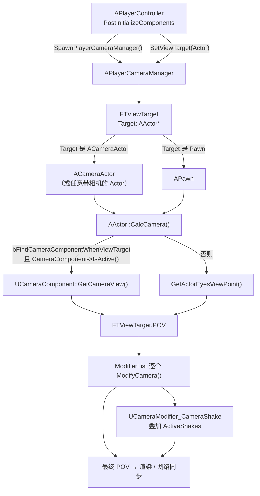
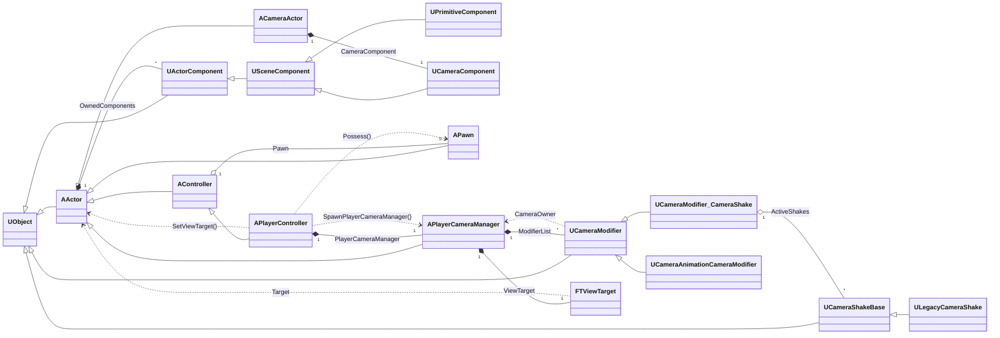
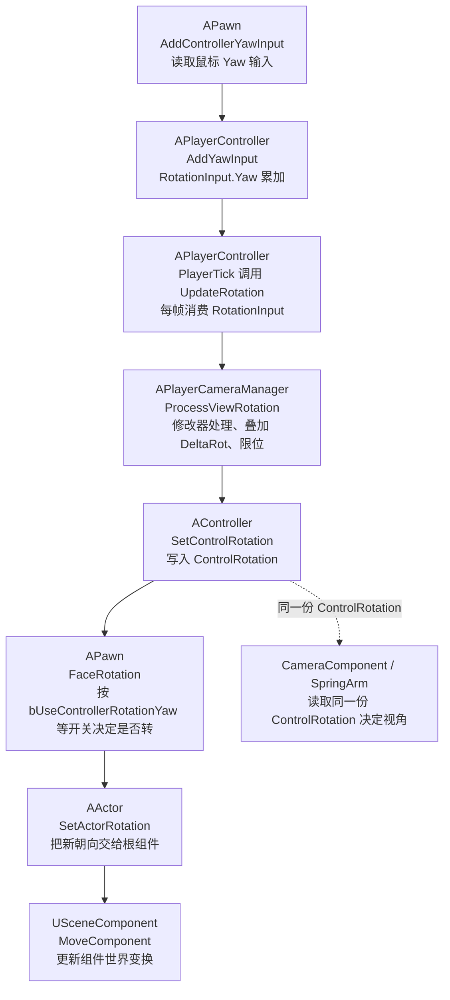
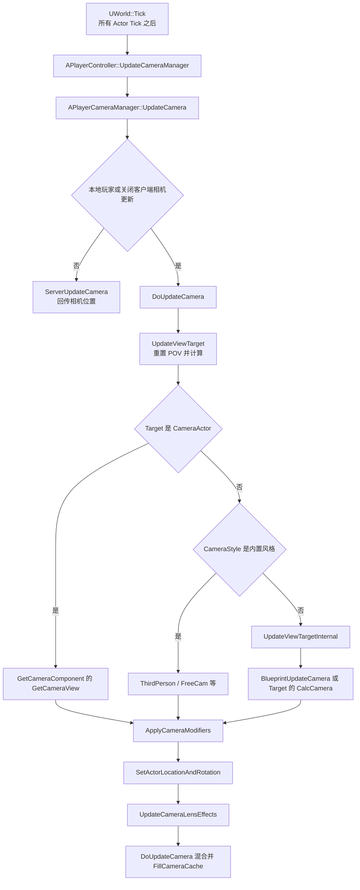

# 1 摄像机工作原理

在游戏中，摄像机是玩家的眼睛，它决定了玩家在什么位置、朝哪个方向、用多大的视野去观察这个世界。UE 把这几件事收进一个结构体里：位置、朝向、FOV、宽高比、裁剪面、投影方式和后处理。这个结构体是 `FMinimalViewInfo`，引擎里习惯把它的实例叫 POV。所以"摄像机"在引擎里更像一份取景数据，而不是场景里的一台设备。

`APlayerCameraManager` 持有当前视图目标 `ViewTarget`，最终拿去渲染的是 `ViewTarget.POV`。

```cpp
// PlayerCameraManager.h:83
/** Target Actor used to compute POV */
TObjectPtr<class AActor> Target;

/** Computed point of view */
struct FMinimalViewInfo POV;
```

`Target` 是"用来算 POV 的 Actor"，`POV` 是"算出来的结果"，两者不要求一对一。

## 1.1 每帧重建，不是累加

`UpdateViewTarget` 一进来就把 POV 整个重置成默认值，再由 ViewTarget 重新填。所以改 POV 不要去改上一帧的残留值，每帧开头它就被覆盖了。

```cpp
// PlayerCameraManager.cpp:366
// Reset the view target POV fully

static const FMinimalViewInfo DefaultViewInfo;
OutVT.POV = DefaultViewInfo;
OutVT.POV.FOV = DefaultFOV;
OutVT.POV.AspectRatio = DefaultAspectRatio;
OutVT.POV.bConstrainAspectRatio = bDefaultConstrainAspectRatio;
OutVT.POV.ProjectionMode = bIsOrthographic ? ECameraProjectionMode::Orthographic : ECameraProjectionMode::Perspective;
OutVT.POV.PostProcessBlendWeight = 1.0f;
```

## 1.2 更新时机由 World Tick 决定

相机不是靠相机 Actor 的 Tick 驱动的。它是 `UWorld::Tick` 里的一个固定阶段：所有 Actor 都 Tick 完、NetUpdate 之前，遍历本地 PlayerController 统一更新。

```cpp
// LevelTick.cpp:1806
// Update cameras last. This needs to be done before NetUpdates, and after all actors have been ticked.

if (!bIsPaused || PlayerController->ShouldPerformFullTickWhenPaused())
{
	PlayerController->UpdateCameraManager(DeltaSeconds);
}
```

这样相机看到的是这一帧所有位移、动画、物理都生效之后的世界，不需要另外抢 TickGroup。每帧每个本地 PlayerController 更新一次，分屏时各有一份 POV。

## 1.3 POV 来自 ViewTarget

`UpdateViewTarget` 先看目标是不是 `ACameraActor`，是就取它的相机组件；否则让目标 Actor 自己算。`AActor::CalcCamera` 的默认实现是：先找身上激活的 `UCameraComponent`，找不到就用 Actor 自己的"眼睛"。

```cpp
// Actor.cpp:3661
void AActor::CalcCamera(float DeltaTime, FMinimalViewInfo& OutResult)
{
	if (bFindCameraComponentWhenViewTarget)
	{
		TInlineComponentArray<UCameraComponent*> Cameras;
		GetComponents(/*out*/ Cameras);
		for (UCameraComponent* CameraComponent : Cameras)
		{
			if (CameraComponent->IsActive())
			{
				CameraComponent->GetCameraView(DeltaTime, OutResult);
				return;
			}
		}
	}
	GetActorEyesViewPoint(OutResult.Location, OutResult.Rotation);
}
```

Pawn 的眼点就是自身位置抬高一个 `BaseEyeHeight`，朝向取控制器的视线方向。所以 `SetViewTarget` 一个没有任何相机组件的 Actor，引擎照样能给出一份 POV。

## 1.4 FOV 是水平角

透视模式下 `FOV` 是水平视角，垂直方向由宽高比推出来，不单独存储。

```cpp
// CameraTypes.h:48
/** The horizontal field of view (in degrees) in perspective mode (ignored in orthographic mode). */
float FOV;
```

它最后变成投影矩阵里的一个角度，宽高比再决定两个轴怎么缩放。

```cpp
// CameraStackTypes.cpp:343
InOutProjectionData.ProjectionMatrix = FReversedZPerspectiveMatrix(
MatrixHalfFOV,
MatrixHalfFOV,
XAxisMultiplier,
YAxisMultiplier,
ClippingPlane,
ClippingPlane
);
```

正交模式下这一切换成 `OrthoWidth` 和 `FReversedZOrthoMatrix`，FOV 被忽略，视野范围不随距离衰减。RTS 那种一览全局的效果靠的是正交投影，只把相机架高并不够。

## 1.5 其余调整都挂在这条链上

切视角切的是 ViewTarget，`SetViewTarget` 自带过渡参数，`BlendViewInfo` 会把位置、朝向、FOV 一起插值；镜头抖动走 `ApplyCameraModifiers` 的修改器链，在 POV 算完之后统一施加；后处理是 POV 里的 `PostProcessSettings` 加权重，跟着 ViewTarget 一起混合。它们都不是另起一套，而是插在这条链的固定位置上。



一句话，摄像机决定如何观察游戏世界，而它给出的不是一台设备的坐标，是一份"位置 + 朝向 + 张角 + 裁剪面 + 后处理"的完整取景数据。

# 2 相机关系梳理



## 2.1 CameraComponent与CameraActor

CameraComponent 描述的是视点本身：位置、朝向、视场角、投影方式、宽高比、后处理，全部落在这个组件上，它本身不产生任何画面。类注释把这一点写得很直接——当把一个 Actor 当作 ViewTarget 时，引擎会去找它上面挂着的相机组件，并用这个组件的位置、旋转和各项参数来取景。

```cpp
// CameraComponent.h:27
/**
  * Represents a camera viewpoint and settings, such as projection type, field of view, and post-process overrides.
  * The default behavior for an actor used as the camera view target is to look for an attached camera component and use its location, rotation, and settings.
  */
class UCameraComponent : public USceneComponent
```

因为它继承的是 USceneComponent 而不是 UObject 平级的东西，所以必须挂在某个父级场景组件下才能跟随变换。常见挂载点是角色骨骼网格的头部插槽（第一人称）或弹簧臂末端（第三人称跟随），直接挂到 Root 上的情况反而少：Root 不随动画曲线和插槽位移移动，相机也就不会跟着头动。

取景时这些参数被汇总进一个 `FMinimalViewInfo` 结构体，交给 PlayerCameraManager 继续处理。位置和旋转直接取自组件的世界变换，FOV、宽高比、投影模式、正交参数逐项拷贝过去，这也是“POV 位置就是组件的位置”这句话的源码依据。

```cpp
// CameraComponent.cpp:459
		DesiredView.Location = GetComponentLocation();
		DesiredView.Rotation = GetComponentRotation();
	}

	DesiredView.FOV = bUseAdditiveOffset ? (FieldOfView + AdditiveFOVOffset) : FieldOfView;
	DesiredView.AspectRatio = AspectRatio;
	DesiredView.bConstrainAspectRatio = bConstrainAspectRatio;
	DesiredView.bUseFieldOfViewForLOD = bUseFieldOfViewForLOD;
	DesiredView.ProjectionMode = ProjectionMode;
	DesiredView.OrthoWidth = OrthoWidth;
	DesiredView.OrthoNearClipPlane = OrthoNearClipPlane;
	DesiredView.OrthoFarClipPlane = OrthoFarClipPlane;
	DesiredView.bAutoCalculateOrthoPlanes = bAutoCalculateOrthoPlanes;
```

这句话有两个例外值得记住。开启 `bUseAdditiveOffset` 时，位置和旋转会先按叠加偏移重新算一遍；`bLockToHmd`（构造函数里默认为 true）在 XR 下由 `HandleXRCamera` 用头显位姿覆盖组件变换。

`bUsePawnControlRotation` 的语义常被误读，它不动位置，只处理旋转，而且是**把组件旋转真的写掉**，不是取景时临时覆盖一次。前提也苛刻：Owner 必须能 Cast 成 APawn，且其控制器是本地玩家控制器，否则整段逻辑直接跳过。

```cpp
// CameraComponent.cpp:425
	if (bUsePawnControlRotation)
	{
		const APawn* OwningPawn = Cast<APawn>(GetOwner());
		const AController* OwningController = OwningPawn ? OwningPawn->GetController() : nullptr;
		if (OwningController && OwningController->IsLocalPlayerController())
		{
			const FRotator PawnViewRotation = OwningPawn->GetViewRotation();
			if (!PawnViewRotation.Equals(GetComponentRotation()))
			{
				SetWorldRotation(PawnViewRotation);
			}
		}
	}
```

投影模透视与正交，`ECameraProjectionMode` 枚举就是这两个值。透视模式下 `FieldOfView` 表示水平视场角；切到正交后它被忽略，画面范围改由 `OrthoWidth` 和正交近远裁剪面决定，这几个值默认还会按 `bAutoCalculateOrthoPlanes` 自动推算。

```cpp
// CameraComponent.h:224
	// The type of camera
	UPROPERTY(Interp, EditAnywhere, BlueprintReadWrite, Category = CameraSettings)
	TEnumAsByte<ECameraProjectionMode::Type> ProjectionMode;
```

宽高比有个前置开关：只改 `AspectRatio` 不会有效果，还要打开 `bConstrainAspectRatio`，画面才会以黑边形式被约束成目标比例；不打开时由 `AspectRatioAxisConstraint` 决定按横向 FOV 还是纵向 FOV 适配屏幕。

```cpp
// CameraComponent.h:118
	/** If bConstrainAspectRatio is true, black bars will be added if the destination view has a different aspect ratio than this camera requested. */
	UPROPERTY(Interp, EditAnywhere, BlueprintReadWrite, Category = CameraOptions)
	uint8 bConstrainAspectRatio : 1;
```

后处理同理，`PostProcessSettings` 存参数，`PostProcessBlendWeight` 决定这套参数以多大权重混进画面，默认是 1。

CameraActor 做的事情确实是把 CameraComponent 包进一个 Actor，方便直接摆进关卡，但它不是空壳：构造时就建好一个普通 USceneComponent 当 Root，再把 UCameraComponent 挂上去，并顺手写好一组默认值（FOV 90、约束 16:9、后处理权重 1）。`GetDefaultAttachComponent` 返回的也是 CameraComponent，所以在编辑器里往 CameraActor 上拖东西，默认就挂到相机下面。

```cpp
// CameraActor.cpp:16
ACameraActor::ACameraActor(const FObjectInitializer& ObjectInitializer)
	: Super(ObjectInitializer)
{
	SceneComponent = CreateDefaultSubobject<USceneComponent>(TEXT("SceneComponent"));

	// Make the scene component the root component
	RootComponent = SceneComponent;
	
	// Setup camera defaults
	CameraComponent = CreateDefaultSubobject<UCameraComponent>(TEXT("CameraComponent"));
	CameraComponent->FieldOfView = 90.0f;
	CameraComponent->bConstrainAspectRatio = true;
	CameraComponent->AspectRatio = 1.777778f;
	CameraComponent->PostProcessBlendWeight = 1.0f;
	
	CameraComponent->SetupAttachment(SceneComponent);
```

它比“封装”多出来的一块能力是 AutoActivateForPlayer。BeginPlay 里把自身登记进世界的自动激活相机池，再给匹配到的 PlayerController 直接 `SetViewTarget(this)`，所以只要在关卡里把 CameraActor 的 AutoActivateForPlayer 设成对应玩家，它当场就能接管该玩家的视角，不需要蓝图里再调一次 SetViewTarget。

```cpp
// CameraActor.cpp:102
void ACameraActor::BeginPlay()
{
	if (AutoActivateForPlayer != EAutoReceiveInput::Disabled && GetNetMode() != NM_Client)
	{
		const int32 PlayerIndex = GetAutoActivatePlayerIndex();
		
		// Always put it in the pool of available auto-activate cameras.
		GetWorld()->RegisterAutoActivateCamera(this, PlayerIndex);

		// If we find a matching PC, bind to it immediately.
		APlayerController* PC = UGameplayStatics::GetPlayerController(this, PlayerIndex);
		if (PC)
		{
			PC->SetViewTarget(this);
		}
	}

	Super::BeginPlay();
}
```

CameraActor 自身那些 `FOVAngle`、`AspectRatio`、`PostProcessSettings` 字段已经废弃，只在加载老版本资源时向组件回填一次，之后所有读写都应该走组件。

```cpp
// CameraActor.cpp:41
void ACameraActor::Serialize(FArchive& Ar)
{
	Super::Serialize(Ar);

	if ((Ar.UEVer() < VER_UE4_CAMERA_ACTOR_USING_CAMERA_COMPONENT) && Ar.IsLoading())
	{
		CameraComponent->bConstrainAspectRatio = bConstrainAspectRatio_DEPRECATED;
		CameraComponent->ProjectionMode = ECameraProjectionMode::Perspective;
		CameraComponent->AspectRatio = AspectRatio_DEPRECATED;
		CameraComponent->FieldOfView = FOVAngle_DEPRECATED;
		CameraComponent->PostProcessBlendWeight = PostProcessBlendWeight_DEPRECATED;
		CameraComponent->PostProcessSettings = PostProcessSettings_DEPRECATED;
	}
```

组件身上另外挂着的两样东西，准确说是编辑器里的可视化代理，而不是运行时的取景部件，而且都只在 `WITH_EDITORONLY_DATA` 构建里存在：烘焙后的游戏包中既没有它们，也没有它们的 Tick 与代理网格。

其中一个是 UDrawFrustumComponent，用来看相机视锥。它不是默认子对象，而是 OnRegister 时懒创建：outer 取所属 Actor，挂在自己身上，标记为 visualization component，初始可见性由 `bDrawFrustumAllowed` 决定。

```cpp
// CameraComponent.h:284
#if WITH_EDITORONLY_DATA
	// The frustum component used to show visually where the camera field of view is
	TObjectPtr<class UDrawFrustumComponent> DrawFrustum;
```

```cpp
// CameraComponent.cpp:180
		if (DrawFrustum == nullptr)
		{
			DrawFrustum = NewObject<UDrawFrustumComponent>(MyOwner, NAME_None, RF_Transactional | RF_TextExportTransient);
			DrawFrustum->SetupAttachment(this);
			DrawFrustum->SetIsVisualizationComponent(true);
			DrawFrustum->CreationMethod = CreationMethod;
			DrawFrustum->bFrustumEnabled = bDrawFrustumAllowed;
			DrawFrustum->RegisterComponentWithWorld(GetWorld());
		}
```

它画出来的是视锥线框，四个参数分别是 `FrustumAngle`、`FrustumStartDist`、`FrustumEndDist`、`FrustumAspectRatio`。这四个值不用手填，UpdateDrawFrustum 会按当前投影模式同步：透视模式把角度设成 `FieldOfView`，起点固定 10，终点再加 1000；正交模式把角度设成 `-OrthoWidth`，起止距离改用正交近远裁剪面。

```cpp
// CameraComponent.cpp:247
		if (ProjectionMode == ECameraProjectionMode::Perspective)
		{
			if (DrawFrustum->FrustumAngle != FieldOfView ||
				DrawFrustum->FrustumStartDist != 10.f ||
				DrawFrustum->FrustumEndDist != DrawFrustum->FrustumStartDist + FrustumDrawDistance)
			{
				DrawFrustum->FrustumAngle = FieldOfView;
				DrawFrustum->FrustumStartDist = 10.f;
				DrawFrustum->FrustumEndDist = DrawFrustum->FrustumStartDist + FrustumDrawDistance;
				bAnythingChanged = true;
			}
		}
		else
		{
			if (DrawFrustum->FrustumAngle != -OrthoWidth ||
				DrawFrustum->FrustumStartDist != OrthoNearClipPlane ||
				DrawFrustum->FrustumEndDist != FMath::Min(OrthoFarClipPlane - OrthoNearClipPlane, FrustumDrawDistance))
			{
				DrawFrustum->FrustumAngle = -OrthoWidth;
				DrawFrustum->FrustumStartDist = OrthoNearClipPlane;
				DrawFrustum->FrustumEndDist = FMath::Min(OrthoFarClipPlane - OrthoNearClipPlane, FrustumDrawDistance);
				bAnythingChanged = true;
			}
		}
```

另一个其实要拆成两样看：`CameraMesh` 是 UStaticMesh 资产，默认指向 `/Engine/EditorMeshes/MatineeCam_SM`；真正把它渲染出来的是 UCameraProxyMeshComponent（UStaticMeshComponent 的子类），同样在 OnRegister 里创建、挂到自己下面，并设成无碰撞、不投影、不参与导航，游戏内默认隐藏（`bCameraMeshHiddenInGame` 初始为 true）。所以这个模型展示的是相机自己长什么样，而不是所属 Actor 的对象模型。

```cpp
// CameraComponent.h:288
	UPROPERTY(BlueprintReadWrite, EditAnywhere, Category = Camera)
	TObjectPtr<class UStaticMesh> CameraMesh;

	// The camera mesh to show visually where the camera is placed
	TObjectPtr<class UStaticMeshComponent> ProxyMeshComponent;
```

```cpp
// CameraComponent.cpp:166
		if (ProxyMeshComponent == nullptr)
		{
			ProxyMeshComponent = NewObject<UCameraProxyMeshComponent>(MyOwner, NAME_None, RF_Transactional | RF_TextExportTransient);
			ProxyMeshComponent->SetupAttachment(this);
			ProxyMeshComponent->SetIsVisualizationComponent(true);
			ProxyMeshComponent->SetCanEverAffectNavigation(false);
			ProxyMeshComponent->SetStaticMesh(CameraMesh);
			ProxyMeshComponent->SetCollisionProfileName(UCollisionProfile::NoCollision_ProfileName);
			ProxyMeshComponent->bHiddenInGame = bCameraMeshHiddenInGame;
			ProxyMeshComponent->CastShadow = false;
			ProxyMeshComponent->CreationMethod = CreationMethod;
			ProxyMeshComponent->RegisterComponentWithWorld(GetWorld());
		}
```

这两个代理与取景是解耦的：它们挂在相机组件之下随相机移动，只为了让编辑器里看得见，即使全部去掉，GetCameraView 输出的位置、旋转与各项参数也不会变。

## 2.2 PlayerCameraManager

从名字上理解，可以叫它摄像机管理器，它管理的是视点 POV。POV 的最终结果在这里汇总：管理器持有 ViewTarget，决定用哪种 CameraStyle 取景、如何在两个 ViewTarget 之间混合、叠加哪些相机修改器，最后把结果写进 CameraCache。某个目标的具体取景数值由目标自己的 `CalcCamera` 给出，管理器负责调用、加工和缓存。

管理器本身是一个 Actor，根组件是隐藏的 `TransformComponent`。每次 `UpdateViewTarget` 结束，它都会被摆到刚算出的 POV 上，因此它的世界变换与这次取景的结果一致。

```cpp
// PlayerCameraManager.cpp:49
SetHidden(true);
...
// PlayerCameraManager.cpp:65
TransformComponent = CreateDefaultSubobject<USceneComponent>(TEXT("TransformComponent0"));
RootComponent = TransformComponent;
```

每帧的驱动不在 PlayerController 的 Tick 中，而在 `UWorld::Tick` 的末尾：所有 Actor tick 完成之后、网络更新之前，遍历本地 PlayerController 调用 `UpdateCameraManager`。

```cpp
// LevelTick.cpp:1799
// Update cameras last. This needs to be done before NetUpdates, and after all actors have been ticked.
for( FConstPlayerControllerIterator Iterator = GetPlayerControllerIterator(); Iterator; ++Iterator )
{
    if (Iterator->IsRemote())
    {
        continue;
    }

    if (APlayerController* PlayerController = Iterator->Get())
    {
        if (!bIsPaused || PlayerController->ShouldPerformFullTickWhenPaused())
        {
            PlayerController->UpdateCameraManager(DeltaSeconds);
        }
        else if (PlayerController->PlayerCameraManager && FCameraPhotographyManager::IsSupported(this))
        {
            PlayerController->PlayerCameraManager->UpdateCameraPhotographyOnly();
        }
    }
}
```

`UpdateCameraManager` 只做转发：

```cpp
// PlayerController.cpp:6353
void APlayerController::UpdateCameraManager(float DeltaSeconds)
{
    if (PlayerCameraManager != NULL)
    {
        PlayerCameraManager->UpdateCamera(DeltaSeconds);
    }
}
```

`UpdateCamera` 只在本地玩家、关闭客户端相机更新或打开调试相机时执行 `DoUpdateCamera`；其余情况由客户端把相机位置回传给服务器。

```cpp
// PlayerCameraManager.cpp:784
void APlayerCameraManager::UpdateCamera(float DeltaTime)
{
    check(PCOwner != nullptr);

    if ((PCOwner->Player && PCOwner->IsLocalPlayerController()) || !bUseClientSideCameraUpdates || bDebugClientSideCamera)
    {
        DoUpdateCamera(DeltaTime);
        ...
    }
}
```

`DoUpdateCamera` 先更新当前 ViewTarget，再处理 PendingViewTarget 的混合。混合期间两个目标的 POV 都会重新计算，按 `BlendFunction` 得到 Alpha 后调用 `BlendViewInfo` 插值；时间走完后把 PendingViewTarget 整体赋给 ViewTarget。

```cpp
// PlayerCameraManager.cpp:858
if ((PendingViewTarget.Target == NULL) || !BlendParams.bLockOutgoing)
{
    // Update current view target
    ViewTarget.CheckViewTarget(PCOwner);
    UpdateViewTarget(ViewTarget, DeltaTime);
}

NewPOV = ViewTarget.POV;

if (PendingViewTarget.Target != NULL)
{
    ...
    PendingViewTarget.CheckViewTarget(PCOwner);
    UpdateViewTarget(PendingViewTarget, DeltaTime);

    if (BlendTimeToGo > 0)
    {
        ...
        NewPOV = ViewTarget.POV;
        NewPOV.BlendViewInfo(PendingViewTarget.POV, BlendPct);
    }
    else
    {
        ViewTarget = PendingViewTarget;
        PendingViewTarget.Target = NULL;
        BlendTimeToGo = 0;
        NewPOV = PendingViewTarget.POV;
        OnBlendComplete().Broadcast();
    }
}
```

最后把结果写进缓存：

```cpp
// PlayerCameraManager.cpp:966
// Cache results
FillCameraCache(NewPOV);
```

游戏侧读到的视角就是这份缓存。`APlayerController::GetPlayerViewPoint` 在相机至少更新过一次之后，直接返回 PlayerCameraManager 的缓存值，不会临时再算一遍。

```cpp
// PlayerController.cpp:1013
else if (PlayerCameraManager != NULL &&
    PlayerCameraManager->GetCameraCacheTime() > 0.f) // Whether camera was updated at least once)
{
    PlayerCameraManager->GetCameraViewPoint(out_Location, out_Rotation);
}
```

```cpp
// PlayerCameraManager.cpp:739
void APlayerCameraManager::GetCameraViewPoint(FVector& OutCamLoc, FRotator& OutCamRot) const
{
    const FMinimalViewInfo& CurrentPOV = GetCameraCacheView();
    OutCamLoc = CurrentPOV.Location;
    OutCamRot = CurrentPOV.Rotation;
}
```

### 2.2.1 ViewTarget

顾名思义，即观察目标，也就是我们想让摄像机跟随的对象。对于一般的第三人称游戏，摄像机一直对准我们控制的角色，这个角色可以认为就是 ViewTarget，但 ViewTarget 的 `Target` 字段类型是 `AActor`，并不限于 Pawn。`FTViewTarget` 定义在 `PlayerCameraManager.h` 里，负责给管理器提供一份理想的 POV。

一个 ViewTarget 包含目标 Actor、该 Actor 对应的 POV 信息，以及当前的 PlayerState。PlayerState 在 5.7 里是 `protected`，外部通过 `GetPlayerState()` 读取，主要用于观战时在 Pawn 切换之间继续跟随同一个玩家。

```cpp
// PlayerCameraManager.h:78
USTRUCT(BlueprintType)
struct FTViewTarget
{
    GENERATED_USTRUCT_BODY()
public:

    /** Target Actor used to compute POV */
    UPROPERTY(EditAnywhere, BlueprintReadWrite, Category=TViewTarget)
    TObjectPtr<class AActor> Target;

    /** Computed point of view */
    UPROPERTY(EditAnywhere, BlueprintReadWrite, Category=TViewTarget)
    struct FMinimalViewInfo POV;

protected:
    /** PlayerState (used to follow same player through pawn transitions, etc., when spectating) */
    UPROPERTY(EditAnywhere, BlueprintReadWrite, Category=TViewTarget)
    TObjectPtr<class APlayerState> PlayerState;

public:
    class APlayerState* GetPlayerState() const { return PlayerState; }

    ENGINE_API void SetNewTarget(AActor* NewTarget);

    ENGINE_API class APawn* GetTargetPawn() const;

    ENGINE_API bool Equal(const FTViewTarget& OtherTarget) const;
    ...
};
```

`POV` 是 `FMinimalViewInfo`，装的是取景所需的完整描述，不只是位置和朝向：

```cpp
// CameraTypes.h:36
struct FMinimalViewInfo
{
    FVector Location;

    FRotator Rotation;

    float FOV;

    float DesiredFOV;

    float OrthoWidth;

    float AspectRatio;

    uint32 bConstrainAspectRatio:1;

    TEnumAsByte<ECameraProjectionMode::Type> ProjectionMode;

    float PostProcessBlendWeight;

    struct FPostProcessSettings PostProcessSettings;
    ...
};
```

`ViewTarget.POV` 既是上一帧的取景结果，也是这一帧的输出缓冲。`UpdateViewTarget` 一进入就把 POV 重置成默认值，再交给目标去填，所以目标没有写的字段会保留管理器的默认设置。

```cpp
// PlayerCameraManager.cpp:362
// Store previous POV, in case we need it later
FMinimalViewInfo OrigPOV = OutVT.POV;

// Reset the view target POV fully
static const FMinimalViewInfo DefaultViewInfo;
OutVT.POV = DefaultViewInfo;
OutVT.POV.FOV = DefaultFOV;
OutVT.POV.OrthoWidth = DefaultOrthoWidth;
OutVT.POV.AspectRatio = DefaultAspectRatio;
OutVT.POV.bConstrainAspectRatio = bDefaultConstrainAspectRatio;
OutVT.POV.ProjectionMode = bIsOrthographic ? ECameraProjectionMode::Orthographic : ECameraProjectionMode::Perspective;
OutVT.POV.PostProcessBlendWeight = 1.0f;
```

ViewTarget 的 `Target` 允许为空。`CheckViewTarget` 会在为空时回退到拥有这个管理器的 PlayerController，并根据 Target 的类型刷新 PlayerState：Target 是 Controller 就取其 PlayerState，是 Pawn 就取 Pawn 的 PlayerState，是 PlayerState 就直接使用。观战时如果 PlayerState 与当前 Pawn 对不上，它还会按 PlayerState 重新找一个对应的 Pawn。

```cpp
// PlayerCameraManager.cpp:1459
if (Target == NULL)
{
    Target = OwningController;
}

// Update ViewTarget PlayerState (used to follow same player through pawn transitions, etc., when spectating)
if (Target == OwningController) 
{	
    PlayerState = NULL;
}
else if (AController* TargetAsController = Cast<AController>(Target))
{
    PlayerState = TargetAsController->PlayerState;
}
else if (APawn* TargetAsPawn = Cast<APawn>(Target))
{
    PlayerState = TargetAsPawn->GetPlayerState();
}
else if (APlayerState* TargetAsPlayerState = Cast<APlayerState>(Target))
{
    PlayerState = TargetAsPlayerState;
}
```

切换观察目标用 `SetViewTarget`。带 `BlendTime` 时，新目标进入 PendingViewTarget，旧目标的 POV 被锁到上一帧的相机缓存，等混合结束再整体替换；`BlendTime` 为 0 则立即赋值。

```cpp
// PlayerCameraManager.cpp:144
if (TransitionParams.BlendTime > 0)
{
    ...
    // use last frame's POV
    ViewTarget.POV = GetLastFrameCameraCacheView();
    BlendTimeToGo = TransitionParams.BlendTime;

    AssignViewTarget(NewTarget, PendingViewTarget, TransitionParams);
    PendingViewTarget.CheckViewTarget(PCOwner);
    ...
}
else
{
    // otherwise, assign new viewtarget instantly
    AssignViewTarget(NewTarget, ViewTarget);
    ViewTarget.CheckViewTarget(PCOwner);
    // remove old pending ViewTarget so we don't still try to switch to it
    PendingViewTarget.Target = NULL;
}
```

## 2.3 CameraComponent，CameraActor 与 PlayerCameraManager

管理器通过 ViewTarget 取景，而 ViewTarget 最常见的两种形态就是“带 CameraComponent 的 Pawn”和 CameraActor。管理器本身不关心它们内部怎么摆，只按 `CameraStyle` 决定走哪条分支。

`CameraStyle` 是一个普通的 `FName`，没有 `UPROPERTY` 标记，蓝图侧读不到，通常在 C++ 构造函数或游戏代码里赋值。构造时默认值赋的是全局的 `NAME_Default`。

```cpp
// PlayerCameraManager.cpp:60
CameraStyle = NAME_Default;
```

`UpdateViewTarget` 先处理 CameraActor 特例，再按 CameraStyle 分支。Fixed、ThirdPerson、FreeCam、FreeCam_Default、FirstPerson 这几个名字在 5.7 里是函数内部的局部静态变量，外部只能拿字符串去匹配 `CameraStyle`。

```cpp
// PlayerCameraManager.cpp:381
if (ACameraActor* CamActor = Cast<ACameraActor>(OutVT.Target))
{
    // Viewing through a camera actor.
    CamActor->GetCameraComponent()->GetCameraView(DeltaTime, OutVT.POV);
}
else
{
    static const FName NAME_Fixed = FName(TEXT("Fixed"));
    static const FName NAME_ThirdPerson = FName(TEXT("ThirdPerson"));
    static const FName NAME_FreeCam = FName(TEXT("FreeCam"));
    static const FName NAME_FreeCam_Default = FName(TEXT("FreeCam_Default"));
    static const FName NAME_FirstPerson = FName(TEXT("FirstPerson"));

    if (CameraStyle == NAME_Fixed)
    {
        ...
    }
    else if (CameraStyle == NAME_ThirdPerson || CameraStyle == NAME_FreeCam || CameraStyle == NAME_FreeCam_Default)
    {
        ...
    }
    else if (CameraStyle == NAME_FirstPerson)
    {
        ...
    }
    else
    {
        UpdateViewTargetInternal(OutVT, DeltaTime);
    }
}
```

几个内置分支各自的行为：

- `Fixed` 直接恢复进入函数时保存的 `OrigPOV`，不更新位置，并跳过相机修改器，相当于把画面钉在上一帧。
- `ThirdPerson`、`FreeCam`、`FreeCam_Default` 是一段简单的第三人称实现：取目标 Actor 的位置与朝向（FreeCam 用 PlayerController 的 ControlRotation），加上 `ViewTargetOffset` 和按朝向旋转的 `FreeCamOffset`，再沿视线反方向退 `FreeCamDistance`，最后用盒体在 `ECC_Camera` 通道上做一次 Sweep，命中就把位置收到碰撞点。
- `FirstPerson` 直接取目标的 `GetActorEyesViewPoint`。

```cpp
// PlayerCameraManager.cpp:429
FVector Pos = Loc + ViewTargetOffset + FRotationMatrix(Rotator).TransformVector(FreeCamOffset) - Rotator.Vector() * FreeCamDistance;
FCollisionQueryParams BoxParams(SCENE_QUERY_STAT(FreeCam), false, this);
BoxParams.AddIgnoredActor(OutVT.Target);
FHitResult Result;

GetWorld()->SweepSingleByChannel(Result, Loc, Pos, FQuat::Identity, ECC_Camera, FCollisionShape::MakeBox(FVector(12.f)), BoxParams);
OutVT.POV.Location = !Result.bBlockingHit ? Pos : Result.Location;
OutVT.POV.Rotation = Rotator;
```

这三个分支都会把 `bDoNotApplyModifiers` 置为 true，默认不叠加相机修改器；只有 `bAlwaysApplyModifiers` 打开时才强制应用。它们属于引擎自带的简易或调试风格，正式项目的第三人称通常自己重写 `UpdateViewTarget`，或者用 SpringArm 加 CameraComponent 搭一套。

默认风格不走这些分支，落到 `UpdateViewTargetInternal`：

```cpp
// PlayerCameraManager.cpp:333
void APlayerCameraManager::UpdateViewTargetInternal(FTViewTarget& OutVT, float DeltaTime)
{
    if (OutVT.Target)
    {
        FVector OutLocation;
        FRotator OutRotation;
        float OutFOV;

        if (BlueprintUpdateCamera(OutVT.Target, OutLocation, OutRotation, OutFOV))
        {
            OutVT.POV.Location = OutLocation;
            OutVT.POV.Rotation = OutRotation;
            OutVT.POV.FOV = OutFOV;
        }
        else
        {
            OutVT.Target->CalcCamera(DeltaTime, OutVT.POV);
        }
    }
}
```

`BlueprintUpdateCamera` 是一个 `BlueprintImplementableEvent`：蓝图里返回 true，就直接采用蓝图给出的位置、朝向和 FOV，不再调用 `CalcCamera`；返回 false 才继续走默认取景。默认风格下真正干活的仍然是目标 Actor 的 `CalcCamera`。

```cpp
// Actor.cpp:3661
void AActor::CalcCamera(float DeltaTime, FMinimalViewInfo& OutResult)
{
    if (bFindCameraComponentWhenViewTarget)
    {
        // Look for the first active camera component and use that for the view
        TInlineComponentArray<UCameraComponent*> Cameras;
        GetComponents(/*out*/ Cameras);

        for (UCameraComponent* CameraComponent : Cameras)
        {
            if (CameraComponent->IsActive())
            {
                CameraComponent->GetCameraView(DeltaTime, OutResult);
                return;
            }
        }
    }

    GetActorEyesViewPoint(OutResult.Location, OutResult.Rotation);
}
```

`bFindCameraComponentWhenViewTarget` 是 Actor 上的开关，默认 true。它找的是“第一个处于激活状态的 CameraComponent”，不是随便一个；开关为 false，或者组件都没激活，才会走 `GetActorEyesViewPoint`。

`GetCameraView` 才是把组件变换写成 POV 的地方，位置、朝向、FOV、投影模式、后期设置都在这里填：

```cpp
// CameraComponent.cpp:418
void UCameraComponent::GetCameraView(float DeltaTime, FMinimalViewInfo& DesiredView)
{
    if (IsXRHeadTrackedCamera())
    {
        HandleXRCamera(DeltaTime);
    }

    if (bUsePawnControlRotation)
    {
        const APawn* OwningPawn = Cast<APawn>(GetOwner());
        const AController* OwningController = OwningPawn ? OwningPawn->GetController() : nullptr;
        if (OwningController && OwningController->IsLocalPlayerController())
        {
            const FRotator PawnViewRotation = OwningPawn->GetViewRotation();
            if (!PawnViewRotation.Equals(GetComponentRotation()))
            {
                SetWorldRotation(PawnViewRotation);
            }
        }
    }
    ...
    DesiredView.Location = GetComponentLocation();
    DesiredView.Rotation = GetComponentRotation();
    DesiredView.FOV = bUseAdditiveOffset ? (FieldOfView + AdditiveFOVOffset) : FieldOfView;
    DesiredView.AspectRatio = AspectRatio;
    DesiredView.bConstrainAspectRatio = bConstrainAspectRatio;
    DesiredView.ProjectionMode = ProjectionMode;
    DesiredView.OrthoWidth = OrthoWidth;
    ...
    DesiredView.PostProcessBlendWeight = PostProcessBlendWeight;
    if (PostProcessBlendWeight > 0.0f)
    {
        DesiredView.PostProcessSettings = PostProcessSettings;
    }
}
```

勾了 `bUsePawnControlRotation` 后，`GetCameraView` 会先把组件世界旋转对齐到 `OwningPawn->GetViewRotation()`，也就是 Controller 的 ControlRotation；这个同步只对本地 PlayerController 生效。没有勾选时，组件只按自己的相对变换跟随拥有者，拥有者不转，它也不会因为 ControlRotation 变化而转。

如果 ViewTarget 是 CameraActor，走的是一开始那个特例分支：直接 `GetCameraComponent()->GetCameraView`，不经过 CameraStyle，也不看 `bFindCameraComponentWhenViewTarget`。取到的同样是位置、朝向、FOV 和后期设置这一整套，而不只是位置与朝向。CameraActor 在构造时创建了 `SceneComponent` 作为根，并把 `CameraComponent` 挂在它下面，所以直接读组件变换就能得到镜头的位置与朝向。

`UpdateViewTarget` 的收尾工作有三件：应用相机修改器、把管理器 Actor 摆到 POV、更新镜头效果。

```cpp
// PlayerCameraManager.cpp:455
if (!bDoNotApplyModifiers || bAlwaysApplyModifiers)
{
    // Apply camera modifiers at the end (view shakes for example)
    ApplyCameraModifiers(DeltaTime, OutVT.POV);
}

// Synchronize the actor with the view target results
SetActorLocationAndRotation(OutVT.POV.Location, OutVT.POV.Rotation, false);
if (bAutoCalculateOrthoPlanes && OutVT.Target)
{
    OutVT.POV.SetCameraToViewTarget(OutVT.Target->GetActorLocation());
}

UpdateCameraLensEffects(OutVT);
```

相机震动并不直接写在管理器里，而是构造函数把 `UCameraModifier_CameraShake` 加进 `DefaultModifiers`，`PostInitializeComponents` 时再统一注册到 `ModifierList` 并缓存 `CachedCameraShakeMod`。`ApplyCameraModifiers` 遍历这个列表，逐个调用 `ModifyCamera`；修改器返回 true 时提前结束，让高优先级的修改器决定最终结果。

```cpp
// PlayerCameraManager.cpp:282
void APlayerCameraManager::ApplyCameraModifiers(float DeltaTime, FMinimalViewInfo& InOutPOV)
{
    ClearCachedPPBlends();

    // Loop through each camera modifier
    ForEachCameraModifier([DeltaTime, &InOutPOV](UCameraModifier* CameraModifier)
    {
        bool bContinue = true;

        // Apply camera modification and output into DesiredCameraOffset/DesiredCameraRotation
        if ((CameraModifier != NULL) && !CameraModifier->IsDisabled())
        {
            // If ModifyCamera returns true, exit loop
            // Allows high priority things to dictate if they are
            // the last modifier to be applied
            bContinue = !CameraModifier->ModifyCamera(DeltaTime, InOutPOV);
        }

        return bContinue;
    });
}
```

镜头效果由 `CameraLensEffects` 维护，数组元素是 `TScriptInterface<ICameraLensEffectInterface>`，`UpdateCameraLensEffects` 每帧把 POV 的位置、朝向、FOV 同步给它们。溅血、雨滴这类贴在镜头上的效果就走这条路径。至于“摄像机碰撞”，默认风格并不做碰撞检测；只有 ThirdPerson、FreeCam 分支里那一次 `ECC_Camera` 的盒体 Sweep。第三人称角色贴墙时的防穿墙，通常是 SpringArm 的碰撞查询在做，不在 PlayerCameraManager 里。

## 2.4 PlayerController 与 PlayerCameraManager



每个被 Possess 的 Pawn 都有一个对应的 Controller。Controller 持有 `ControlRotation`，Pawn 的朝向和相机的朝向都从它派生，但两者派生的方式不同：Pawn 走 `FaceRotation`，相机走 CameraComponent 的 `GetCameraView` 或 `CalcCamera` 的回退路径。Controller 只管朝向，位置交给 ViewTarget 的取景结果，所以这里没有对应的 Location 控制函数。

鼠标的 X/Y 轴事件一般绑定到 Pawn 的 `AddControllerYawInput`、`AddControllerPitchInput`，它们只接受本地 PlayerController，然后转给 PlayerController 的输入函数。

```cpp
// Pawn.cpp:863
void APawn::AddControllerYawInput(float Val)
{
    if (Val != 0.f && GetController() && GetController()->IsLocalPlayerController())
    {
        APlayerController* const PC = CastChecked<APlayerController>(GetController());
        PC->AddYawInput(Val);
    }
}
```

```cpp
// PlayerController.cpp:5959
void APlayerController::AddPitchInput(float Val)
{	
    RotationInput.Pitch += !IsLookInputIgnored() ? Val * (GetDefault<UInputSettings>()->bEnableLegacyInputScales ? InputPitchScale_DEPRECATED : 1.0f) : 0.0f;
}

void APlayerController::AddYawInput(float Val)
{
    RotationInput.Yaw += !IsLookInputIgnored() ? Val * (GetDefault<UInputSettings>()->bEnableLegacyInputScales ? InputYawScale_DEPRECATED : 1.0f) : 0.0f;
}
```

`RotationInput` 在一帧内累加，是否乘旧的 `InputYawScale`、`InputPitchScale` 取决于 `bEnableLegacyInputScales`，默认情况下乘 1。它在 `PlayerTick` 里被 `UpdateRotation` 消费，在 `TickActor` 末尾清零。

```cpp
// PlayerController.cpp:2326
TickPlayerInput(DeltaTime, DeltaTime == 0.f);
...
// Update rotation
if (bUpdateRotation)
{
    UpdateRotation(DeltaTime);
}
```

`bUpdateRotation` 在 Playing 且 Pawn 已被确认、Inactive 且未冻结、以及 Spectating 三种状态下为 true。

`UpdateRotation` 取出当前 ControlRotation，把本帧的 `RotationInput` 作为 DeltaRot 交给 `ProcessViewRotation`，拿回结果后写进 ControlRotation，再让 Pawn 转向。

```cpp
// PlayerController.cpp:1037
void APlayerController::UpdateRotation( float DeltaTime )
{
    // Calculate Delta to be applied on ViewRotation
    FRotator DeltaRot(RotationInput);

    FRotator ViewRotation = GetControlRotation();

    if (PlayerCameraManager)
    {
        PlayerCameraManager->ProcessViewRotation(DeltaTime, ViewRotation, DeltaRot);
    }

    AActor* ViewTarget = GetViewTarget();
    if (!PlayerCameraManager || !ViewTarget || !ViewTarget->HasActiveCameraComponent() || ViewTarget->HasActivePawnControlCameraComponent())
    {
        if (IsLocalPlayerController() && GEngine->XRSystem.IsValid() && GetWorld() != nullptr && GEngine->XRSystem->IsHeadTrackingAllowedForWorld(*GetWorld()))
        {
            auto XRCamera = GEngine->XRSystem->GetXRCamera();
            if (XRCamera.IsValid())
            {
                XRCamera->ApplyHMDRotation(this, ViewRotation);
            }
        }
    }

    SetControlRotation(ViewRotation);

    APawn* const P = GetPawnOrSpectator();
    if (P)
    {
        P->FaceRotation(ViewRotation, DeltaTime);
    }
}
```

中间那段 HMD 处理只在“没有激活的相机组件”或“相机组件使用 Pawn 控制旋转”时执行，和普通鼠标视角是两条互不冲突的路径。

`ProcessViewRotation` 先让相机修改器处理朝向，再把 DeltaRot 叠加上去，最后按管理器的限位参数裁剪；有 HMD 时改为 Normalize，不做限位。

```cpp
// PlayerCameraManager.cpp:1026
void APlayerCameraManager::ProcessViewRotation(float DeltaTime, FRotator& OutViewRotation, FRotator& OutDeltaRot)
{
    for( int32 ModifierIdx = 0; ModifierIdx < ModifierList.Num(); ModifierIdx++ )
    {
        if( ModifierList[ModifierIdx] != NULL && 
            !ModifierList[ModifierIdx]->IsDisabled() )
        {
            if( ModifierList[ModifierIdx]->ProcessViewRotation(ViewTarget.Target, DeltaTime, OutViewRotation, OutDeltaRot) )
            {
                break;
            }
        }
    }

    // Add Delta Rotation
    OutViewRotation += OutDeltaRot;
    OutDeltaRot = FRotator::ZeroRotator;

    ...
    if(bIsHeadTrackingAllowed)
    {
        // With the HMD devices, we can't limit the view pitch, because it's bound to the player's head.  A simple normalization will suffice
        OutViewRotation.Normalize();
    }
    else
    {
        // Limit Player View Axes
        LimitViewPitch( OutViewRotation, ViewPitchMin, ViewPitchMax );
        LimitViewYaw( OutViewRotation, ViewYawMin, ViewYawMax );
        LimitViewRoll( OutViewRotation, ViewRollMin, ViewRollMax );
    }
}
```

限位默认值在构造函数里：Pitch 正负 89.9，Yaw 0 到 359.999，Roll 正负 89.9。它不负责写 ControlRotation，只把算好的朝向通过 `OutViewRotation` 返回。

`SetControlRotation` 是 `AController` 的函数，`APlayerController` 直接继承。它只写 Controller 自己的 ControlRotation，不会去改 Pawn；只有在 Controller 根组件使用绝对旋转时，才顺带把根组件的世界旋转同步过去。

```cpp
// Controller.cpp:128
void AController::SetControlRotation(const FRotator& NewRotation)
{
    if (!IsValidControlRotation(NewRotation))
    {
        logOrEnsureNanError(TEXT("AController::SetControlRotation attempted to apply NaN-containing or NaN-causing rotation! (%s)"), *NewRotation.ToString());
        return;
    }

    if (!ControlRotation.Equals(NewRotation, 1e-3f))
    {
        ControlRotation = NewRotation;

        if (RootComponent && RootComponent->IsUsingAbsoluteRotation())
        {
            RootComponent->SetWorldRotation(GetControlRotation());
        }
    }
}
```

Pawn 的旋转由紧接着的 `FaceRotation` 完成：

```cpp
// Pawn.cpp:1058
void APawn::FaceRotation(FRotator NewControlRotation, float DeltaTime)
{
    // Only if we actually are going to use any component of rotation.
    if (bUseControllerRotationPitch || bUseControllerRotationYaw || bUseControllerRotationRoll)
    {
        const FRotator CurrentRotation = GetActorRotation();

        if (!bUseControllerRotationPitch)
        {
            NewControlRotation.Pitch = CurrentRotation.Pitch;
        }

        if (!bUseControllerRotationYaw)
        {
            NewControlRotation.Yaw = CurrentRotation.Yaw;
        }

        if (!bUseControllerRotationRoll)
        {
            NewControlRotation.Roll = CurrentRotation.Roll;
        }

        SetActorRotation(NewControlRotation);
    }
}
```

三个 `bUseControllerRotation*` 全关时，函数直接返回，Pawn 不会因为 ControlRotation 变化而转向；只开 Yaw 时只跟 Yaw，Pitch 和 Roll 保留 Actor 当前值。这也解释了为什么“ControlRotation 已经更新”不等于“Pawn 已经转身”。

`SetActorRotation` 最终落到根组件的 `MoveComponent`：

```cpp
// Actor.cpp:4947
bool AActor::SetActorRotation(FRotator NewRotation, ETeleportType Teleport)
{
    ...
    if (RootComponent)
    {
        return RootComponent->MoveComponent(FVector::ZeroVector, NewRotation, true, nullptr, MOVECOMP_NoFlags, Teleport);
    }

    return false;
}
```

这里的 bSweep 为 true，根组件把新的世界旋转写进组件变换。Character 的胶囊由 CharacterMovementComponent 接管时，移动组件还会在 `PhysicsRotation` 里按 `bUseControllerRotationYaw`、`bOrientRotationToMovement` 再处理一次旋转，`FaceRotation` 负责的是 Actor 这一层的朝向。

相机一侧的同步发生在 `GetCameraView` 里：Pawn 身上的 CameraComponent 如果勾了 `bUsePawnControlRotation`，它会在这时把组件世界旋转对齐到 `Pawn->GetViewRotation()`，而 `GetViewRotation` 在拥有 Controller 时直接返回 `Controller->GetControlRotation()`。所以相机看到的朝向是 ControlRotation，但它不是靠“FaceRotation 已经把组件转过去”得到的，而是 `GetCameraView` 每次取景时重新对齐的结果。没有勾选这个选项时，组件只按自己的相对变换跟随 Pawn，Pawn 没转，它也不会转。

如果 Pawn 身上没有任何激活的 CameraComponent，`CalcCamera` 会落到 `GetActorEyesViewPoint`：

```cpp
// Pawn.cpp:977
void APawn::GetActorEyesViewPoint( FVector& out_Location, FRotator& out_Rotation ) const
{
    out_Location = GetPawnViewLocation();
    out_Rotation = GetViewRotation();
}
```

```cpp
// Pawn.cpp:334
FVector APawn::GetPawnViewLocation() const
{
    return GetActorLocation() + FVector(0.f,0.f,BaseEyeHeight);
}
```

```cpp
// Pawn.cpp:339
FRotator APawn::GetViewRotation() const
{
    if (GetController() != nullptr)
    {
        return GetController()->GetControlRotation();
    }
    else if (GetLocalRole() < ROLE_Authority)
    {
        // check if being spectated
        for (FConstPlayerControllerIterator Iterator = GetWorld()->GetPlayerControllerIterator(); Iterator; ++Iterator)
        {
            ...
        }
    }

    return GetActorRotation();
}
```

位置不是 Actor 原点，而是加上 `BaseEyeHeight` 的眼睛高度；朝向在拥有 Controller 时来自 ControlRotation，没有 Controller 时回退到 Actor 自身朝向，模拟代理还会先尝试观战者的混合朝向。

如果 ViewTarget 直接是 PlayerController 本身，走的则是 `APlayerController::CalcCamera`：位置取 `GetFocalLocation()`，朝向取 ControlRotation。

```cpp
// PlayerController.cpp:998
void APlayerController::CalcCamera(float DeltaTime, FMinimalViewInfo& OutResult)
{
    OutResult.Location = GetFocalLocation();
    OutResult.Rotation = GetControlRotation();
}
```

所以“没有 CameraComponent 也能取到朝向”是成立的，但路径是 `CalcCamera` 到 `GetActorEyesViewPoint`、`GetViewRotation`，再到 `Controller->GetControlRotation()`，由 ViewTarget 自己把 ControlRotation 取出来交给管理器，管理器并不持有 PlayerController 引用去直接读它。整条链在默认风格下是：输入写进 `RotationInput`，`UpdateRotation` 调 `ProcessViewRotation` 得到新朝向，`SetControlRotation` 写进 Controller，`FaceRotation` 决定 Pawn 转不转，`CalcCamera` 或 `GetCameraView` 决定相机取什么位置和朝向，最后由 `UpdateViewTarget` 收尾并写入 CameraCache。

# 3 摄像机更新方案



如果我们想实现摄像机的控制，有两个基本方案。两条方案最终都会汇到 PlayerCameraManager 的 `UpdateViewTarget`，区别只在于 POV 是由 ViewTarget 自己算，还是由管理器按 CameraStyle 算。

**方案一：把 CameraComponent 放到目标身上**

这是官方教程和第三人称模板里最常见的做法。把 CameraComponent 放到我们想控制的目标身上，管理器更新 POV 时，会调用目标 Actor 的 `CalcCamera`。`CalcCamera` 在 `bFindCameraComponentWhenViewTarget` 为 true 时，遍历目标身上的组件，取第一个处于激活状态的 CameraComponent，调用它的 `GetCameraView`；开关为 false，或者没有激活的相机组件，才会退回 `GetActorEyesViewPoint`。

```cpp
// Actor.cpp:3661
void AActor::CalcCamera(float DeltaTime, FMinimalViewInfo& OutResult)
{
    if (bFindCameraComponentWhenViewTarget)
    {
        // Look for the first active camera component and use that for the view
        TInlineComponentArray<UCameraComponent*> Cameras;
        GetComponents(/*out*/ Cameras);

        for (UCameraComponent* CameraComponent : Cameras)
        {
            if (CameraComponent->IsActive())
            {
                CameraComponent->GetCameraView(DeltaTime, OutResult);
                return;
            }
        }
    }

    GetActorEyesViewPoint(OutResult.Location, OutResult.Rotation);
}
```

`bFindCameraComponentWhenViewTarget` 默认是 true，所以大多数情况下，只要目标身上有一个激活的 CameraComponent，取景就会走组件。`GetCameraView` 填的不只是位置和朝向，还包括 FOV、投影模式、正交宽度和后期设置；如果组件勾了 `bUsePawnControlRotation`，它还会在取景前把组件世界旋转对齐到 Pawn 的 `GetViewRotation`。

```cpp
// CameraComponent.cpp:425
if (bUsePawnControlRotation)
{
    const APawn* OwningPawn = Cast<APawn>(GetOwner());
    const AController* OwningController = OwningPawn ? OwningPawn->GetController() : nullptr;
    if (OwningController && OwningController->IsLocalPlayerController())
    {
        const FRotator PawnViewRotation = OwningPawn->GetViewRotation();
        if (!PawnViewRotation.Equals(GetComponentRotation()))
        {
            SetWorldRotation(PawnViewRotation);
        }
    }
}
...
DesiredView.Location = GetComponentLocation();
DesiredView.Rotation = GetComponentRotation();
DesiredView.FOV = bUseAdditiveOffset ? (FieldOfView + AdditiveFOVOffset) : FieldOfView;
DesiredView.AspectRatio = AspectRatio;
DesiredView.bConstrainAspectRatio = bConstrainAspectRatio;
DesiredView.ProjectionMode = ProjectionMode;
DesiredView.OrthoWidth = OrthoWidth;
...
DesiredView.PostProcessBlendWeight = PostProcessBlendWeight;
if (PostProcessBlendWeight > 0.0f)
{
    DesiredView.PostProcessSettings = PostProcessSettings;
}
```

如果 ViewTarget 是 CameraActor，走的是 `UpdateViewTarget` 里的特例：管理器直接取它的 CameraComponent 调 `GetCameraView`，不经过 CameraStyle，也不经过 `CalcCamera`。

**方案二：ViewTarget 身上没有 CameraComponent**

如果目标身上没有 CameraComponent，`CalcCamera` 会退回 `GetActorEyesViewPoint`。对 APawn 来说，位置是 Actor 位置加上 `BaseEyeHeight`，朝向是 `GetViewRotation`；拥有 Controller 时，`GetViewRotation` 返回的就是 ControlRotation。普通 AActor 则直接返回自身的 Location 和 Rotation。

```cpp
// Pawn.cpp:977
void APawn::GetActorEyesViewPoint( FVector& out_Location, FRotator& out_Rotation ) const
{
    out_Location = GetPawnViewLocation();
    out_Rotation = GetViewRotation();
}
```

```cpp
// Pawn.cpp:334
FVector APawn::GetPawnViewLocation() const
{
    return GetActorLocation() + FVector(0.f,0.f,BaseEyeHeight);
}

// Pawn.cpp:339
FRotator APawn::GetViewRotation() const
{
    if (GetController() != nullptr)
    {
        return GetController()->GetControlRotation();
    }
    ...
    return GetActorRotation();
}
```

这条默认路径不会加任何第三人称偏移，位置就是眼睛位置，朝向就是 ControlRotation 或 Actor 旋转。如果想要“目标位置 + 偏移”的效果，需要把 `CameraStyle` 设成 ThirdPerson 或 FreeCam，或者自己重写 `UpdateViewTarget`/`CalcCamera`。内置的 ThirdPerson/FreeCam 分支用的是 `ViewTargetOffset`、`FreeCamOffset` 和 `FreeCamDistance`，这三个属性在 5.7 里标成 Debug，只服务这几个内置风格。

```cpp
// PlayerCameraManager.cpp:404
else if (CameraStyle == NAME_ThirdPerson || CameraStyle == NAME_FreeCam || CameraStyle == NAME_FreeCam_Default)
{
    // Simple third person view implementation
    FVector Loc = OutVT.Target->GetActorLocation();
    FRotator Rotator = OutVT.Target->GetActorRotation();

    if (OutVT.Target == PCOwner)
    {
        Loc = PCOwner->GetFocalLocation();
    }
    ...
    if( CameraStyle == NAME_FreeCam || CameraStyle == NAME_FreeCam_Default )
    {
        Rotator = PCOwner->GetControlRotation();
    }

    FVector Pos = Loc + ViewTargetOffset + FRotationMatrix(Rotator).TransformVector(FreeCamOffset) - Rotator.Vector() * FreeCamDistance;
    ...
}
```

这段分支里，位置由目标位置、`ViewTargetOffset`、`FreeCamOffset` 和 `FreeCamDistance` 共同决定，随后还会做一次 `ECC_Camera` 的盒体 Sweep，避免相机穿进墙里。朝向方面，ThirdPerson 取的是目标 Actor 的旋转，只有 FreeCam 才取 `PCOwner` 的 ControlRotation；默认的 `CameraStyle` 是 `Default`，走的是 `UpdateViewTargetInternal` 再到 `CalcCamera`，不会进入这段偏移计算。

**PlayerCameraManager 的取景流程与扩展点**

PlayerCameraManager 的计算确实偏底层：它不负责“相机应该在哪”，而是负责“这一帧用哪个 ViewTarget、按什么风格取景、取完景之后叠加什么”。`UpdateViewTarget` 一开始会把 POV 重置成默认值，然后按 CameraActor、CameraStyle、`CalcCamera` 的顺序填 POV；填完之后应用相机修改器、把管理器 Actor 摆到 POV、更新镜头效果。`DoUpdateCamera` 再处理 PendingViewTarget 的混合，最后把结果写进 CameraCache。

```cpp
// PlayerCameraManager.cpp:455
if (!bDoNotApplyModifiers || bAlwaysApplyModifiers)
{
    // Apply camera modifiers at the end (view shakes for example)
    ApplyCameraModifiers(DeltaTime, OutVT.POV);
}

// Synchronize the actor with the view target results
SetActorLocationAndRotation(OutVT.POV.Location, OutVT.POV.Rotation, false);
...
UpdateCameraLensEffects(OutVT);
```

旋转角度限制不需要改这段流程。`ProcessViewRotation` 在 `UpdateRotation` 把结果写回 Controller 之前，会按 `ViewPitchMin`/`ViewPitchMax`、`ViewYawMin`/`ViewYawMax`、`ViewRollMin`/`ViewRollMax` 做限位；要改限制，调这几个属性即可。

```cpp
// PlayerCameraManager.cpp:1056
LimitViewPitch( OutViewRotation, ViewPitchMin, ViewPitchMax );
LimitViewYaw( OutViewRotation, ViewYawMin, ViewYawMax );
LimitViewRoll( OutViewRotation, ViewRollMin, ViewRollMax );
```

如果确实需要自定义 POV 的计算，扩展点不在 PlayerController 的 `UpdateRotation` 里，而在取景这一步：可以重写 ViewTarget 的 `CalcCamera`，也可以重写 PlayerCameraManager 的 `UpdateViewTarget`。PlayerController 自己也有一个 `CalcCamera`，但它只在 PlayerController 成为 ViewTarget 时才会被调用。`FTViewTarget::CheckViewTarget` 在 Target 为空时会把 Target 设成 `OwningController`，随后 `UpdateViewTargetInternal` 调 `Target->CalcCamera`，这时才走到 PlayerController 的版本。

```cpp
// PlayerCameraManager.cpp:1459
if (Target == NULL)
{
    Target = OwningController;
}
```

```cpp
// PlayerController.cpp:998
void APlayerController::CalcCamera(float DeltaTime, FMinimalViewInfo& OutResult)
{
    OutResult.Location = GetFocalLocation();
    OutResult.Rotation = GetControlRotation();
}
```

这个基类实现只是把焦点位置和 ControlRotation 交出去，适合作为“没有 Pawn 时”的默认视角，也可以被游戏自己的 PlayerController 重写。正常有 Pawn 作为 ViewTarget 的路径不会走到它；想改角色身上的相机，重写它没有用，应该重写 Pawn 或目标 Actor 的 `CalcCamera`，或者直接重写 PlayerCameraManager 的 `UpdateViewTarget`。

**最后再总结一下，摄像机 POV 计算的要点有两个**

一：计算过程要发生在摄像机更新之前。摄像机更新在 `UWorld::Tick` 的末尾，所有 Actor Tick 之后：

```cpp
// LevelTick.cpp:1799
// Update cameras last. This needs to be done before NetUpdates, and after all actors have been ticked.
for( FConstPlayerControllerIterator Iterator = GetPlayerControllerIterator(); Iterator; ++Iterator )
{
    if (Iterator->IsRemote())
    {
        continue;
    }

    if (APlayerController* PlayerController = Iterator->Get())
    {
        if (!bIsPaused || PlayerController->ShouldPerformFullTickWhenPaused())
        {
            PlayerController->UpdateCameraManager(DeltaSeconds);
        }
        ...
    }
}
```

常规的 Actor/Component Tick 早于这一步，所以在 Tick 里更新位置与旋转是来得及的；如果把计算放到更晚的渲染或 Slate 阶段，就会错过这一帧的取景。

二：计算结果要放在 PlayerCameraManager 能读到的地方。管理器读的是 ViewTarget 的 Actor 变换或它身上的组件，不是任意成员变量；而且 `UpdateViewTarget` 每帧开头会把 POV 重置成默认值，直接写 `ViewTarget.POV` 会被下一帧的重置覆盖。正确做法是把结果写进 Actor/组件的 Transform，让 `CalcCamera` 自然读到；或者重写 `CalcCamera`/`UpdateViewTarget` 直接返回你的 POV；或者在 CameraModifier 的 `ModifyCamera` 里改已经算好的 POV。

```cpp
// PlayerCameraManager.cpp:362
FMinimalViewInfo OrigPOV = OutVT.POV;

// Reset the view target POV fully
static const FMinimalViewInfo DefaultViewInfo;
OutVT.POV = DefaultViewInfo;
OutVT.POV.FOV = DefaultFOV;
...
```

平滑也是同一个道理：在更新端用 `VInterpTo`/`RInterpTo` 把位置和旋转插值到目标值，`CalcCamera` 每帧读到的就是平滑后的结果；也可以直接用 SpringArm 的 `bEnableCameraLag`，或者写一个 CameraModifier 在 `ModifyCamera` 里插值。只要保证“更新发生在取景之前”和“结果放在取景能读到的地方”，POV 就会平滑地跟着目标走。

到这里，我们已经遇到了两个 `CalcCamera`。一个在 Actor 里，是默认 ViewTarget 路径：有激活的 CameraComponent 就用它，没有就退回 `GetActorEyesViewPoint`。另一个在 PlayerController 里，是 PlayerController 自己作为 ViewTarget 时的重写点，基类只返回 `GetFocalLocation` 和 ControlRotation。它不是永远不调用：没有 Pawn、或者显式把 PC 设为 ViewTarget 时，它就是默认路径；但有 Pawn 的常规路径不会走它。CameraActor 则是第三种情况，`UpdateViewTarget` 直接取它的 CameraComponent 调 `GetCameraView`，两个 `CalcCamera` 都不经过。

# 4 CameraModifier

CameraModifier 是挂在 PlayerCameraManager 上的一个 UObject。它不负责算出 POV，而是在 POV 算完之后修改最终结果；也可以在 ControlRotation 写回 Controller 之前，先拦截朝向。因为它可以持有状态，所以很适合做震屏、后坐力、镜头倾斜、呼吸晃动这类需要逐帧累积的效果。

`UCameraModifier` 继承自 UObject，带 `BlueprintType` 和 `Blueprintable`，每个管理器可以挂多个。它有几个关键属性：

- `Priority`：0 最高，255 最低，默认 127；管理器按这个值升序插入。
- `bExclusive`：同一优先级只允许一个。
- `bDisabled` / `bPendingDisable`：直接禁用与淡出后禁用。
- `AlphaInTime` / `AlphaOutTime`：淡入淡出时间；`Alpha` 是当前权重。
- `CameraOwner`：所属的 PlayerCameraManager。

```cpp
// CameraModifier.h:44
/** Priority value that determines the order in which modifiers are applied. 0 = highest priority, 255 = lowest. */
UPROPERTY(EditDefaultsOnly, BlueprintReadOnly, Category = CameraModifier)
uint8 Priority;

/** If true, no other modifiers of same priority allowed. */
UPROPERTY(EditDefaultsOnly, BlueprintReadOnly, Category = CameraModifier)
uint32 bExclusive : 1;

/** When blending in, alpha proceeds from 0 to 1 over this time */
UPROPERTY(EditDefaultsOnly, BlueprintReadOnly, Category = CameraModifier)
float AlphaInTime;

/** When blending out, alpha proceeds from 1 to 0 over this time */
UPROPERTY(EditDefaultsOnly, BlueprintReadOnly, Category = CameraModifier)
float AlphaOutTime;

/** Current blend alpha. */
UPROPERTY(transient, BlueprintReadOnly, Category = CameraModifier)
float Alpha;
```

它有两个主要的虚函数。`ModifyCamera` 在 POV 算完之后调用，直接改 `InOutPOV`，返回 true 会截断后面的修改器；`ProcessViewRotation` 在 ControlRotation 写回之前调用，改的是 `OutViewRotation` 和 `OutDeltaRot`，返回 true 会截断后面的修改器。

基类的 `ModifyCamera` 会先更新 `Alpha`，再调用 native 的 `ModifyCamera` 重载和蓝图事件，最后处理后期设置；如果子类重写它却忘了调 `Super`，`Alpha` 不会更新，`DisableModifier` 的淡出也不会完成。

```cpp
// CameraModifier.cpp:21
bool UCameraModifier::ModifyCamera(float DeltaTime, FMinimalViewInfo& InOutPOV)
{
    // Update the alpha
    UpdateAlpha(DeltaTime);

    // let native do what it wants
    ModifyCamera(DeltaTime, InOutPOV.Location, InOutPOV.Rotation, InOutPOV.FOV, InOutPOV.Location, InOutPOV.Rotation, InOutPOV.FOV);
    // let BP do what it wants
    BlueprintModifyCamera(DeltaTime, InOutPOV.Location, InOutPOV.Rotation, InOutPOV.FOV, InOutPOV.Location, InOutPOV.Rotation, InOutPOV.FOV);

    if (CameraOwner)
    {
        ...
        if (PPBlendWeight > 0.f)
        {
            CameraOwner->AddCachedPPBlend(PPSettings, PPBlendWeight);
        }
    }

    // If pending disable and fully alpha'd out, truly disable this modifier
    if (bPendingDisable && (Alpha <= 0.f))
    {
        DisableModifier(true);
    }

    // allow subsequent modifiers to update
    return false;
}
```

`ProcessViewRotation` 默认什么都不做，直接返回 false：

```cpp
// CameraModifier.cpp:163
bool UCameraModifier::ProcessViewRotation( AActor* ViewTarget, float DeltaTime, FRotator& OutViewRotation, FRotator& OutDeltaRot)
{
    return false;
}
```

## 4.1 调用流程

管理器在构造时把 `UCameraModifier_CameraShake` 加进 `DefaultModifiers`，`PostInitializeComponents` 再统一注册，并把相机抖动修改器缓存到 `CachedCameraShakeMod`：

```cpp
// PlayerCameraManager.cpp:69
DefaultModifiers.Add(UCameraModifier_CameraShake::StaticClass());

// PlayerCameraManager.cpp:658
UCameraModifier* const NewMod = AddNewCameraModifier(ModifierClass);

UCameraModifier_CameraShake* const ShakeMod = Cast<UCameraModifier_CameraShake>(NewMod);
if (ShakeMod)
{
    CachedCameraShakeMod = ShakeMod;
}
```

`AddNewCameraModifier` 负责创建对象，`AddCameraModifierToList` 按 `Priority` 找到插入位置；同优先级遇到 `bExclusive` 会拒绝插入。插入后调用 `AddedToCamera`，把 `CameraOwner` 指过来。

```cpp
// PlayerCameraManager.cpp:554
bool APlayerCameraManager::AddCameraModifierToList(UCameraModifier* NewModifier)
{
    if (NewModifier)
    {
        int32 BestIdx = ModifierList.Num();
        for (int32 ModifierIdx = 0; ModifierIdx < ModifierList.Num(); ModifierIdx++)
        {
            UCameraModifier* const M = ModifierList[ModifierIdx];
            if (M)
            {
                if (M == NewModifier)
                {
                    return false;
                }

                if (NewModifier->Priority <= M->Priority)
                {
                    if (NewModifier->bExclusive && NewModifier->Priority == M->Priority)
                    {
                        return false;
                    }

                    BestIdx = ModifierIdx;
                    break;
                }
            }
        }

        ModifierList.InsertUninitialized(BestIdx, 1);
        ModifierList[BestIdx] = NewModifier;
        NewModifier->AddedToCamera(this);
        return true;
    }

    return false;
}
```

每帧有两条路径会碰到修改器。第一条在 `PlayerController::UpdateRotation` 里：`ProcessViewRotation` 先让修改器处理朝向，再叠加 `DeltaRot`、做限位，最后 `SetControlRotation`：

```cpp
// PlayerCameraManager.cpp:1029
for( int32 ModifierIdx = 0; ModifierIdx < ModifierList.Num(); ModifierIdx++ )
{
    if( ModifierList[ModifierIdx] != NULL && 
        !ModifierList[ModifierIdx]->IsDisabled() )
    {
        if( ModifierList[ModifierIdx]->ProcessViewRotation(ViewTarget.Target, DeltaTime, OutViewRotation, OutDeltaRot) )
        {
            break;
        }
    }
}
```

第二条在 `PlayerCameraManager::UpdateViewTarget` 里：POV 算完后 `ApplyCameraModifiers` 遍历修改器，调用 `ModifyCamera`。它会先清空后期混合缓存，再按列表顺序调用；`ModifyCamera` 返回 true 时提前结束。

```cpp
// PlayerCameraManager.cpp:282
void APlayerCameraManager::ApplyCameraModifiers(float DeltaTime, FMinimalViewInfo& InOutPOV)
{
    ClearCachedPPBlends();

    // Loop through each camera modifier
    ForEachCameraModifier([DeltaTime, &InOutPOV](UCameraModifier* CameraModifier)
    {
        bool bContinue = true;

        // Apply camera modification and output into DesiredCameraOffset/DesiredCameraRotation
        if ((CameraModifier != NULL) && !CameraModifier->IsDisabled())
        {
            // If ModifyCamera returns true, exit loop
            // Allows high priority things to dictate if they are
            // the last modifier to be applied
            bContinue = !CameraModifier->ModifyCamera(DeltaTime, InOutPOV);
        }

        return bContinue;
    });
}
```

`ForEachCameraModifier` 会先拷贝一份 `ModifierList` 再遍历，所以在回调里增删修改器不会破坏这次遍历。内置的 Fixed、ThirdPerson、FreeCam、FirstPerson 分支会把 `bDoNotApplyModifiers` 置为 true，默认跳过修改器；要强制应用，得打开 `bAlwaysApplyModifiers`。混合期间 `ViewTarget` 和 `PendingViewTarget` 会各走一次 `UpdateViewTarget`，修改器也会各跑一次，带累积状态的修改器要自己区分。

## 4.2 使用方式

C++ 里写一个自定义修改器，继承 `UCameraModifier`，重写 `ModifyCamera`。先调 `Super` 更新 `Alpha`，再按 `Alpha` 插值自己的偏移；返回 false 让后面的修改器继续跑，返回 true 则截断。

```cpp
// 示例：自定义修改器
UCLASS()
class UMyCameraModifier : public UCameraModifier
{
    GENERATED_BODY()
public:
    UMyCameraModifier()
    {
        Priority = 100;
        AlphaInTime = 0.2f;
        AlphaOutTime = 0.2f;
    }

    virtual bool ModifyCamera(float DeltaTime, FMinimalViewInfo& InOutPOV) override;
};

bool UMyCameraModifier::ModifyCamera(float DeltaTime, FMinimalViewInfo& InOutPOV)
{
    Super::ModifyCamera(DeltaTime, InOutPOV);

    if (Alpha <= 0.f)
    {
        return false;
    }

    const float Sway = FMath::Sin(GetWorld()->TimeSeconds * 8.f) * 1.5f * Alpha;
    InOutPOV.Rotation.Pitch += Sway;
    return false;
}
```

使用时通过 PlayerCameraManager 的 `AddNewCameraModifier` 创建并注册，`RemoveCameraModifier` 移除，`EnableModifier`/`DisableModifier` 控制开关。`Priority` 和 `bExclusive` 在类默认值里设，或者在构造函数里改。

```cpp
// 示例：注册与移除
if (APlayerController* PC = Cast<APlayerController>(GetController()))
{
    if (PC->PlayerCameraManager)
    {
        UCameraModifier* Modifier = PC->PlayerCameraManager->AddNewCameraModifier(UMyCameraModifier::StaticClass());
        ...
        PC->PlayerCameraManager->RemoveCameraModifier(Modifier);
    }
}
```

蓝图也可以写修改器：继承 `UCameraModifier`，实现 `BlueprintModifyCamera`/`BlueprintModifyPostProcess`，然后用 `AddNewCameraModifier` 添加。蓝图事件没有暴露 `Alpha`，需要淡入淡出就自己维护曲线；`ProcessViewRotation` 只有 C++ 虚函数，蓝图修改器不能拦截 ControlRotation。

如果希望每个管理器一创建就带某个修改器，把它加到自定义 PlayerCameraManager 的 `DefaultModifiers` 里：

```cpp
// 示例：在自定义 PlayerCameraManager 构造函数里
DefaultModifiers.Add(UMyCameraModifier::StaticClass());
```

## 4.3 以 CameraShake 为例

`UCameraModifier_CameraShake` 就是一个现成的修改器。它默认被加进 `DefaultModifiers`，所以管理器初始化后 `CachedCameraShakeMod` 就指向它；`StartCameraShake` 只是把抖动实例交给这个修改器：

```cpp
// PlayerCameraManager.cpp:1249
UCameraShakeBase* APlayerCameraManager::StartCameraShake(TSubclassOf<UCameraShakeBase> ShakeClass, const FAddCameraShakeParams& Params)
{
    if (ShakeClass && CachedCameraShakeMod)
    {
        return CachedCameraShakeMod->AddCameraShake(ShakeClass, Params);
    }

    return nullptr;
}
```

`AddCameraShake` 会先看 `bSingleInstance`，决定是重启已有实例还是新建；然后从池里取或 `NewObject`，调用 `StartShake` 初始化，再放进 `ActiveShakes`。

```cpp
// CameraModifier_CameraShake.cpp:263
UCameraShakeBase* NewInst = ReclaimShakeFromExpiredPool(ShakeClass);

// No old shakes, create a new one
if (NewInst == nullptr)
{
    NewInst = NewObject<UCameraShakeBase>(this, ShakeClass);
}

if (NewInst)
{
    ...
    FCameraShakeBaseStartParams StartParams;
    StartParams.CameraManager = CameraOwner;
    StartParams.Scale = Scale;
    StartParams.PlaySpace = Params.PlaySpace;
    StartParams.UserPlaySpaceRot = Params.UserPlaySpaceRot;
    StartParams.DurationOverride = Params.DurationOverride;
    NewInst->StartShake(StartParams);
    ...
}
```

每帧 `ModifyCamera` 先调 `Super` 更新 `Alpha`；`Alpha` 小于等于 0 就直接返回；否则遍历 `ActiveShakes`，把 `Alpha` 乘上震源衰减得到 `CurShakeAlpha`，调用 `UpdateAndApplyCameraShake`，最后把已经结束的抖动移除、放回池里。

```cpp
// CameraModifier_CameraShake.cpp:66
bool UCameraModifier_CameraShake::ModifyCamera(float DeltaTime, FMinimalViewInfo& InOutPOV)
{
    // Call super where modifier may be disabled
    Super::ModifyCamera(DeltaTime, InOutPOV);

    // If no alpha, exit early
    if( Alpha <= 0.f )
    {
        return false;
    }

    if( ActiveShakes.Num() > 0 )
    {
        for (FActiveCameraShakeInfo& ShakeInfo : ActiveShakes)
        {
            ...
            float CurShakeAlpha = Alpha;
            if (ShakeInfo.ShakeSource.IsValid())
            {
                ...
                CurShakeAlpha *= AttenuationFactor;
            }

            ShakeInfo.ShakeInstance->UpdateAndApplyCameraShake(DeltaTime, CurShakeAlpha, InOutPOV);
        }

        // Delete any obsolete shakes
        ...
    }

    return false;
}
```

`UpdateAndApplyCameraShake` 把当前 POV、`DeltaTime`、`ShakeScale`、`Alpha` 交给 `RootShakePattern`，由 Pattern 生成一份偏移结果，再通过 `ApplyResult` 缩放、限位、转换到播放空间，最后加到 POV 上：

```cpp
// CameraShakeBase.cpp:315
void UCameraShakeBase::UpdateAndApplyCameraShake(float DeltaTime, float Alpha, FMinimalViewInfo& InOutPOV)
{
    ...
    if (RootShakePattern)
    {
        FCameraShakePatternUpdateParams Params(InOutPOV);
        Params.DeltaTime = DeltaTime;
        Params.ShakeScale = ShakeScale;
        Params.DynamicScale = Alpha;

        FCameraShakePatternUpdateResult Result;
        RootShakePattern->UpdateShakePattern(Params, Result);

        if (!RootShakePattern->IsFinished())
        {
            FCameraShakeApplyResultParams ApplyParams;
            ApplyParams.Scale = Params.GetTotalScale();
            ApplyParams.PlaySpace = PlaySpace;
            ApplyParams.UserPlaySpaceMatrix = UserPlaySpaceMatrix;
            ApplyParams.CameraManager = CameraManager;
            ApplyResult(ApplyParams, Result, InOutPOV);
        }
    }
}
```

一个爆炸震屏可以这样配：新建一个 `CameraShakeBase` 的蓝图子类，`RootShakePattern` 选 `WaveOscillatorCameraShakePattern`，`Duration` 设 0.5，`BlendInTime` 设 0.05，`BlendOutTime` 设 0.2，`RotationAmplitudeMultiplier` 设 2，`Pitch` 的 `Amplitude` 设 1.5、`Frequency` 设 25，`Roll` 的 `Amplitude` 设 0.5、`Frequency` 设 20，`bSingleInstance` 打开。

```cpp
// SimpleCameraShakePattern.h:24
float Duration = 1.f;
float BlendInTime = 0.2f;
float BlendOutTime = 0.2f;
```

```cpp
// WaveOscillatorCameraShakePattern.h:66
float LocationAmplitudeMultiplier = 1.f;
float LocationFrequencyMultiplier = 1.f;
FWaveOscillator X;
FWaveOscillator Y;
FWaveOscillator Z;

float RotationAmplitudeMultiplier = 1.f;
float RotationFrequencyMultiplier = 1.f;
FWaveOscillator Pitch;
FWaveOscillator Yaw;
FWaveOscillator Roll;

FWaveOscillator FOV;
```

抖动自己的淡入淡出由 Pattern 里的 `State` 处理，`State.Update` 返回 BlendWeight，再乘到振荡结果上：

```cpp
// WaveOscillatorCameraShakePattern.cpp:58
void UWaveOscillatorCameraShakePattern::UpdateShakePatternImpl(const FCameraShakePatternUpdateParams& Params, FCameraShakePatternUpdateResult& OutResult)
{
    UpdateOscillators(Params.DeltaTime, OutResult);

    const float BlendWeight = State.Update(Params.DeltaTime);
    OutResult.ApplyScale(BlendWeight);
}
```

播放时，单机可以直接调 PlayerCameraManager 的 `StartCameraShake`；联网时在服务器调 PlayerController 的 `ClientStartCameraShake`，让 owning client 本地播放：

```cpp
// PlayerController.cpp:4897
void APlayerController::ClientStartCameraShake_Implementation( TSubclassOf<class UCameraShakeBase> Shake, float Scale, ECameraShakePlaySpace PlaySpace, FRotator UserPlaySpaceRot )
{
    if (PlayerCameraManager != NULL)
    {
        PlayerCameraManager->StartCameraShake(Shake, Scale, PlaySpace, UserPlaySpaceRot);
    }
}
```

世界里的爆炸可以用 `PlayWorldCameraShake`，它会按 `InnerRadius`、`OuterRadius`、`Falloff` 算一个距离衰减，再发给每个本地玩家：

```cpp
// 示例：爆炸震屏
APlayerCameraManager::PlayWorldCameraShake(
    GetWorld(),
    UExplosionShake::StaticClass(),
    GetActorLocation(),
    0.f,
    2000.f,
    2.f);
```

停止时用 `StopCameraShake`；`bImmediately` 为 false 会走 `BlendOutTime` 的淡出，true 则立即移除。`UCameraShakeBase` 默认的 `RootShakePattern` 是空类，单独继承它不会产生任何偏移，必须挂一个 Pattern；`UWaveOscillatorCameraShakePattern` 在 `EngineCameras` 插件里，include 路径是 `Shakes/WaveOscillatorCameraShakePattern.h`，模块依赖是 `EngineCameras`。

# 5 学习资料

- [[原创]UE基础—Camera系统（一） - 知乎](https://zhuanlan.zhihu.com/p/642207659)
- [《Exploring in UE4》摄像机系统解析[经验总结] - 知乎](https://zhuanlan.zhihu.com/p/34897458)
