# 1 UpdatedComponent

UE中角色移动的本质是修改某个特定组件的坐标位置。例如在`Character`中，通常将`CapsuleComponent`作为根组件，那么`Character`的坐标本质上就是`RootComponent`的坐标，其他组件都会跟随根组件而移动。

`UMovementComponent`在初始化的时候会把不同组件设置为移动基础组件`UpdateComponent`，它是`UMovementComponent`中一个成员变量。随后的操作都是在计算`UpdateComponent`的位置，即 `UpdatedComponent` 所指向的组件。

`Character`

```cpp
CharacterMovement->UpdatedComponent = CapsuleComponent
```

`DefaultPawn`

```cpp
MovementComponent->UpdatedComponent = CollisionComponent;
```

`WheeledVehiclePawn`

```cpp
VehicleMovementComponent->UpdatedComponent = Mesh;
```

## 1.1 为什么UpdatedComponent必须是USceneComponent

因为移动的本质就是修改 Transform，而只有 `USceneComponent` 才有 `ComponentTransform`，并且提供 `MoveComponent()`。如果 `UpdatedComponent` 是一个 `UActorComponent`（没有坐标），移动逻辑就无法进行计算。

# 2 继承链

移动组件类一共有四个，它们分别对应实现了不同的功能，另外还有一个`UProjectileMovementComponent`用于模拟抛射物的运动状态移动组件。
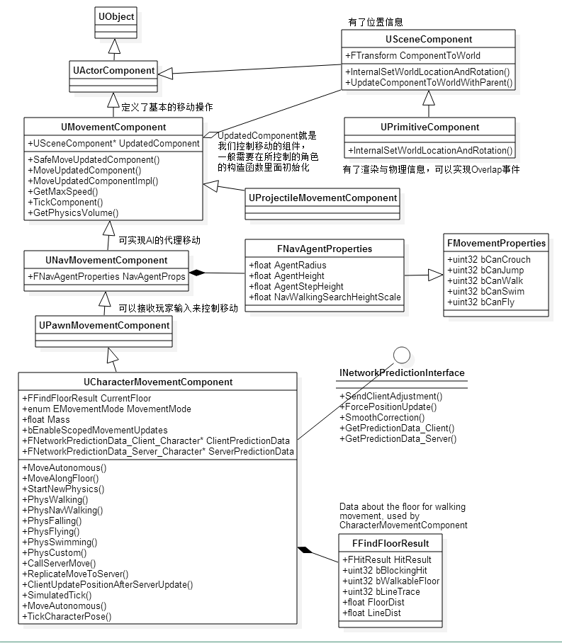

## 2.1 UMovementComponent

提供了基本的移动接口，如`SafeMoveUpdatedComponent`、`MoveUpdatedComponent`，最终会调用到`UpdateComponent`组件的接口进行更新位置。

```cpp
bool UMovementComponent::MoveUpdatedComponentImpl( const FVector& Delta, const FQuat& NewRotation, bool bSweep, FHitResult* OutHit, ETeleportType Teleport)  
{  
    if (UpdatedComponent)  
    {       
	   const FVector NewDelta = ConstrainDirectionToPlane(Delta);  
       return UpdatedComponent->MoveComponent(NewDelta, NewRotation, bSweep, OutHit, MoveComponentFlags, Teleport);  
    }  
    return false;  
}
```

## 2.2 UNavMovementComponent

该组件更多的是提供给AI寻路的能力，同时包括基本的移动状态，比如是否能游泳，是否能飞行等，向导航系统提供代理信息。

## 2.3 UPawnMovementComponent

`UPawnMovementComponent`提供了`AddInputVector`，可以实现接收玩家的输入并根据输入值修改所控制`Pawn`的位置。要注意的是，在UE中，`Pawn`是一个可控制的游戏角色（也可以是被AI控制），他的移动必须与`UPawnMovementComponent`配合才行。

```cpp
void UPawnMovementComponent::AddInputVector(FVector WorldAccel, bool bForce /*=false*/)
{
	if (PawnOwner)
	{
		PawnOwner->Internal_AddMovementInput(WorldAccel, bForce);
	}
}
```

玩家通过`InputComponent`组件绑定一个按键操作，然后在按键响应时调用`Pawn`的`AddMovementInput`接口，进而调用移动组件的`AddInputVector()`，调用结束后会通过`ConsumeMovementInputVector()`接口消耗掉该次操作的输入数值，完成一次移动操作。

```cpp
FVector UPawnMovementComponent::ConsumeInputVector()  
{  
    return PawnOwner ? PawnOwner->Internal_ConsumeMovementInputVector() : FVector::ZeroVector;  
}

FVector APawn::Internal_ConsumeMovementInputVector()  
{  
    LastControlInputVector = ControlInputVector;  
    ControlInputVector = FVector::ZeroVector;  
    return LastControlInputVector;  
}
```

## 2.4 UCharacterMovementComponent

处理了各种常见的移动状态细节，实现了比较流畅的同步解决方案。各种位置校正，平滑处理才达到了目前的移动效果。

# 3 移动组件相关类关系

**CMC 是“状态机 + 数据约定”的组合体**：纵向靠四层继承获得“计算位移 → 导航语义 → 输入管道”的能力，横向靠接口（网络预测、避让）和 struct（地面结果、平台绑定、量化同步）与其他系统交接；它既不拥有坐标，也不拥有动画，只负责在每帧算出“该把胶囊体挪到哪”，然后把结果写回角色状态。

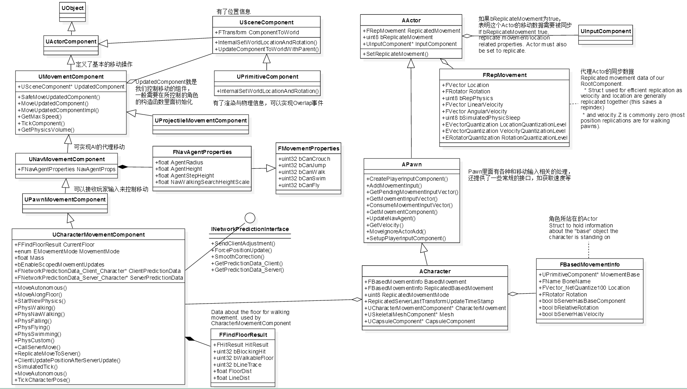

|关系类型|对方|CMC 用它做什么|图/源码位置|
|---|---|---|---|
|**继承**|`UMovementComponent`|继承 `UpdatedComponent`、`Velocity`、`SafeMoveUpdatedComponent`|`MovementComponent.h:70`|
|**继承**|`UNavMovementComponent`|继承 `NavAgentProps` 与 `IsFalling/IsMovingOnGround` 查询|`NavMovementComponent.h:26`|
|**继承**|`UPawnMovementComponent`|继承 `PawnOwner`、输入向量管道|`PawnMovementComponent.h:42`|
|**接口实现**|`INetworkPredictionInterface`|暴露 `SendClientAdjustment`、`ForcePositionUpdate`|`CharacterMovementComponent.h:136, 2324`|
|**接口实现**|`IRVOAvoidanceInterface`|给群体避让提供速度与半径|同上|
|**组合**|`UCapsuleComponent`|作为 `UpdatedComponent`：碰撞扫掠、站立判定|`Character.cpp:114`|
|**组合**|`USkeletalMeshComponent`|位置更新后驱动动画姿态|`TickCharacterPose`|
|**数据约定**|`FFindFloorResult`|缓存地面法线、距离、是否可行走|`CurrentFloor`|
|**数据约定**|`FBasedMovementInfo`|记录“站在哪个平台/骨骼上”并随平台移动|`Character.h:259, 532`|
|**数据约定**|`FNavAgentProperties`|向导航系统声明代理尺寸|`NavigationTypes.h:445`|
|**数据约定**|`FRepMovement`|网络同步的量化载体|`AActor::ReplicatedMovement`|
|**外部查询**|`APhysicsVolume`|判断是否在水里（浮力、阻尼）|`GetPhysicsVolume()`|

# 4 移动状态的处理

## 4.1 Tick调用链

### 4.1.1 简略版

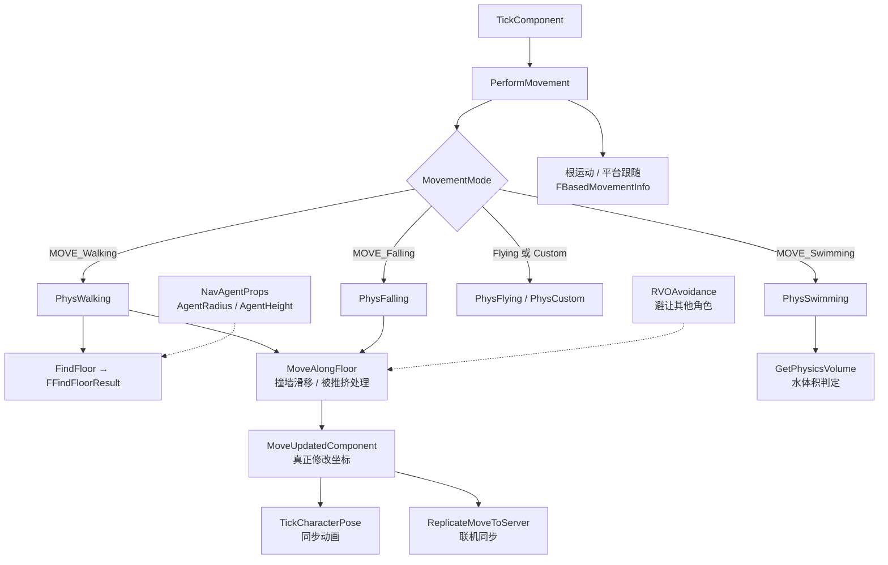

三条虚线是**外部输入**：导航网格只关心代理体尺寸，避让只关心“别撞人”，它们都不修改坐标，只影响 `FindFloor` 和 `MoveAlongFloor` 的判断。

### 4.1.2 详细版

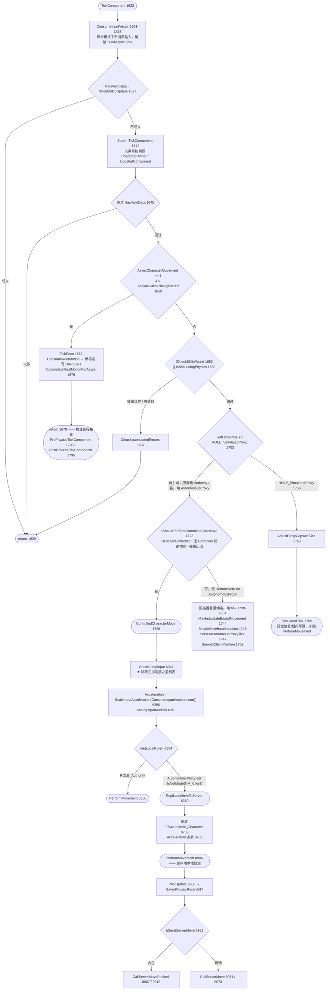

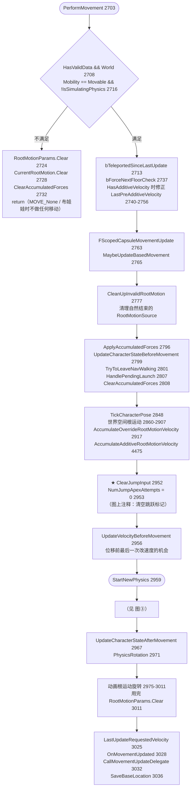

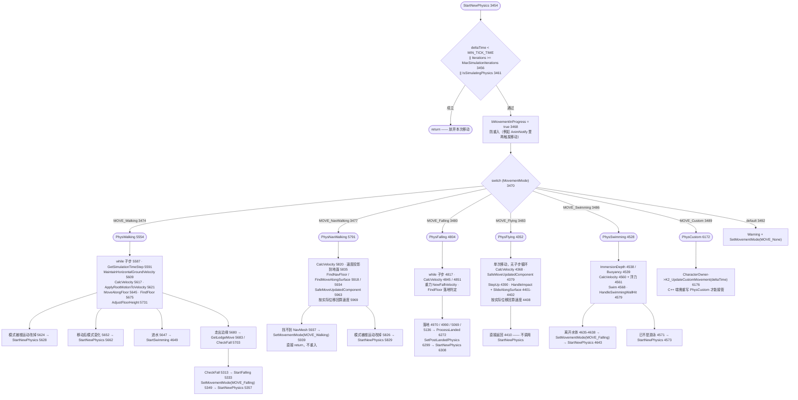

## 4.2 Walking

行走模式是唯一同时处理"地面吸附 + 斜坡 + 台阶 + 边缘"的分支，为了模拟移动的效果，角色脚下必须要有一个可以支撑不会掉落的物理对象。

在移动组件中，通过`FFindFloorResult CurrentFloor`来缓存记录地面信息。移动组件就会根据配置设置默认的`MovementMode`，`ACharacter::Restart`、`APawn::Restart`会覆盖这个缓存数据。首先在`PhysWalking`中调用`FindFloor`找到地面。

### 4.2.1 FindFloor流程

**`FindFloor`本质是通过胶囊Sweep检测**找到脚下地面：

- 地面需要有物理数据
- 碰撞通道类型需要与玩法`Pawn` Block

需要注意的细节：

1. **胶囊被压扁了 10%**（`ShrinkScale=0.9`），注释 7007–7008 说是为了避免"贴着表面起步时扫出怪异结果"，同时允许把角色从穿透里拉出来。
2. **命中点太靠边缘会被拒**（7022 `!IsWithinEdgeTolerance(...)`），因为那是腰部旁边的墙/箱子，不是脚下地面，因此检测只考虑脚下。
3. 被拒后用**更小半径**（`Radius - SWEEP_EDGE_REJECT_DISTANCE`）重扫一次（7026–7034），避免相邻物体干扰。

```cpp
// ComputeFloorDist 7005-7016
const float ShrinkScale = 0.9f;
float ShrinkHeight = (PawnHalfHeight - PawnRadius) * (1.f - ShrinkScale);
FCollisionShape CapsuleShape = FCollisionShape::MakeCapsule(SweepRadius, PawnHalfHeight - ShrinkHeight);
bBlockingHit = FloorSweepTest(Hit, CapsuleLocation, CapsuleLocation + TraceDist * GetGravityDirection(), ...);
```

Sweep用的是胶囊体而不是射线检测，方便处理斜面移动，计算可站立半径，如下图所示。

- **`Normal`**：**扫掠体（胶囊）自己在接触点的表面法线**。胶囊是圆的，所以它等于"从接触点指向胶囊中轴"的方向。
- **`ImpactNormal`**：**被撞物体表面的法线**（坡面/棱边的真实法线）。

目前`Character`的移动是基于胶囊体实现的，所以一个不带胶囊体组件的Actor是无法正常使用`UCharacterMovementComponent`的。
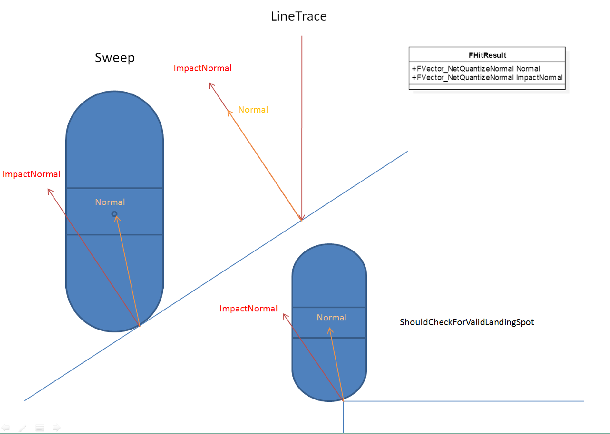

### 4.2.2 PerchRadiusThreshold：为什么"找到地面 ≠ 能站住"

`PerchRadiusThreshold`，即可站立半径。默认这个值为0，移动组件会忽略这个可站立半径的相关计算，一旦这个值大于0.15，就会做进一步的判断看看当前的地面空间是否足够让玩家站立在上面。

```
// ShouldComputePerchResult 7352-7363
if (!InHit.IsValidBlockingHit()) return false;
// Don't try to perch if the edge radius is very small.
if (GetPerchRadiusThreshold() <= SWEEP_EDGE_REJECT_DISTANCE)   // 0.15
    return false;
```

默认 `PerchRadiusThreshold = 0`（680），所以**默认情况下这套逻辑完全不执行**；一旦调大超过 0.15，引擎就用"缩小半径的胶囊"再扫一次（`ComputePerchResult` 7380–7411，半径来自 `GetValidPerchRadius` = 胶囊半径 − 阈值），判断"我站在边缘时脚下是否还有可站面积"。

`FindFloor` 末尾的 7163–7196 就是在用这次 perch 结果改判：

```
// 7185-7189
// If the regular capsule is on an unwalkable surface but the perched one would allow us to stand, override the normal to be one that is walkable.
if (!OutFloorResult.bWalkableFloor)
    OutFloorResult.SetFromLineTrace(PerchFloorResult.HitResult, ...);
```

### 4.2.3 位移计算

在`PhysWalking`中，为了现的更为平滑流畅，把一个Tick的移动分成了N段处理。准确来说**超过 0.05s 就折半切分，最多切 8 次；第 8 次之后不再切，剩余时间一次性用完**。迭代计数一路传进 `StartNewPhysics → PhysWalking`。

```cpp
// GetSimulationTimeStep 8044-8068
if (RemainingTime > MaxSimulationTimeStep)          // 0.05s
{
    if (Iterations < MaxSimulationIterations)        // 8
        RemainingTime = FMath::Min(MaxSimulationTimeStep, RemainingTime * 0.5f);  // 折半
    else
        /* 最后一次直接把剩余时间全用掉，并打警告 8056-8063 */
}
return FMath::Max(MIN_TICK_TIME, RemainingTime);
```

在`TickComponent`的时候根据玩家的按键输入向量计算水平加速度，按键时长影响跳跃加速度计算。随后在`CalcVelocity()`根据加速度计算速度，同时还会考虑地面摩擦，是否在水中等情况。

```cpp
// apply input to acceleration
Acceleration = ScaleInputAcceleration(ConstrainInputAcceleration(InputVector));
```

### 4.2.4 移动斜面与障碍检测

正常在walking状态下，玩家只会前后左右移动，不会有Z方向的移动速度。如果遇到斜坡怎么办？如果这个斜坡可以行走，就会调用`ComputeGroundMovementDelta()`函数去根据当前的水平速度计算出一个新的平行与斜面的速度，这样可以简单模拟一个沿着斜面行走的效果，而且一般来说上坡的时候玩家的水平速度应该减小，通过设置`bMaintainHorizontalGroundVelocity`为false可以自动处理这种情况。

```cpp
// ComputeGroundMovementDelta 5394-5412
const FVector FloorNormal = RampHit.ImpactNormal;          // 坡面法线（地面）
const FVector::FReal ContactNormalZ = GetGravitySpaceZ(RampHit.Normal); // 接触法线（胶囊侧）
if (FloorNormalZ < (1.f - KINDA_SMALL) && FloorNormalZ > KINDA_SMALL
    && ContactNormalZ > KINDA_SMALL && !bHitFromLineTrace && IsWalkable(RampHit))
{
    const float FloorDotDelta = (FloorNormal | Delta);
    FVector RampMovement = Delta;
    SetGravitySpaceZ(RampMovement, -FloorDotDelta / FloorNormalZ);   // 把位移压到坡面上
    if (bMaintainHorizontalGroundVelocity) return RampMovement;
    else return RampMovement.GetSafeNormal() * Delta.Size();          // 沿坡等速
}
```

- `bMaintainHorizontalGroundVelocity = true`（780，默认）：保持**水平分量**不变，Z 分量被补成"贴着坡走"，所以爬坡时实际速度会变快一点。
- 设为 `false`：把速度重新缩放到**沿坡方向、长度等于原速度**，上坡时水平推进自然变慢（5411）。
- 收尾时 `MaintainHorizontalGroundVelocity`（5536–5551）再做一次"去掉垂直分量"或"按大小重缩放"。

注意条件里 `ContactNormalZ > 0` 用的是 `RampHit.Normal`（胶囊侧法线），而不是 `ImpactNormal`。

算出速度之后，调用函数`MoveAlongFloor()`改变当前对象的坐标位置。调用真正的移动接口堆栈是`SafeMoveUpdatedComponent`（5468）→ `UPrimitiveComponent::MoveComponentImpl`（3042）→ `World->ComponentSweepMulti`（3146）→ 返回 `HitResult`，这里是检测移动过程中是否遇到了障碍。

```cpp
// MoveAlongFloor 5498-5529
if (Hit.IsValidBlockingHit())
{
    if (CanStepUp(Hit) || 命中物体就是当前 Base)
    {
        if (!StepUp(GetGravityDirection(), Delta * (1.f - PercentTimeApplied), Hit, OutStepDownResult))
        {
            HandleImpact(Hit, LastMoveTimeSlice, RampVector);
            SlideAlongSurface(Delta, 1.f - PercentTimeApplied, Hit.Normal, Hit, true);
        }
        ...
    }
    else if (!Hit.Component.Get()->CanCharacterStepUp(CharacterOwner))
    {
        HandleImpact(...); SlideAlongSurface(...);
    }
}
```

在接收到`SafeMoveUpdatedComponent()`返回的`HitResult`后，会在下面的代码里面处理碰撞障碍的情况。

1. 如果Hit.Normal在Z方向上有值而且还可以行走，那说明这是一个可以移动上去的斜面，随后让玩家沿着斜面移动。
2. 判断当前的碰撞体是否可以踩上去，如果可以的话就试着踩上去，如果过程中发现没有踩上去，也会调用`SlideAlongSurface()`沿着碰撞滑动。

### 4.2.5 状态切换

基本上的移动处理就完成了，移动后还会立刻判断玩家是否进入水中，或者进入Falling状态，如果是的话立刻切换到新的状态。

由于玩家在一帧里面可能会从Walking、Swiming、Falling的等状态不断的切换，所以在每次执行移动前都会有一个iteration记录当前帧的移动次数，如果超过限制就会取消本次的移动模拟行为。

```cpp
if (IsSwimming())                                   // 5647 刚进水
{
    StartSwimming(OldLocation, OldVelocity, timeTick, remainingTime, Iterations);  // 5649
    return;
}
else if (MovementMode != StartingMovementMode || CustomMovementMode != StartingCustomMovementMode)  // 5652
{
    StartNewPhysics(remainingTime, Iterations);      // 5662 别的代码改了模式
    return;
}
```

走出边缘则走 5680 `bCheckLedges` → 5703 `CheckFall` → 5326 `StartFalling` → `SetMovementMode(MOVE_Falling)` 5349 → `StartNewPhysics` 5357。

一句话来说就是，先确认脚下有可站的物理面（`FindFloor` + Perch + `ImpactNormal`），再沿这个面用胶囊扫掠前进（`MoveAlongFloor` + Normal 滑动），途中处理台阶/斜坡/障碍，最后立刻检查是否换成游泳或下落。

## 4.3 Falling

这个阶段把 `PhysFalling` 概括为“分段 → 水平加速 → 加重力 → 梯形积分位移 → 三种碰撞决策”。

### 4.3.1 进入 Falling入口

`PhysWalking` 的 `CheckFall`（5313 → 5326），也就是走出边缘、且不允许走落时，因此在下落第一帧入口是从Walking中进入的。

```cpp
// StartFalling 5333-5358
if (IsMovingOnGround())
{
    if (!GIsEditor || (GetWorld()->HasBegunPlay() && GetTimeSeconds() >= 1.f))
        SetMovementMode(MOVE_Falling);      // 5349
    else
        bForceNextFloorCheck = true;        // 编辑器首帧延迟切换 5354
}
StartNewPhysics(remainingTime, Iterations); // 5357
```

### 4.3.2 分段平滑计算

`MaxSimulationTimeStep = 0.05f`、`MaxSimulationIterations = 8`（688–689），切分规则是“超过 0.05 就折半，最多 8 次，最后一次用完全部剩余时间”（8044–8069）。

与 Walking 的差别：Walking 的循环条件里还检查 `CharacterOwner`、Controller、根运动（5587），Falling 只检查时间和迭代数。

```cpp
// PhysFalling 4816-4821
float remainingTime = deltaTime;
while ((remainingTime >= MIN_TICK_TIME) && (Iterations < MaxSimulationIterations))
{
    Iterations++;
    float timeTick = GetSimulationTimeStep(remainingTime, Iterations);
}
```

### 4.3.3 输入控制

在每段处理计算的时候，需要先计算玩家输入控制的水平速度。

```cpp
// 4813-4814
const FVector FallAcceleration = ProjectToGravityFloor(GetFallingLateralAcceleration(deltaTime));
const bool bHasLimitedAirControl = ShouldLimitAirControl(deltaTime, FallAcceleration);
```

`GetAirControl`（4765–4774）会先走 `BoostAirControl`（4792，速度越快转向增益越低），再乘 `AirControl`。这就是“空中不能像地面一样自由转”的实现。

```cpp
FVector FallAcceleration = ProjectToGravityFloor(Acceleration);   // 4747 去掉 Z
if (!HasAnimRootMotion() && FallAcceleration.SizeSquared() > 0.f)
{
    FallAcceleration = GetAirControl(DeltaTime, AirControl, FallAcceleration);       // 4752
    FallAcceleration = FallAcceleration.GetClampedToMaxSize(GetMaxAcceleration());    // 4753
}
```

### 4.3.4 重力来源

|层|代码|说明|
|---|---|---|
|角色组件|`CMC::GetGravityZ()` 3505–3508|`Super::GetGravityZ() * GravityScale`|
|移动组件基类|`UMovementComponent::GetGravityZ()` `MovementComponent.cpp:371-375`|`PhysicsVolume->GetGravityZ()`，没有体积则用 `UPhysicsSettings::DefaultGravityZ`|
|取体积|`UMovementComponent::GetPhysicsVolume()` 290–298|`UpdatedComponent->GetPhysicsVolume()`；否则 `GetWorld()->GetDefaultPhysicsVolume()`|
|Actor 兜底|`AActor::GetPhysicsVolume()` `Actor.cpp:2956-2964`|没有根组件 → 默认 `PhysicsVolume`|
|体积|`APhysicsVolume::GetGravityZ()` `PhysicsVolume.cpp:117-121`|`MyWorld->GetGravityZ()`|
|世界|`UWorld::GetGravityZ()` `World.cpp:6880-6884`|转 `WorldSettings`|
|世界设置|`AWorldSettings::GetGravityZ()` `WorldSettings.cpp:280-290`|`bGlobalGravitySet ? GlobalGravityZ : UPhysicsSettings::DefaultGravityZ`|

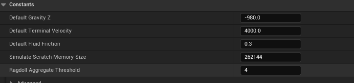

### 4.3.5 下落速度与位移计算

1. **符号**：`Gravity` 传入前已经是负方向（4858 `Gravity = -GetGravityDirection() * GetGravityZ()`），所以是 `+=`，效果等价于“原速度 + 重力加速度×时间”。
2. **`TerminalLimit` 是局部变量**，成员叫 `TerminalVelocity`（默认 4000，来自项目设置）。它只钳制“沿重力方向”的分量（3719–3721），不会把水平速度砍掉。

另外 4863–4876 说明跳跃力期间重力会被削弱：`GravityTime` 可能小于 `timeTick`，`bApplyGravityWhileJumping=false` 时起跳阶段完全不受重力。

```cpp
// NewFallVelocity 3705-3727
FVector Result = InitialVelocity;
if (DeltaTime > 0.f)
{
    Result += Gravity * DeltaTime;                                    // 3712
    const float TerminalLimit = FMath::Abs(GetPhysicsVolume()->TerminalVelocity);   // 3715
    if (Result.SizeSquared() > FMath::Square(TerminalLimit))
    {
        const FVector GravityDir = Gravity.GetSafeNormal();
        if ((Result | GravityDir) > TerminalLimit)
            Result = FVector::PointPlaneProject(Result, FVector::ZeroVector, GravityDir) + GravityDir * TerminalLimit;
    }
}
```

- 位移计算公式用的是 `OldVelocityWithRootMotion`（含根运动的旧速度）。
- 这是**梯形/中点积分**：用“起点速度 + 终点速度”的平均值乘时间，比只用新速度快半步，抵消一部分数值误差。
- 4939–4945 是“跳跃力刚好在本段结束”的特殊积分，把一段拆成“匀速段 + 重力段”

```cpp
// 4935-4949
// Compute change in position (using midpoint integration method).
FVector Adjusted = 0.5f * (OldVelocityWithRootMotion + Velocity) * timeTick;   // 4936

if (bEndingJumpForce && !bApplyGravityWhileJumping)
{
    const float NonGravityTime = FMath::Max(0.f, timeTick - GravityTime);
    Adjusted = (OldVelocityWithRootMotion * NonGravityTime)
             + (0.5f * (OldVelocityWithRootMotion + Velocity) * GravityTime);   // 4944
}

FHitResult Hit(1.f);
SafeMoveUpdatedComponent(Adjusted, PawnRotation, true, Hit);                    // 4949
```

### 4.3.6 移动碰撞处理

移动碰撞一共有三种情况。
入口：

```cpp
// 4959-4972
if (IsSwimming())                                  // 刚进水
{
    remainingTime += subTimeTickRemaining;
    StartSwimming(OldLocation, OldVelocity, timeTick, remainingTime, Iterations);
    return;
}
else if (Hit.bBlockingHit)
{
    if (IsValidLandingSpot(UpdatedComponent->GetComponentLocation(), Hit))
    {
        remainingTime += subTimeTickRemaining;
        ProcessLanded(Hit, remainingTime, Iterations);   // ← 情况 1
        return;
    }
```

#### 4.3.6.1 正常落地

如果玩家需要计算发现碰撞到一个可以站立的地形，这个判断主要是根据碰撞点的高度来的，可以筛选掉墙面，再加上 `IsWalkable`（7092/6909 用 `ImpactNormal` 比 `WalkableFloorZ`）。

```cpp
// IsValidLandingSpot 7263-7314
if (!Hit.bStartPenetrating)
{
    if (!IsWalkable(Hit)) return false;                        // 7274 坡度（用 ImpactNormal）
    const float LowerHemisphereZ = GetGravitySpaceZ(Hit.Location) - PawnHalfHeight + PawnRadius;
    if (GetGravitySpaceZ(Hit.ImpactPoint) >= LowerHemisphereZ)
        return false;                                          // 7284 撞点在胶囊上半部 → 判为墙面
    if (!IsWithinEdgeTolerance(Hit.Location, Hit.ImpactPoint, PawnRadius))
        return false;                                          // 7290 擦到胶囊侧边缘 → 不算落地
}
else if (GetGravitySpaceZ(Hit.Normal) < UE_KINDA_SMALL_NUMBER)
    return false;                                              // 7298 穿透方向不对 → 不算落地
```

落地后找到可站立对象后调用`ProcessLanded`（6272–6309）→ `SetPostLandedPhysics`（6311–6338）

#### 4.3.6.2 落到平台边缘

跳的过程中遇到一个平台，然后检测玩家的坐标与当前碰撞点是否在一个可接受的范围（`IsWithinEdgeTolerance`），是的话就执行`FindFloor`重新检测一遍地面，检测到的话就执行落地流程。

```cpp
// 4979-4992
if (!Hit.bStartPenetrating && ShouldCheckForValidLandingSpot(timeTick, Adjusted, Hit))
{
    const FVector PawnLocation = UpdatedComponent->GetComponentLocation();
    FFindFloorResult FloorResult;
    FindFloor(PawnLocation, FloorResult, false);

    // Note that we only care about capsule sweep floor results, since the line trace may detect a lower walkable surface that our falling capsule wouldn't actually reach yet.
    if (!FloorResult.bLineTrace && FloorResult.IsWalkableFloor() && IsValidLandingSpot(PawnLocation, FloorResult.HitResult))
    {
        remainingTime += subTimeTickRemaining;
        ProcessLanded(FloorResult.HitResult, remainingTime, Iterations);
        return;
    }
}
```

#### 4.3.6.3 墙面等不可站立

解决方法总结：冲击力 + 滑动 + 限空控制

- 下落过程如果碰到障碍，首先会执行`HandleImpact`给碰到的对象一个力。
- 随后调用`ComputeSlideVector`计算一下滑动的位移，由于碰撞到障碍后，玩家的速度会有变化，这时候重新计算一下速度，再次调整玩家的位置与方向。
- 如果玩家这时候有水平方向上的位移，还会通过`LimitAirControl`来限制玩家的速度，因为玩家在空中是无法自由控制角色的。

```cpp
// 4995-5059
HandleImpact(Hit, LastMoveTimeSlice, Adjusted);                   // 4995 给被撞对象力/触发通知
if (!HasValidData() || !IsFalling()) return;                      // 4998 模式被改就退出

FVector VelocityNoAirControl = OldVelocity;
FVector AirControlAccel = Acceleration;
if (bHasLimitedAirControl)
{
    // 5012-5029：把 Acceleration 临时清零重算一次速度，得到"没有空控"的速度
    AirControlAccel = (Velocity - VelocityNoAirControl) / timeTick;                 // 5032
    const FVector AirControlDeltaV = LimitAirControl(..., AirControlAccel, Hit, false) * LastMoveTimeSlice; // 5033
    Adjusted = (VelocityNoAirControl + AirControlDeltaV) * LastMoveTimeSlice;       // 5034
}

const FVector OldHitNormal = Hit.Normal;
const FVector OldHitImpactNormal = Hit.ImpactNormal;
FVector Delta = ComputeSlideVector(Adjusted, 1.f - Hit.Time, OldHitNormal, Hit);    // 5039 ← 文章说的 ComputeSlideVector
```

`LimitAirControl`（5169–5193）的逻辑：

```cpp
if (命中法线朝上且超过 VERTICAL_SLOPE_NORMAL_Z)
    if (加速度朝墙里) Result = FVector::VectorPlaneProject(FallAcceleration, Normal2D); // 只允许沿墙平行
else if (bStartPenetrating)
    return (Result | HitResult.Normal) > 0 ? Result : ZeroVector;                      // 允许脱离穿透
```

第三种情况做进一步的延伸，可能会出现碰撞调整后又碰到了另一个墙面，这里Falling的处理可以让玩家在两个墙面找到一个合适的位置。但是仍然不能解决玩家被夹在两个斜面但是却无法落地的情况（或者在Waling和Falling中不断切换）。

1. **先撞第一面墙 → 不停止，改为滑行**：`ComputeSlideVector` 把剩余位移投影到墙面上（5039），再沿滑动方向做第二次移动（5058），所以角色会贴墙擦过去而不是走不动。
2. **撞到第二面墙 → 在两墙之间找折中方向**：调用 `TwoWallAdjust(Delta, Hit, OldHitNormal)`（5089），用两次命中法线求出一个不进入任一面墙的位移；同时只允许沿墙切向的空中控制（5092–5102）。
3. **如果彻底卡死（Hit.Time == 0）→ 强制侧向脱困**：取两墙法线之和的水平方向作为侧移方向，直接挪一下（5117–5130）；两墙法线正好相反时用垂直方向兜底。
4. **如果是“夹在两个斜面之间” → 直接判定落地**：用 `bDitch` 条件（两法线都朝上、位移无 Z、两法线相对，5111–5112）识别这种地形，一旦成立就 `ProcessLanded`（5133–5138），让角色站住而不是继续下落。
5. **如果站在窄缝边缘、位移几乎为零 → 微弹射脱困**：位移小于阈值时，给一个随机水平速度加向上速度把角色“弹”出来（5139–5155）。
6. **从源头放宽“能不能站”的判定**：`FindFloor` 在常规扫描失败时用小半径再扫一次（perch 复核，7163–7196），仍不行可开 `bUseFlatBaseForFloorChecks`（7237–7256），用方盒代替胶囊做地面检测，避免胶囊在棱边“骑”着下不去。

核心思想：**先滑动、再折角、卡死就侧移、斜坡夹缝就判落地、最后用地面检测兜底**，而不是只靠一次碰撞结果决定是否坠落。

```cpp
// 5060-5157
if (Hit.bBlockingHit)
{
    LastMoveTimeSlice = subTimeTickRemaining;
    subTimeTickRemaining *= (1.f - Hit.Time);

    if (IsValidLandingSpot(...)) { ProcessLanded(...); return; }   // 5066-5071
    HandleImpact(Hit, LastMoveTimeSlice, Delta);                   // 5073
    ...
    FVector PreTwoWallDelta = Delta;
    TwoWallAdjust(Delta, Hit, OldHitNormal);                       // 5089 ← 两墙折角的核心
    ...
    // 5111-5112 判断是否被夹在两个斜面之间
    bool bDitch = (OldHitImpactNormal.Z > 0 && Hit.ImpactNormal.Z > 0
                   && FMath::Abs(Delta.Z) <= KINDA_SMALL
                   && (Hit.ImpactNormal | OldHitImpactNormal) < 0.f);

    SafeMoveUpdatedComponent(Delta, PawnRotation, true, Hit);      // 5113
    if (Hit.Time == 0.f)                                           // 5114 完全卡住
    {
        FVector SideDelta = ProjectToGravityFloor(OldHitNormal + Hit.ImpactNormal).GetSafeNormal();
        ... SafeMoveUpdatedComponent(SideDelta, ...);              // 5130 侧移脱困
    }

    if (bDitch || IsValidLandingSpot(...) || Hit.Time == 0.f)      // 5133
    {
        remainingTime = 0.f;
        ProcessLanded(Hit, remainingTime, Iterations);             // 5136 直接判定落地
        return;
    }
    else if (GetPerchRadiusThreshold() > 0.f && Hit.Time == 1.f && OldHitImpactNormal.Z >= WalkableFloorZ) // 5139
    {
        // 5139-5155：极小位移时给一点随机侧向速度 + 向上速度，把角色"弹"出夹缝
    }
}
```

## 4.4 Jump 跳跃流程

Falling 之外，跳跃是最常见的移动操作。一次跳跃从按键到角色真正腾空，会经过输入绑定、输入检测、条件判定、速度设置、状态清理几个环节，下面按流程说明。

### 4.4.1 绑定触发响应事件

跳跃的输入绑定通常写在角色类的 `SetupPlayerInputComponent` 中：

```cpp
void APrimalCharacter::SetupPlayerInputComponent(UInputComponent* PlayerInputComponent)
{
    check(PlayerInputComponent);
    PlayerInputComponent->BindAction("Jump", IE_Pressed,  this, &ACharacter::Jump);
    PlayerInputComponent->BindAction("Jump", IE_Released, this, &ACharacter::StopJumping);
}
```

对应的引擎实现只负责记录状态：

```cpp
void ACharacter::Jump()
{
    bPressedJump = true;      // 玩家请求跳跃
    JumpKeyHoldTime = 0.0f;   // 按住计时归零
}

void ACharacter::StopJumping()
{
    bPressedJump = false;
    ResetJumpState();         // 清除跳跃相关状态
}
```

`Jump()` 并不会立刻让角色起跳，它只是把“玩家想跳”写入 `bPressedJump`，真正的起跳发生在下一帧的移动处理中。

### 4.4.2 按键响应与 CheckJumpInput

`TickComponent` 在自主端分支调用 `ControlledCharacterMove`，跳跃检测就在这个函数里完成：

```cpp
void UCharacterMovementComponent::ControlledCharacterMove(const FVector& InputVector, float DeltaSeconds)
{
    CharacterOwner->CheckJumpInput(DeltaSeconds);                                     // 处理跳跃

    Acceleration = ScaleInputAcceleration(ConstrainInputAcceleration(InputVector));   // 计算加速度
    AnalogInputModifier = ComputeAnalogInputModifier();

    if (CharacterOwner->GetLocalRole() == ROLE_Authority)
    {
        PerformMovement(DeltaSeconds);
    }
    else if (CharacterOwner->GetLocalRole() == ROLE_AutonomousProxy && IsNetMode(NM_Client))
    {
        ReplicateMoveToServer(DeltaSeconds, Acceleration);
    }
}
```

`CheckJumpInput` 在加速度计算和 `PerformMovement` 之前执行，因此起跳产生的垂直速度能立刻参与本帧的物理移动：

```cpp
void ACharacter::CheckJumpInput(float DeltaTime)
{
    JumpCurrentCountPreJump = JumpCurrentCount;      // 记录本次检查前的段数

    if (CharacterMovement && bPressedJump)
    {
        // 首跳时如果已经在空中，先补一次计数
        if (JumpCurrentCount == 0 && CharacterMovement->IsFalling())
        {
            JumpCurrentCount++;
        }

        const bool bDidJump = CanJump() && CharacterMovement->DoJump(bClientUpdating, DeltaTime);

        if (bDidJump && !bWasJumping)
        {
            JumpCurrentCount++;                              // 段数加一
            JumpForceTimeRemaining = GetJumpMaxHoldTime();   // 长按续力时长
            OnJumped();                                      // 蓝图事件
        }

        bWasJumping = bDidJump;
    }
}
```

#### 4.4.2.1 执行 CanJump

`CanJump` 内部是蓝图可重写的 `CanJumpInternal`，实际判定集中在 `JumpIsAllowedInternal`：

```cpp
bool ACharacter::CanJumpInternal_Implementation() const
{
    return !IsCrouched() && JumpIsAllowedInternal();
}

bool ACharacter::JumpIsAllowedInternal() const
{
    bool bJumpIsAllowed = CharacterMovement->CanAttemptJump();

    if (bJumpIsAllowed)
    {
        if (!bWasJumping || GetJumpMaxHoldTime() <= 0.0f)
        {
            if (JumpCurrentCount == 0 && CharacterMovement->IsFalling())
            {
                bJumpIsAllowed = JumpCurrentCount + 1 < JumpMaxCount;
            }
            else
            {
                bJumpIsAllowed = JumpCurrentCount < JumpMaxCount;
            }
        }
        else
        {
            const bool bJumpKeyHeld = (bPressedJump && JumpKeyHoldTime < GetJumpMaxHoldTime());
            bJumpIsAllowed = bJumpKeyHeld &&
                ((JumpCurrentCount < JumpMaxCount) || (bWasJumping && JumpCurrentCount == JumpMaxCount));
        }
    }

    return bJumpIsAllowed;
}
```

运动组件侧还有一道基础判定：

```cpp
bool UCharacterMovementComponent::CanAttemptJump() const
{
    return IsJumpAllowed() &&
           !bWantsToCrouch &&
           (IsMovingOnGround() || IsFalling());
}
```

`CanAttemptJump` 要求角色处于地面或下落状态，因此游泳时无法起跳；蹲伏状态则由 `!IsCrouched()` 与 `!bWantsToCrouch` 两处共同拦截。

`JumpMaxHoldTime` 表示一次跳跃可以持续施加跳跃力的最长时间，超过后跳跃力停止；`JumpMaxCount` 表示允许跳跃的段数，两者共同决定角色能跳多高、跳几次。

#### 4.4.2.2 执行 DoJump

```cpp
bool UCharacterMovementComponent::DoJump(bool bReplayingMoves, float DeltaTime)
{
    if (CharacterOwner && CharacterOwner->CanJump())
    {
        // 平面约束下无法上下移动时不处理跳跃
        if (!bConstrainToPlane || !FMath::IsNearlyEqual(FMath::Abs(GetGravitySpaceZ(PlaneConstraintNormal)), 1.f))
        {
            // 用检查前的段数判断是否为首跳
            const bool bFirstJump = (CharacterOwner->JumpCurrentCountPreJump == 0);

            if (bFirstJump || bDontFallBelowJumpZVelocityDuringJump)
            {
                Velocity.Z = FMath::Max<FVector::FReal>(Velocity.Z, JumpZVelocity);
            }

            SetMovementMode(MOVE_Falling);
            return true;
        }
    }

    return false;
}
```

几个细节值得留意：

- `DoJump` 会再次调用 `CanJump()` 做一次确认，避免在移动过程中状态已经变化。
- 只有首跳（或开启了 `bDontFallBelowJumpZVelocityDuringJump`）才会注入跳跃速度，二段跳默认不额外给速度。
- 速度通过 `FMath::Max` 取较大值，不会削减角色已有的上升速度。
- `JumpZVelocity` 在编辑器中限制为非负值，实际使用时只增不减。
- 最后调用 `SetMovementMode(MOVE_Falling)` 进入下落状态。

#### 4.4.2.3 判断 bDidJump

```cpp
const bool bDidJump = CanJump() && CharacterMovement->DoJump(bClientUpdating);
if (bDidJump && !bWasJumping)
{
    JumpCurrentCount++;
    JumpForceTimeRemaining = GetJumpMaxHoldTime();
    OnJumped();
}
bWasJumping = bDidJump;
```

`bWasJumping` 用来防止按住跳跃键期间重复触发 `OnJumped` 和重复计数；`JumpForceTimeRemaining` 则交给下落阶段消耗，决定起跳阶段是否受重力影响：

```cpp
if (CharacterOwner->JumpForceTimeRemaining > 0.0f)
{
    const float JumpForceTime = FMath::Min(CharacterOwner->JumpForceTimeRemaining, timeTick);
    GravityTime = bApplyGravityWhileJumping ? timeTick : FMath::Max(0.0f, timeTick - JumpForceTime);

    CharacterOwner->JumpForceTimeRemaining -= JumpForceTime;
    if (CharacterOwner->JumpForceTimeRemaining <= 0.0f)
    {
        CharacterOwner->ResetJumpState();
        bEndingJumpForce = true;
    }
}
```

### 4.4.3 PerformMovement 结束后的 ClearJumpInput

`PerformMovement` 在移动计算完成后调用 `ClearJumpInput`：

```cpp
// Clear jump input now, to allow movement events to trigger it for next update.
CharacterOwner->ClearJumpInput(DeltaSeconds);
NumJumpApexAttempts = 0;
```

`ClearJumpInput` 按按住时长决定是否清除跳跃请求：

```cpp
void ACharacter::ClearJumpInput(float DeltaTime)
{
    if (bPressedJump)
    {
        JumpKeyHoldTime += DeltaTime;

        // 按住时间达到上限后才清除
        if (JumpKeyHoldTime >= GetJumpMaxHoldTime())
        {
            bPressedJump = false;
        }
    }
    else
    {
        JumpForceTimeRemaining = 0.0f;
        bWasJumping = false;
    }
}
```

按住时间未达上限时，`bPressedJump` 保持为 true，下一帧仍会进入 `CheckJumpInput`，配合 `JumpForceTimeRemaining` 实现长按跳得更高。`JumpCurrentCount` 不会在这里被清除，它只在 `ResetJumpState` 中重置，用于处理多段跳。

### 4.4.4 玩家松开按键

松开按键时 `StopJumping` 会清除按键标记并重置状态：

```cpp
void ACharacter::ResetJumpState()
{
    bPressedJump = false;
    bWasJumping = false;
    JumpKeyHoldTime = 0.0f;
    JumpForceTimeRemaining = 0.0f;

    // 只有落地后才重置段数
    if (CharacterMovement && !CharacterMovement->IsFalling())
    {
        JumpCurrentCount = 0;
        JumpCurrentCountPreJump = 0;
    }
}
```

如果玩家仍在空中，`JumpCurrentCount` 会保留，因此落地前仍可继续使用剩余的跳跃段数。角色落地时，`OnMovementModeChanged` 也会调用 `ResetJumpState`，把段数清零：

```cpp
void ACharacter::OnMovementModeChanged(EMovementMode PrevMovementMode, uint8 PrevCustomMode)
{
    if (!bPressedJump || !CharacterMovement->IsFalling())
    {
        ResetJumpState();
    }
    ...
}
```

一旦 `bPressedJump` 为 false，`CheckJumpInput` 会直接跳过本次处理，不会再执行跳跃操作。

### 4.4.5 空中再次按下跳跃键

角色在空中再次按下跳跃键时，同样会触发 `Jump()`，并在下一帧进入 `CheckJumpInput`。此时能否继续跳跃由段数上限决定：

```cpp
if (JumpCurrentCount == 0 && CharacterMovement->IsFalling())
{
    bJumpIsAllowed = JumpCurrentCount + 1 < JumpMaxCount;   // 首跳时已在空中
}
else
{
    bJumpIsAllowed = JumpCurrentCount < JumpMaxCount;      // 普通多段跳
}
```

当 `JumpCurrentCount` 小于 `JumpMaxCount` 时，判定通过，`DoJump` 返回 true，`CheckJumpInput` 会把段数加一并触发 `OnJumped`，完成一次二段跳。

需要注意的是，二段跳默认只增加跳跃次数，不会再次注入 `JumpZVelocity`。若希望二段跳也获得向上的冲量，需要开启 `bDontFallBelowJumpZVelocityDuringJump`，或在蓝图与子类中自行添加速度。

### 4.4.6 小结

一次完整的跳跃依次经过：输入绑定写入 `bPressedJump`，`CheckJumpInput` 判定能否起跳，`DoJump` 设置垂直速度并切换到 Falling，`PerformMovement` 结束后按按住时长清理输入，松键或落地时重置段数。理清这几个函数的调用顺序，跳跃的高度控制、二段跳与空中起跳等行为都能对应到具体的代码位置。

```mermaid
flowchart TD
    subgraph S1["① 输入入口（InputComponent 绑定回调）"]
        J1(["按下跳跃键 IE_Pressed"])
        J2["ACharacter::Jump 1157<br/>bPressedJump = true<br/>JumpKeyHoldTime = 0"]
        J3(["松开跳跃键 IE_Released"])
        J4["ACharacter::StopJumping 1163<br/>bPressedJump = false"]
        J5["ResetJumpState 355<br/>bWasJumping = false<br/>JumpKeyHoldTime = 0<br/>JumpForceTimeRemaining = 0"]
        J6{"CharacterMovement->IsFalling() ? 362"}
        J7["保留 JumpCurrentCount<br/>空中松键不清段数"]
        J8["JumpCurrentCount = 0 364<br/>JumpCurrentCountPreJump = 0"]
        J9["注：落地时 OnMovementModeChanged 1124<br/>也会调用 ResetJumpState"]
    end

    subgraph S2["② 帧循环 TickComponent 1622"]
        T1["ControlledCharacterMove 6340<br/>服务器→PerformMovement<br/>客户端→ReplicateMoveToServer"]
        T2["CheckJumpInput 6347<br/>ACharacter::CheckJumpInput 1169"]
        T3["JumpCurrentCountPreJump = JumpCurrentCount 1171"]
    end

    subgraph S3["③ CheckJumpInput 决策 1169-1200"]
        C1{"bPressedJump ? 1175"}
        CZ(["本帧跳过跳跃处理"])
        C2{"JumpCurrentCount == 0<br/>且 IsFalling ? 1180"}
        C3["JumpCurrentCount++ 1182<br/>起跳帧已在空中的补偿"]
        C4["bDidJump = CanJump() && DoJump(...) 1185"]
        C5{"bDidJump ? 1186"}
        C9["bWasJumping = false 1197<br/>无失败回调"]
        C6{"!bWasJumping ? 1189"}
        C7["JumpCurrentCount++ 1191<br/>JumpForceTimeRemaining = GetJumpMaxHoldTime() 1192<br/>OnJumped 1193"]
        C8["bWasJumping = bDidJump 1197"]
    end

    subgraph S4["④ CanJump 过滤链"]
        K1["CanJump 297<br/>→ CanJumpInternal_Implementation 302<br/>= !IsCrouched() && JumpIsAllowedInternal()"]
        K2["JumpIsAllowedInternal 307<br/>CanAttemptJump 1160 =<br/>IsJumpAllowed() && !bWantsToCrouch<br/>&& (IsMovingOnGround() || IsFalling())"]
        K3{"JumpCurrentCount < JumpMaxCount ?<br/>319 / 323"}
    end

    subgraph S5["⑤ DoJump 1120-1158"]
        D1{"CharacterOwner && CanJump() ? 1122"}
        D2{"bConstrainToPlane 且<br/>PlaneConstraintNormal 与重力轴重合 ? 1125"}
        D3{"bFirstJump ? 1138<br/>JumpCurrentCountPreJump == 0"}
        D4{"bDontFallBelowJumpZVelocityDuringJump ? 1140"}
        D5["Velocity.Z = Max(Velocity.Z, JumpZVelocity) 1148"]
        D6["保持现有速度<br/>二段跳默认不注入速度"]
        D7["SetMovementMode(MOVE_Falling) 1152"]
        D8(["return true 1153"])
        D9(["return false 1157"])
    end

    subgraph S6["⑥ PerformMovement 2703 及后续"]
        P1["Acceleration = ScaleInputAcceleration(ConstrainInputAcceleration()) 6350"]
        P0["PerformMovement 2703"]
        P2["ClearJumpInput 2952 → ACharacter 1203"]
        P3{"JumpKeyHoldTime >= JumpMaxHoldTime ? 1211"}
        P4["bPressedJump = false 1213"]
        P5["保留 bPressedJump<br/>本帧继续施加跳跃力"]
        P6["StartNewPhysics 2959"]
        P7["switch (MovementMode) 3470"]
        P8["PhysFalling 4804<br/>4863-4876 消耗 JumpForceTimeRemaining"]
    end

    J1 --> J2
    J3 --> J4 --> J5 --> J6
    J6 -- 是 --> J7
    J6 -- 否 --> J8
    J5 -. 同一状态重置入口 .-> J9
    J2 -- 下一帧 --> T1
    T1 --> T2 --> T3 --> C1

    C1 -- 否 --> CZ
    C1 -- 是 --> C2
    C2 -- 是 --> C3 --> C4
    C2 -- 否 --> C4

    C4 --> K1 --> K2 --> K3
    K3 -- 否 --> C5
    K3 -- 是 --> D1

    D1 -- 否 --> D9
    D1 -- 是 --> D2
    D2 -- 是（无法上下移动） --> D9
    D2 -- 否 --> D3
    D3 -- 是 --> D5
    D3 -- 否 --> D4
    D4 -- 是 --> D5
    D4 -- 否 --> D6
    D5 --> D7
    D6 --> D7
    D7 --> D8
    D8 --> C5
    D9 --> C5

    C5 -- 否 --> C9
    C5 -- 是 --> C6
    C6 -- 是 --> C7 --> C8
    C6 -- 否 --> C8

    C8 --> P1 --> P0 --> P2
    P2 --> P3
    P3 -- 是 --> P4
    P3 -- 否 --> P5
    P4 --> P6
    P5 --> P6
    P6 --> P7 --> P8
```

## 4.5 Swimming

### 4.5.1 调用流程

1. 进入游泳：`SetDefaultMovementMode`（1293）或落地后 `SetPostLandedPhysics`（6311）检测 `CanEverSwim() && IsInWater()`，切换到 `MOVE_Swimming`。
2. 调度：`PerformMovement`（2703）→ `StartNewPhysics`（2959）→ `switch(MovementMode)`（3470）分派到 `PhysSwimming`（4528）。
3. 时间保护与根运动恢复：`deltaTime < MIN_TICK_TIME` 直接返回（4530），否则恢复预加性根运动速度（4535）。
4. 计算浸没深度与净浮力：`Depth = ImmersionDepth()`、`NetBuoyancy = Buoyancy * Depth`（4538–4539）。
5. 上浮与浅水处理：向上速度超过 `0.33 * MaxSwimSpeed` 时按 `Depth²` 衰减（4543–4546）；`Depth < 0.65` 时把向上加速度压到 0.1 并记录 `bLimitedUpAccel`（4548–4552）。
6. 计算摩擦：`Friction = 0.5 * FluidFriction * Depth`（4559）。
7. 更新速度：`CalcVelocity(deltaTime, Friction, true, GetMaxBrakingDeceleration())`（4560）。
8. 叠加浮力：`Velocity += GravityZ * dt * (1 - NetBuoyancy) * -GravityDirection`（4561）。
9. 应用根运动并计算位移：`ApplyRootMotionToVelocity`（4564）、`Adjusted = Velocity * dt`（4566）。
10. 移动：`Swim(Adjusted, Hit)`（4684）内部调用 `SafeMoveUpdatedComponent`（4688）；若已离开水体，用 `FindWaterLine`（4692/4707）求水线并把角色拉回（4701），返回 `airTime`。
11. 离开游泳状态：`IsSwimming()` 为假则 `StartNewPhysics(remainingTime)`（4571–4574）。
12. 撞到障碍：`HandleSwimmingWallHit`（4579）→ 浅水贴墙时补回向上速度（4580–4591）→ 满足条件尝试 `StepUp`（4597–4602）→ 失败则 `HandleImpact` + `SlideAlongSurface`（4619–4620）。
13. 收尾：按实际位移回算速度（4624–4633）；若已不在水体则 `SetMovementMode(MOVE_Falling)`（4635–4638）；仍有剩余时间则 `StartNewPhysics`（4641–4643）。

```mermaid
flowchart TD
    A0(["进入游泳状态"])
    A1["SetDefaultMovementMode 1293<br/>CanEverSwim() && IsInWater()"]
    A2["SetMovementMode(MOVE_Swimming)"]
    A3["PerformMovement 2703<br/>StartNewPhysics 2959<br/>switch 3470"]
    B0(["PhysSwimming 4528"])
    B1{"deltaTime < MIN_TICK_TIME ? 4530"}
    BZ(["return"])
    B2["RestorePreAdditiveRootMotionVelocity 4535"]
    C1["Depth = ImmersionDepth() 4538<br/>NetBuoyancy = Buoyancy * Depth 4539"]
    C2{"向上速度 > 0.33 * MaxSwimSpeed<br/>且 NetBuoyancy != 0 ? 4543"}
    C3["向上速度按 Depth² 衰减 4546"]
    C4{"Depth < 0.65 ? 4548"}
    C5["向上加速度限制为 0.1 4551<br/>bLimitedUpAccel = true"]
    C6["Iterations++ 4554<br/>记录 OldLocation 4555"]
    D1["Friction = 0.5 * FluidFriction * Depth 4559"]
    D2["CalcVelocity(dt, Friction, true,<br/>GetMaxBrakingDeceleration()) 4560"]
    D3["Velocity += GravityZ * dt * (1 - NetBuoyancy)<br/>* -GravityDirection 4561"]
    D4["ApplyRootMotionToVelocity 4564"]
    D5["Adjusted = Velocity * dt 4566"]
    E0(["Swim(Adjusted, Hit) 4684"])
    E1["SafeMoveUpdatedComponent 4688"]
    E2{"移动后离开水体 ? 4690"}
    E3["FindWaterLine 4692 / 4707<br/>计算 airTime 4696<br/>拉回水线 4701"]
    E4["返回 airTime 4704"]
    F1{"IsSwimming() ? 4571"}
    FZ(["StartNewPhysics(remainingTime) 4573"])
    G1{"Hit.Time < 1 ? 4577"}
    G2["HandleSwimmingWallHit 4579"]
    G3{"浅水贴墙且 Z 速度 >= 0 ? 4580"}
    G4["补回向上速度 4583<br/>再次 Swim 4585"]
    G5{"仍游泳 ? 4586"}
    H1{"满足 StepUp 条件 ? 4597<br/>Abs(ImpactNormal.Z) < 0.2<br/>UpDown 在 -0.2 到 0.5 之间<br/>CanStepUp"}
    H2["StepUp 4602"]
    H3{"StepUp 成功 ?"}
    H4["HandleImpact 4619<br/>SlideAlongSurface 4620"]
    H5{"踩上后仍游泳 ? 4606"}
    K1["按实际位移回算速度 4624-4633"]
    K2{"非水体且仍在游泳 ? 4635"}
    K3["SetMovementMode(MOVE_Falling) 4637"]
    K4{"IsSwimming() ? 4641"}
    K5(["StartNewPhysics(remainingTime) 4643"])
    K6(["本帧结束"])

    A0 --> A1 --> A2 --> A3 --> B0
    B0 --> B1
    B1 -- 是 --> BZ
    B1 -- 否 --> B2 --> C1
    C1 --> C2
    C2 -- 是 --> C3 --> C6
    C2 -- 否 --> C4
    C4 -- 是 --> C5 --> C6
    C4 -- 否 --> C6
    C6 --> D1 --> D2 --> D3 --> D4 --> D5 --> E0
    E0 --> E1 --> E2
    E2 -- 是 --> E3 --> E4
    E2 -- 否 --> E4
    E4 --> F1
    F1 -- 否 --> FZ
    F1 -- 是 --> G1
    G1 -- 否 --> K1
    G1 -- 是 --> G2 --> G3
    G3 -- 是 --> G4 --> G5
    G3 -- 否 --> H1
    G5 -- 否 --> FZ
    G5 -- 是 --> H1
    H1 -- 是 --> H2 --> H3
    H1 -- 否 --> H4
    H3 -- 否 --> H4
    H3 -- 是 --> H5
    H5 -- 否 --> FZ
    H5 -- 是 --> K1
    H4 --> K1
    K1 --> K2
    K2 -- 是 --> K3 --> K4
    K2 -- 否 --> K4
    K4 -- 否 --> K5
    K4 -- 是 --> K6
```

### 4.5.2 状态详解

各个状态的差异本质上体现在三个点：1. 速度不同 2. 受重力影响的程度不同 3. 惯性大小不同。

游泳状态在表现上是一个有移动惯性（松开输入后不会立刻停止）、受重力影响小（在水中会慢慢下落或者不动）、移动速度比平时慢（表现为水有阻力）的状态。

**1. 水中检测**

玩家是否在水中的默认检测逻辑比较简单，就是判断当前 `UpdatedComponent` 所在的 `PhysicsVolume` 是否是 `WaterVolume`（在编辑器里放一个 `PhysicsVolume`，勾选 `WaterVolume` 即可）。

```cpp
// MovementComponent.cpp:290-304
APhysicsVolume* UMovementComponent::GetPhysicsVolume() const
{
    if (UpdatedComponent)
    {
        return UpdatedComponent->GetPhysicsVolume();
    }
    return GetWorld()->GetDefaultPhysicsVolume();
}

bool UMovementComponent::IsInWater() const
{
    const APhysicsVolume* PhysVolume = GetPhysicsVolume();
    return PhysVolume && PhysVolume->bWaterVolume;
}
```

判定只看体积标记，与角色位置、水深都无关。进入水体时移动组件会收到 `PhysicsVolumeChanged` 回调，`CanEverSwim()` 为真且当前不在游泳状态时切到 `MOVE_Swimming`：

```cpp
// CharacterMovementComponent.cpp:6664-6691
void UCharacterMovementComponent::PhysicsVolumeChanged(APhysicsVolume* NewVolume)
{
    if (!HasValidData())
    {
        return;
    }
    if (NewVolume && NewVolume->bWaterVolume)
    {
        if (!CanEverSwim())
        {
            IPathFollowingAgentInterface* PFAgent = GetPathFollowingAgent();
            if (PFAgent)
            {
                PFAgent->OnUnableToMove(*this);
            }
        }
        else if (!IsSwimming())
        {
            SetMovementMode(MOVE_Swimming);
        }
    }
    else if (IsSwimming())
    {
        SetMovementMode(MOVE_Falling);
        ...
    }
}
```

因此游泳状态通常不需要手动设置，走进水体就会切换。`IsSwimming()` 本身只看枚举，不看体积：

```cpp
// CharacterMovementComponent.cpp:3776-3779
bool UCharacterMovementComponent::IsSwimming() const
{
    return (MovementMode == MOVE_Swimming) && UpdatedComponent;
}
```

从 Walking 走进水体时，入口是 `StartSwimming`（4648–4682），它会修正水线、调整速度，最后把剩余时间交给 `PhysSwimming`（4680）。

**2. 浮力与浸没深度**

`CharacterMovement` 组件里有浮力大小配置 `Buoyancy`，根据玩家潜入水中的程度（`ImmersionDepth` 返回 0 到 1）可计算最终的浮力：

```cpp
// CharacterMovementComponent.cpp:3730-3759
float UCharacterMovementComponent::ImmersionDepth() const
{
    float depth = 0.f;

    if (CharacterOwner && GetPhysicsVolume()->bWaterVolume)
    {
        const float CollisionHalfHeight = CharacterOwner->GetSimpleCollisionHalfHeight();

        if ((CollisionHalfHeight == 0.f) || (Buoyancy == 0.f))
        {
            depth = 1.f;
        }
        else
        {
            UBrushComponent* VolumeBrushComp = GetPhysicsVolume()->GetBrushComponent();
            FHitResult Hit(1.f);
            if (VolumeBrushComp)
            {
                const FVector TraceStart = UpdatedComponent->GetComponentLocation() + CollisionHalfHeight * -GetGravityDirection();
                const FVector TraceEnd = UpdatedComponent->GetComponentLocation() - CollisionHalfHeight * -GetGravityDirection();

                FCollisionQueryParams NewTraceParams(SCENE_QUERY_STAT(ImmersionDepth), true);
                VolumeBrushComp->LineTraceComponent(Hit, TraceStart, TraceEnd, NewTraceParams);
            }

            depth = (Hit.Time == 1.f) ? 1.f : (1.f - Hit.Time);
        }
    }
    return depth;
}
```

深度是通过从胶囊顶部向底部打一条线来判断的：命中体积刷子时取 `1 - Hit.Time`，未命中（`Hit.Time == 1`）表示整条线都在水里，直接返回 1；`Buoyancy` 为 0 或胶囊半高为 0 时同样返回 1，避免除零。

`PhysSwimming` 里把深度换算成净浮力：

```cpp
// CharacterMovementComponent.cpp:4537-4539
float Depth = ImmersionDepth();
float NetBuoyancy = Buoyancy * Depth;
```

`Depth` 从 0 到 1，`Buoyancy` 默认 1，满浸没时 `NetBuoyancy = 1`，重力项的系数归零。

**3. 摩擦与速度计算**

随后开始计算速度。先获取 Volume 里的摩擦力 `Friction`，传入 `CalcVelocity`，这体现出玩家在水中移动变慢的效果：

```cpp
// CharacterMovementComponent.cpp:4557-4562
if (!HasAnimRootMotion() && !CurrentRootMotion.HasOverrideVelocity())
{
    const float Friction = 0.5f * GetPhysicsVolume()->FluidFriction * Depth;
    CalcVelocity(deltaTime, Friction, true, GetMaxBrakingDeceleration());
    Velocity += (GetGravityZ() * deltaTime * (1.f - NetBuoyancy)) * -GetGravityDirection();
}
```

`Friction = 0.5 × FluidFriction × Depth`，`FluidFriction` 默认 0.3，满浸没时为 0.15，并随深度线性变化，浅水摩擦更小、深水更粘。第四个参数是 `GetMaxBrakingDeceleration()`，它在游泳模式下返回 `BrakingDecelerationSwimming`（4283–4284），默认值为 0。

浮力项沿重力方向叠加（末尾的 `* -GetGravityDirection()`），标准重力下等价于 `Velocity.Z += ...`，自定义重力下同样成立。随着玩家潜水程度加深，Z 方向的重力速度越来越小，全身浸入（`Depth = 1`）且 `Buoyancy = 1` 时，重力项被完全抵消。

`CalcVelocity` 里的流体摩擦再补一层阻尼：

```cpp
// CharacterMovementComponent.cpp:3854-3858
// Apply fluid friction
if (bFluid)
{
    Velocity = Velocity * (1.f - FMath::Min(Friction * DeltaTime, 1.f));
}
```

`bFluid` 为 true 时速度会再乘一次 `(1 - min(Friction × dt, 1))`，与后面的刹车阶段叠加，形成水中的阻力感。

**4. 移动：Swim 与水线修正**

速度计算后，玩家就可以移动了。这里 UE 单独写了一个接口 `Swim` 来执行移动操作，同时它考虑到如果移动后玩家离开了水体积，会把玩家位置拉回水线附近：

```cpp
// CharacterMovementComponent.cpp:4684-4705
float UCharacterMovementComponent::Swim(FVector Delta, FHitResult& Hit)
{
    FVector Start = UpdatedComponent->GetComponentLocation();
    float airTime = 0.f;
    SafeMoveUpdatedComponent(Delta, UpdatedComponent->GetComponentQuat(), true, Hit);

    if (!GetPhysicsVolume()->bWaterVolume) // 移动后离开水体
    {
        const FVector End = FindWaterLine(Start, UpdatedComponent->GetComponentLocation());
        const float DesiredDist = Delta.Size();
        if (End != UpdatedComponent->GetComponentLocation() && DesiredDist > UE_KINDA_SMALL_NUMBER)
        {
            airTime = (End - UpdatedComponent->GetComponentLocation()).Size() / DesiredDist;
            if (((UpdatedComponent->GetComponentLocation() - Start) | (End - UpdatedComponent->GetComponentLocation())) > 0.f)
            {
                airTime = 0.f;
            }

            SafeMoveUpdatedComponent(End - UpdatedComponent->GetComponentLocation(), UpdatedComponent->GetComponentQuat(), true, Hit);
        }
    }
    return airTime;
}
```

`FindWaterLine`（4707–4733）沿“出水点到入水点”做多段线检测，找到水体刷子的交点并留 0.1 的偏移（4724、4726），所以角色出水面时会被贴回水线，而不是直接飞出去。返回的 `airTime` 表示这次位移中在水外飞行的比例，`PhysSwimming` 用它折算剩余时间：

```cpp
// CharacterMovementComponent.cpp:4568-4575
const float remainingTime = deltaTime * Swim(Adjusted, Hit);

//may have left water - if so, script might have set new physics mode
if (!IsSwimming())
{
    StartNewPhysics(remainingTime, Iterations);
    return;
}
```

如果 `Swim` 之后已经不在游泳状态，直接把剩余时间交给新的移动模式，避免状态切换时丢时间。

**5. 碰撞处理**

接下来处理移动中检测到碰撞障碍的情况，和地面逻辑基本一致：满足条件能踩上去就调整位置踩上去，踩不上去就给障碍一个力，然后顺着障碍表面滑动一段距离：

```cpp
// CharacterMovementComponent.cpp:4577-4621
if (Hit.Time < 1.f && CharacterOwner)
{
    HandleSwimmingWallHit(Hit, deltaTime);

    if (bLimitedUpAccel && (GetGravitySpaceZ(Velocity) >= 0.f))
    {
        // 贴墙时补回被限制的向上速度
        Velocity += OriginalAccelZ * deltaTime * -GetGravityDirection();
        Adjusted = Velocity * (1.f - Hit.Time) * deltaTime;
        Swim(Adjusted, Hit);
        if (!IsSwimming())
        {
            StartNewPhysics(remainingTime, Iterations);
            return;
        }
    }

    const FVector VelDir = Velocity.GetSafeNormal();
    const float UpDown = VelDir | GetGravityDirection();

    bool bSteppedUp = false;
    if ((FMath::Abs(GetGravitySpaceZ(Hit.ImpactNormal)) < 0.2f) && (UpDown < 0.5f) && (UpDown > -0.2f) && CanStepUp(Hit))
    {
        bSteppedUp = StepUp(GetGravityDirection(), Adjusted * (1.f - Hit.Time), Hit, OutStepDownResult);
        ...
    }

    if (!bSteppedUp)
    {
        HandleImpact(Hit, deltaTime, Adjusted);
        SlideAlongSurface(Adjusted, (1.f - Hit.Time), Hit.Normal, Hit, true);
    }
}
```

`StepUp` 需要同时满足三个条件：撞击面接近竖直（`Abs(ImpactNormal.Z) < 0.2`）、速度方向接近水平（`UpDown` 在 -0.2 到 0.5 之间）、`CanStepUp` 通过。踩上去成功后还要再查一次 `IsSwimming()`，因为可能已经出水，此时交回 `StartNewPhysics`（4606–4610）。`HandleSwimmingWallHit` 默认是空实现（4524–4526），留作扩展点。

**6. 出水与收尾**

整段移动结束后，如果已经不在水体但仍是游泳状态，强制切到 `Falling`；仍有剩余时间则继续调度：

```cpp
// CharacterMovementComponent.cpp:4635-4643
if (!GetPhysicsVolume()->bWaterVolume && IsSwimming())
{
    SetMovementMode(MOVE_Falling); // in case script didn't change it (w/ zone change)
}

//may have left water - if so, script might have set new physics mode
if (!IsSwimming())
{
    StartNewPhysics(remainingTime, Iterations);
}
```

这段属于兜底：`Swim` 只处理单次位移内的水线修正，最终状态仍在这里统一确认，所以即使体积切换和位移不是同一帧发生，角色也不会卡在游泳状态。

**7. 惯性从哪来**

水中移动的惯性表现并不是水中做了什么特殊处理，而是计算速度时有两个传入的参数与 Walking 不同。一个是 `Friction` 表示摩擦力，另一个是 `BrakingDeceleration` 表示刹车的反向减速度。

在加速度为 0 的时候（表示玩家的输入已经被清空），水中传入的摩擦力要远比地面摩擦小（0.15 : 8），而刹车速度为 0（Walking 为 2048，即 `MaxAcceleration`），所以 `ApplyVelocityBraking` 在处理时，Walking 表现得好像立刻刹车一样，而 Swim 和 Fly 等情况下就好像有移动惯性一样。

```cpp
// CharacterMovementComponent.cpp:3828-3845
// Only apply braking if there is no acceleration, or we are over our max speed and need to slow down to it.
if ((bZeroAcceleration && bZeroRequestedAcceleration) || bVelocityOverMax)
{
    const FVector OldVelocity = Velocity;

    const float ActualBrakingFriction = (bUseSeparateBrakingFriction ? BrakingFriction : Friction);
    ApplyVelocityBraking(DeltaTime, ActualBrakingFriction, BrakingDeceleration);

    //Don't allow braking to lower us below max speed if we started above it.
    if (bVelocityOverMax && Velocity.SizeSquared() < FMath::Square(MaxSpeed) && FVector::DotProduct(Acceleration, OldVelocity) > 0.0f)
    {
        Velocity = OldVelocity.GetSafeNormal() * MaxSpeed;
    }
}
```

`ApplyVelocityBraking` 内部会把摩擦乘上 `BrakingFrictionFactor`（默认 2）：

```cpp
// CharacterMovementComponent.cpp:4307-4334
const float FrictionFactor = FMath::Max(0.f, BrakingFrictionFactor);
Friction = FMath::Max(0.f, Friction * FrictionFactor);

const bool bZeroBraking = (BrakingDeceleration == 0.f);
const FVector OldVel = Velocity;
const FVector RevAccel = (bZeroBraking ? FVector::ZeroVector : (-BrakingDeceleration * Velocity.GetSafeNormal()));

while (RemainingTime >= MIN_TICK_TIME)
{
    ...
    Velocity = Velocity + ((-Friction) * Velocity + RevAccel) * dt;

    // Don't reverse direction
    if ((Velocity | OldVel) <= 0.f)
    {
        Velocity = FVector::ZeroVector;
        return;
    }
}
```

代入参数后，水中实际摩擦是 `0.15 × 2 = 0.3`、反向加速度为 0，速度只按指数缓慢衰减；地面实际摩擦是 `8 × 2 = 16`、反向加速度 `-2048 × 方向`，几十毫秒内就归零。再加上 `bFluid` 分支的额外乘性摩擦（3857），水中的滑行感就来自这两个参数，而不是游泳状态本身。

**8. 参数**

```cpp
// CharacterMovementComponent.cpp:668, 685, 729, 742, 724
GroundFriction = 8.0f;
MaxSwimSpeed = 300.0f;
BrakingDecelerationSwimming = 0.f;
Buoyancy = 1.0f;
BrakingFrictionFactor = 2.0f;
```

`MaxSwimSpeed` 默认 300，是 `MaxWalkSpeed` 600 的一半，对应“水中移动变慢”。`BrakingDecelerationSwimming` 为 0 表示游泳没有主动刹车，只靠摩擦减速。`Buoyancy` 为 1 表示满浸没时刚好抵消重力，调小会让角色缓慢下沉。`FluidFriction` 来自项目设置（`PhysicsSettingsCore.cpp:31`，默认 0.3），`APhysicsVolume` 构造时读取（`PhysicsVolume.cpp:16-17`），修改它会影响所有依赖流体力学的移动模式。

## 4.6 Flying

### 4.6.1 调用流程

Flying 每步的调用顺序如下：

1. 进入模式：`DefaultLandMovementMode` 为 `MOVE_Flying` 时由 `SetDefaultMovementMode`（1293）设置；GM 的 `Fly` 由 `UCheatManager::Fly`（`CheatManager.cpp:220`）调用 `ACharacter::ClientCheatFly`（`Character.cpp:1824`），把 `bCheatFlying` 置 true 后再切到 `MOVE_Flying`。
2. 调度：`TickComponent` → `ControlledCharacterMove`（6350 计算 `Acceleration`）→ `PerformMovement`（2703）→ `StartNewPhysics`（2959）→ `switch (MovementMode)`（3470）的 `MOVE_Flying` 分支（3483）分派到 `PhysFlying`（4352）。
3. 时间保护：`deltaTime < MIN_TICK_TIME` 时直接返回（4354）。
4. 恢复预加性根运动速度（4359）。
5. 速度计算：`bCheatFlying` 且输入加速度为零时清零速度（4363–4366）；否则按 `Friction = 0.5 × FluidFriction`（4367）调用 `CalcVelocity`（4368）。
6. 应用根运动速度（4371）。
7. 计算位移并移动：`Adjusted = Velocity × deltaTime`（4377）、`SafeMoveUpdatedComponent`（4379）。
8. 碰撞处理：满足条件时尝试 `StepUp`（4387–4390），成功则修正 `OldLocation` 的 Z（4393–4394），失败则 `HandleImpact`（4401）加 `SlideAlongSurface`（4402）。
9. 按实际位移回算速度（4406–4408）。

```mermaid
flowchart TD
    A0(["进入 Flying"])
    A1["SetDefaultMovementMode 1293<br/>DefaultLandMovementMode = MOVE_Flying"]
    A2["UCheatManager::Fly 220<br/>→ ClientCheatFly 1824<br/>bCheatFlying = true"]
    A3["ControlledCharacterMove 6350<br/>计算 Acceleration"]
    A4["PerformMovement 2703<br/>→ StartNewPhysics 2959"]
    A5["switch(MovementMode) 3470<br/>case MOVE_Flying 3483"]
    B0(["PhysFlying 4352"])
    B1{"deltaTime < MIN_TICK_TIME ? 4354"}
    BZ(["return"])
    B2["RestorePreAdditiveRootMotionVelocity 4359"]
    B3{"HasAnimRootMotion 或 HasOverrideVelocity ? 4361"}
    B4["跳过速度计算"]
    B5{"bCheatFlying 且 Acceleration.IsZero() ? 4363"}
    B6["Velocity = ZeroVector 4365"]
    B7["Friction = 0.5 * FluidFriction 4367"]
    B8["CalcVelocity(dt, Friction, true,<br/>GetMaxBrakingDeceleration()) 4368"]
    B9["ApplyRootMotionToVelocity 4371"]
    C1["Iterations++ 4373<br/>bJustTeleported = false 4374<br/>OldLocation = 当前位置 4376"]
    C2["Adjusted = Velocity * dt 4377"]
    C3["SafeMoveUpdatedComponent 4379"]
    C4{"Hit.Time < 1 ? 4381"}
    C5{"满足 StepUp 条件 ? 4387<br/>Abs(ImpactNormal.Z) < 0.2<br/>UpDown 在 -0.2 到 0.5 之间<br/>CanStepUp"}
    C6["StepUp 4390"]
    C7{"StepUp 成功 ?"}
    C8["HandleImpact 4401<br/>SlideAlongSurface 4402"]
    D3["按实际位移回算速度 4406-4408"]
    D4(["本次 PhysFlying 结束"])

    A0 --> A1 --> A3
    A0 --> A2 --> A3
    A3 --> A4 --> A5 --> B0
    B0 --> B1
    B1 -- 是 --> BZ
    B1 -- 否 --> B2 --> B3
    B3 -- 是 --> B4 --> B9
    B3 -- 否 --> B5
    B5 -- 是 --> B6 --> B7
    B5 -- 否 --> B7
    B7 --> B8 --> B9
    B9 --> C1 --> C2 --> C3 --> C4
    C4 -- 否 --> D3
    C4 -- 是 --> C5
    C5 -- 是 --> C6 --> C7
    C5 -- 否 --> C8
    C7 -- 是 --> D3
    C7 -- 否 --> C8
    C8 --> D3
    D3 --> D4
```

### 4.6.2 Flying流程详解

**1.进入 Flying 的两条路径**

把 `DefaultLandMovementMode` 设为 `MOVE_Flying` 后，角色生成时会由 `SetDefaultMovementMode` 直接切到飞行。

```cpp
void UCharacterMovementComponent::SetDefaultMovementMode()
{
    if (CanEverSwim() && IsInWater())
        SetMovementMode(DefaultWaterMovementMode);          // 1296-1298
    else if (!CharacterOwner || MovementMode != DefaultLandMovementMode)
    {
        const float SavedVelocityZ = GetGravitySpaceZ(Velocity);
        SetMovementMode(DefaultLandMovementMode);           // 1303
        if (MovementMode == MOVE_Walking && GetMovementBase() == NULL)
        {
            SetGravitySpaceZ(Velocity, SavedVelocityZ);
            SetMovementMode(MOVE_Falling);                  // 1309
        }
    }
}
```

GM飞行命令走的是另一条代码路径。`UCheatManager::Fly`（`CheatManager.cpp:220`）会调用这个函数，先置 `bCheatFlying = true`，再切到 `MOVE_Flying`。它与默认设置唯一的区别就是 `bCheatFlying` 这个标记，因此两者的移动表现并不相同。

```cpp
// Character.cpp:1824-1834
void ACharacter::ClientCheatFly_Implementation()
{
    SetActorEnableCollision(true);
    if (CharacterMovement)
    {
        CharacterMovement->bCheatFlying = true;
        CharacterMovement->SetMovementMode(MOVE_Flying);
    }
}
```

**2.从输入到 `PhysFlying` 的调度**

`Acceleration` 在 `ControlledCharacterMove` 中根据输入向量生成，并传递给本帧的 `PerformMovement`。飞行状态没有额外的输入转换，方向键给什么，加速度就是什么。

```cpp
// CharacterMovementComponent.cpp:6347-6360
CharacterOwner->CheckJumpInput(DeltaSeconds);

Acceleration = ScaleInputAcceleration(ConstrainInputAcceleration(InputVector));
AnalogInputModifier = ComputeAnalogInputModifier();
...
if (CharacterOwner->GetLocalRole() == ROLE_Authority)
{
    PerformMovement(DeltaSeconds);
}
```

`PerformMovement` 内部的 `StartNewPhysics` 按 `MovementMode` 分派，飞行分支直接进入 `PhysFlying`，不再经过地面检测和重力积分。

```
// CharacterMovementComponent.cpp:3470-3491
switch (MovementMode)
{
case MOVE_Flying:
    PhysFlying(deltaTime, Iterations);
    break;
}
```

**3. `PhysFlying` 的入口与速度计算**
入口先检查时间步长，再恢复上一帧的预加性根运动速度。速度计算被包在“没有动画根运动、也没有根运动源覆盖速度”的条件里，因此根运动期间飞行速度由根运动接管。摩擦固定取 `FluidFriction` 的一半，默认 `FluidFriction` 为 0.3，因此 `Friction = 0.15`，且不随体积或深度变化。

```cpp
// CharacterMovementComponent.cpp:4352-4371
void UCharacterMovementComponent::PhysFlying(float deltaTime, int32 Iterations)
{
    if (deltaTime < MIN_TICK_TIME)
    {
        return;
    }

    RestorePreAdditiveRootMotionVelocity();

    if (!HasAnimRootMotion() && !CurrentRootMotion.HasOverrideVelocity())
    {
        if (bCheatFlying && Acceleration.IsZero())
        {
            Velocity = FVector::ZeroVector;
        }

        const float Friction = 0.5f * GetPhysicsVolume()->FluidFriction;
        CalcVelocity(deltaTime, Friction, true, GetMaxBrakingDeceleration());
    }

    ApplyRootMotionToVelocity(deltaTime);
```

**4. `CalcVelocity` 内部的三段顺序**
`bFluid` 传 true，因此飞行速度会额外乘一次 `(1 - Friction × dt)`；第四个参数是 `GetMaxBrakingDeceleration()`，它在 `MOVE_Flying` 下返回 `BrakingDecelerationFlying`（4274–4293，4285–4286），默认值为 0（727）。没有输入时，速度只受 0.15 的摩擦影响，按指数曲线缓慢衰减，这就是松开按键后仍能滑行的原因。

```cpp
// CharacterMovementComponent.cpp:3828-3874
if ((bZeroAcceleration && bZeroRequestedAcceleration) || bVelocityOverMax)
{
    const float ActualBrakingFriction = (bUseSeparateBrakingFriction ? BrakingFriction : Friction);
    ApplyVelocityBraking(DeltaTime, ActualBrakingFriction, BrakingDeceleration);
}
else if (!bZeroAcceleration)
{
    const FVector AccelDir = Acceleration.GetSafeNormal();
    const float VelSize = Velocity.Size();
    Velocity = Velocity - (Velocity - AccelDir * VelSize) * FMath::Min(DeltaTime * Friction, 1.f);
}

if (bFluid)
{
    Velocity = Velocity * (1.f - FMath::Min(Friction * DeltaTime, 1.f));
}

if (!bZeroAcceleration)
{
    const float NewMaxInputSpeed = IsExceedingMaxSpeed(MaxInputSpeed) ? Velocity.Size() : MaxInputSpeed;
    Velocity += Acceleration * DeltaTime;
    Velocity = Velocity.GetClampedToMaxSize(NewMaxInputSpeed);
}
```

**5. 位移与移动**
`PhysFlying` 没有 `while` 子步循环，`Iterations` 只自增一次，一帧只做一次位移；`OldLocation` 留给最后的位移回算使用。位移直接由速度乘以时间得到，不经过斜坡贴合或台阶抬升。

```cpp
// CharacterMovementComponent.cpp:4373-4379
Iterations++;
bJustTeleported = false;

FVector OldLocation = UpdatedComponent->GetComponentLocation();
const FVector Adjusted = Velocity * deltaTime;
FHitResult Hit(1.f);
SafeMoveUpdatedComponent(Adjusted, UpdatedComponent->GetComponentQuat(), true, Hit);
```

**6. 碰撞处理**
只有撞击面接近竖直（`Abs(ImpactNormal.Z) < 0.2`）、速度方向接近水平（`UpDown` 在 -0.2 到 0.5 之间）、且 `CanStepUp` 通过时，才会尝试 `StepUp`。踩上去成功后，这里修改的是 `OldLocation` 的 Z，而不是速度，这样第 7 步的速度回算只反映水平位移，不会把台阶高度算进速度里。

```cpp
// CharacterMovementComponent.cpp:4381-4404
if (Hit.Time < 1.f)
{
    const FVector VelDir = Velocity.GetSafeNormal();
    const float UpDown = VelDir | GetGravityDirection();

    bool bSteppedUp = false;
    if ((FMath::Abs(GetGravitySpaceZ(Hit.ImpactNormal)) < 0.2f) && (UpDown < 0.5f) && (UpDown > -0.2f) && CanStepUp(Hit))
    {
        const FVector::FReal StepZ = GetGravitySpaceZ(UpdatedComponent->GetComponentLocation());
        bSteppedUp = StepUp(GetGravityDirection(), Adjusted * (1.f - Hit.Time), Hit);
        if (bSteppedUp)
        {
            const FVector::FReal LocationZ = GetGravitySpaceZ(UpdatedComponent->GetComponentLocation()) + (GetGravitySpaceZ(OldLocation) - StepZ);
            SetGravitySpaceZ(OldLocation, LocationZ);
        }
    }

    if (!bSteppedUp)
    {
        HandleImpact(Hit, deltaTime, Adjusted);
        SlideAlongSurface(Adjusted, (1.f - Hit.Time), Hit.Normal, Hit, true);
    }
}
```

**7. 位移回算速度**
碰撞滑动之后，速度会被重写为“实际位移除以时间”。这样下一帧就会沿滑出来的方向继续移动，不会保持原方向继续向墙面推挤，贴墙飞行时会比较平滑。

```cpp
// CharacterMovementComponent.cpp:4406-4408
if (!bJustTeleported && !HasAnimRootMotion() && !CurrentRootMotion.HasOverrideVelocity())
{
    Velocity = (UpdatedComponent->GetComponentLocation() - OldLocation) / deltaTime;
}
```

**8. GM 命令下松开按键立刻停止的原因**
GM 飞行时 `bCheatFlying` 为 true，松开按键后 `Acceleration` 归零，这里直接把速度清零，后面的摩擦计算再对零向量执行，所以看不到任何滑行。默认 `DefaultLandMovementMode = MOVE_Flying` 时该标记为 false，走的是正常摩擦路径，于是有惯性。

```cpp
// CharacterMovementComponent.cpp:4363-4366
if (bCheatFlying && Acceleration.IsZero())
{
    Velocity = FVector::ZeroVector;
}
```

Ghost 模式同样会置 `bCheatFlying`，区别是关闭了碰撞，`SafeMoveUpdatedComponent` 不会产生命中，因此可以穿墙；Fly 模式保持碰撞开启，仍会被墙体挡住。`bCheatFlying` 还影响掉落检测，`TickComponent` 中只有 `!bCheatFlying` 时才执行 `CheckStillInWorld`（1683），所以 GM 飞行可以飞出关卡边界。

```cpp
// Character.cpp:1836-1846
void ACharacter::ClientCheatGhost_Implementation()
{
    SetActorEnableCollision(false);
    if (CharacterMovement)
    {
        CharacterMovement->bCheatFlying = true;
        CharacterMovement->SetMovementMode(MOVE_Flying);
    }
}
```

**9. 退出飞行**
进入水体且 `CanEverSwim()` 为真时，飞行会被动切到 `MOVE_Swimming`；离开水体的分支只对游泳状态生效，飞行中离开水体仍保持飞行。其余情况需要脚本显式调用 `SetMovementMode`，飞行本身不会因为贴地或下落自动改变状态。

```cpp
// CharacterMovementComponent.cpp:6664-6691
void UCharacterMovementComponent::PhysicsVolumeChanged(APhysicsVolume* NewVolume)
{
    ...
    if (NewVolume && NewVolume->bWaterVolume)
    {
        ...
        else if (!IsSwimming())
        {
            SetMovementMode(MOVE_Swimming);
        }
    }
    else if (IsSwimming())
    {
        SetMovementMode(MOVE_Falling);
        ...
    }
}
```

**10. 可调参数**
`MaxFlySpeed` 决定速度上限，默认值与 `MaxWalkSpeed` 相同。`BrakingDecelerationFlying` 默认为 0，因此只有摩擦；把它调大，飞行会有明确的刹车感。`BrakingFrictionFactor` 会在 `ApplyVelocityBraking` 中把 0.15 放大到 0.3（4307–4308），改动它会同时影响飞行和游泳的滑行距离。项目设置里的 `DefaultFluidFriction`（`PhysicsSettingsCore.cpp:31`）也会通过 `APhysicsVolume` 的初始化（`PhysicsVolume.cpp:16–17`）传递进来，改它会改变所有使用流体力学的移动模式。

```cpp
// CharacterMovementComponent.cpp:683, 727, 724
MaxFlySpeed = 600.0f;
BrakingDecelerationFlying = 0.f;
BrakingFrictionFactor = 2.0f;
```

# 5 FScopedMovementUpdate 延迟更新优化

`FScopedMovementUpdate` 不是一个移动状态，而是一个用于优化移动的作用域类。读引擎代码时，经常能看到移动逻辑被一对大括号包住，并在其中构造一个作用域对象：

```cpp
// CharacterMovementComponent.cpp:2762-2765
{
    FScopedCapsuleMovementUpdate ScopedMovementUpdate(UpdatedComponent, bEnableScopedMovementUpdates);

    MaybeUpdateBasedMovement(DeltaSeconds);
```

同一段代码里，真正改变位置的调用发生在作用域内部：

```cpp
// CharacterMovementComponent.cpp:2951-2959
CharacterOwner->ClearJumpInput(DeltaSeconds);
NumJumpApexAttempts = 0;

UpdateVelocityBeforeMovement(DeltaSeconds);

StartNewPhysics(DeltaSeconds, 0);
```

5.7 里这个类已经被包了一层：`FScopedCapsuleMovementUpdate` 只做一件事，开关关闭时把组件传成 `nullptr`，让整个作用域变成空操作：

```cpp
// CharacterMovementComponent.cpp:535-543
struct FScopedCapsuleMovementUpdate : public FScopedMovementUpdate
{
    typedef FScopedMovementUpdate Super;

    FScopedCapsuleMovementUpdate(USceneComponent* UpdatedComponent, bool bEnabled)
    : Super(bEnabled ? UpdatedComponent : nullptr, EScopedUpdate::DeferredUpdates)
    {
    }
};
```

`nullptr` 会走基类构造函数的兜底分支，把 `bDeferUpdates` 强制设为 false，析构时不入栈也不提交，等于完全关闭延迟逻辑。

**1. 为什么要把移动放进作用域**

一帧里的移动并不只有一次。走路会进入 `PhysWalking` 的子步循环，碰到障碍会回滚重试，上台阶会先抬升再落下，这些过程会反复调用 `SafeMoveUpdatedComponent`。如果每次移动都立刻通知世界，就会产生大量无效的中间状态。

位置本身其实改得很干脆：

```cpp
// PrimitiveComponent.cpp:3284-3286
// Update the location.  This will teleport any child components as well (not sweep).
bMoved = InternalSetWorldLocationAndRotation(NewLocation, NewRotationQuat, bSkipPhysicsMove, Teleport);
```

真正昂贵的是“传播”。`PropagateTransformUpdate` 一旦发现当前处于延迟作用域，就直接返回：

```cpp
// SceneComponent.cpp:953-968
void USceneComponent::PropagateTransformUpdate(bool bTransformChanged, EUpdateTransformFlags UpdateTransformFlags, ETeleportType Teleport)
{
    if (IsDeferringMovementUpdates())
    {
        FScopedMovementUpdate* CurrentUpdate = GetCurrentScopedMovement();

        if (CurrentUpdate && Teleport != ETeleportType::None)
        {
            CurrentUpdate->SetHasTeleported(Teleport);
        }

        // We are deferring these updates until later.
        return;
    }
```

被这一步拦住的内容包括包围盒刷新、`OnUpdateTransform`、子组件变换、渲染脏标记。物理体的同步挂在 `OnUpdateTransform` 下面，因此也一起被推迟：

```cpp
// PrimitiveComponent.cpp:1032-1042
// Always send new transform to physics
if (bPhysicsStateCreated && !(UpdateTransformFlags & EUpdateTransformFlags::SkipPhysicsUpdate))
{
    const bool bTransformSetDirectly = !(UpdateTransformFlags & EUpdateTransformFlags::PropagateFromParent);
    if (bTransformSetDirectly || !IsWelded())
    {
        SendPhysicsTransform(Teleport);
    }
}
```

所以作用域内的多次试探移动只改 Transform，不会反复刷包围盒、重复同步物理体、重复通知子组件。

**2. 重叠与命中不是丢弃，而是排队**

碰撞重叠和阻挡命中需要通知，只是改成先存起来：

```cpp
// PrimitiveComponent.cpp:3288-3302
if (bMoved)
{
    if (IsDeferringMovementUpdates())
    {
        // Defer UpdateOverlaps until the scoped move ends.
        FScopedMovementUpdate* ScopedUpdate = GetCurrentScopedMovement();
        if (bRotationOnly && bIncludesOverlapsAtEnd)
        {
            ScopedUpdate->KeepCurrentOverlapsAfterRotation(bSweep);
        }
        else
        {
            ScopedUpdate->AppendOverlapsAfterMove(PendingOverlaps, bSweep, bIncludesOverlapsAtEnd);
        }
    }
```

```cpp
// PrimitiveComponent.cpp:3330-3343
if (BlockingHit.bBlockingHit && bAllowHitDispatch && IsValidChecked(this))
{
    check(bFilledHitResult);
    if (IsDeferringMovementUpdates())
    {
        FScopedMovementUpdate* ScopedUpdate = GetCurrentScopedMovement();
        ScopedUpdate->AppendBlockingHitAfterMove(BlockingHit);
    }
    else
    {
        DispatchBlockingHit(*Actor, BlockingHit);
    }
}
```

物理体积的更新也不在移动时执行，而是挂在重叠更新的末尾：

```cpp
// SceneComponent.cpp:3347-3351
if (bShouldUpdatePhysicsVolume)
{
    UpdatePhysicsVolume(bDoNotifies);
    bCanSkipUpdateOverlaps = false;
}
```

这些待处理的数据保存在作用域对象里，等作用域结束再一次性处理，所以中间过程的命中不会被重复派发。

**3. 构造时保存初始状态并入栈**

构造函数会记录移动前的完整变换，供回滚使用：

```cpp
// ScopedMovementUpdate.cpp:21-27
if (IsValid(Component))
{
    OuterDeferredScope = Component->GetCurrentScopedMovement();
    InitialTransform = Component->GetComponentToWorld();
    InitialRelativeLocation = Component->GetRelativeLocation();
    InitialRelativeRotation = Component->GetRelativeRotation();
    InitialRelativeScale = Component->GetRelativeScale3D();
```

延迟模式下把自己压入组件的移动作用域栈：

```cpp
// ScopedMovementUpdate.cpp:58-61
if (bDeferUpdates || bIsGroupDeferedUpdate)
{
    Component->BeginScopedMovementUpdate(*this);
}
```

```cpp
// SceneComponent.cpp:1221-1235
void USceneComponent::BeginScopedMovementUpdate(FScopedMovementUpdate& ScopedUpdate)
{
    ...
    ScopedMovementStack.Push(&ScopedUpdate);
}
```

构造函数里还处理了两种非法嵌套：在延迟作用域里创建立即更新会被改成延迟，组更新放在非组作用域里也会退回普通延迟，避免内层提前提交、破坏外层的中间态。

**4. 最外层结束时才提交**

析构本身只负责出栈：

```cpp
// ScopedMovementUpdate.cpp:73-80
FScopedMovementUpdate::~FScopedMovementUpdate()
{
    if ((bDeferUpdates || bIsGroupDeferedUpdate) && IsValid(Owner))
    {
        Owner->EndScopedMovementUpdate(*this);
    }
    Owner = nullptr;
}
```

```cpp
// SceneComponent.cpp:1249-1253
FScopedMovementUpdate* CurrentScopedUpdate = ScopedMovementStack.Pop(EAllowShrinking::No);
checkSlow(CurrentScopedUpdate == &CompletedScope);
{
    checkSlow(CurrentScopedUpdate->IsDeferringUpdates());
    if (ScopedMovementStack.Num() == 0)
    {
```

只有栈空了，也就是最外层大括号结束时，才真正传播变换、更新重叠、派发命中：

```cpp
// SceneComponent.cpp:1273-1292
if (bTransformChanged)
{
    PropagateTransformUpdate(true, EUpdateTransformFlags::None, CurrentScopedUpdate->TeleportType);
}

if (bTransformChanged || CurrentScopedUpdate->bHasMoved)
{
    UPrimitiveComponent* PrimitiveThis = Cast<UPrimitiveComponent>(this);
    if (PrimitiveThis)
    {
        TInlineOverlapInfoArray EndOverlaps;
        const TOverlapArrayView PendingOverlaps(CurrentScopedUpdate->GetPendingOverlaps());
        const TOptional<TOverlapArrayView> EndOverlapsOptional = CurrentScopedUpdate->GetOverlapsAtEnd(*PrimitiveThis, EndOverlaps, bTransformChanged);
        UpdateOverlaps(&PendingOverlaps, true, EndOverlapsOptional.IsSet() ? &(EndOverlapsOptional.GetValue()) : nullptr);
    }
}
```

```cpp
// SceneComponent.cpp:1300-1321
// Dispatch all deferred blocking hits
if (CurrentScopedUpdate->BlockingHits.Num() > 0)
{
    ...
    for (const FHitResult& Hit : CurrentScopedUpdate->BlockingHits)
    {
        ...
        PrimitiveThis->DispatchBlockingHit(*Owner, Hit);
    }
}
```

栈里还有外层时，内层不会提交，而是把结果合并给外层：

```cpp
// SceneComponent.cpp:1326-1331
else
{
    // Combine with next item on the stack
    FScopedMovementUpdate* OuterScopedUpdate = ScopedMovementStack.Last();
    OuterScopedUpdate->OnInnerScopeComplete(*CurrentScopedUpdate);
}
```

这就是移动代码外面那对大括号的作用：把整段移动的副作用压缩成一次提交。

**5. 回滚**

作用域还提供了回滚入口，直接恢复构造时保存的变换：

```cpp
// ScopedMovementUpdate.cpp:92-121
void FScopedMovementUpdate::RevertMove()
{
    USceneComponent* Component = Owner;
    if (IsValid(Component))
    {
        FinalOverlapCandidatesIndex = INDEX_NONE;
        PendingOverlaps.Reset();
        BlockingHits.Reset();

        if (IsTransformDirty())
        {
            // Teleport to start
            Component->ComponentToWorld = InitialTransform;
            Component->RelativeLocation = InitialRelativeLocation;
            Component->RelativeRotation = InitialRelativeRotation;
            Component->RelativeScale3D = InitialRelativeScale3D;
            ...
            if (!IsDeferringUpdates())
            {
                Component->PropagateTransformUpdate(true);
                Component->UpdateOverlaps();
            }
        }
    }
    bHasMoved = false;
    CurrentOverlapState = EOverlapState::eUseParent;
    TeleportType = ETeleportType::None;
}
```

上台阶的流程就是典型用例：整个“抬起、前移、落下”包在一个嵌套作用域里，任何一步不合法就整体撤销。

```cpp
// CharacterMovementComponent.cpp:7511-7523
// Scope our movement updates, and do not apply them until all intermediate moves are completed.
FScopedCapsuleMovementUpdate ScopedStepUpMovement(UpdatedComponent, true);

// step up - treat as vertical wall
FHitResult SweepUpHit(1.f);
const FQuat PawnRotation = UpdatedComponent->GetComponentQuat();
MoveUpdatedComponent(-GravDir * StepTravelUpHeight, PawnRotation, true, &SweepUpHit);

if (SweepUpHit.bStartPenetrating)
{
    // Undo movement
    ScopedStepUpMovement.RevertMove();
    return false;
}
```

抬高过高、落点法线不可走、落点太靠胶囊边缘等分支也都调用同一个 `RevertMove`，所以一次失败的台阶尝试不会在世界上留下任何痕迹。

**6. 5.7 的组延迟与网格版本**

除了普通延迟，5.7 还提供 `EScopedUpdate::DeferredGroupUpdates`，把传播、重叠、命中整体推迟到帧末统一处理：

```cpp
// SceneComponent.cpp:1260-1270
if (CurrentScopedUpdate->bIsGroupDeferedUpdate && IsGroupedComponentMovementEnabled())
{
    ...
    UWorld* World = GetWorld();
    check(World);

    World->PushComponentGroupMove(CurrentScopedUpdate);
}
```

角色网格也有一层同样的封装，用于把骨骼网格的变换更新延后：

```cpp
// CharacterMovementComponent.cpp:550-559
struct FScopedMeshMovementUpdate
{
    FScopedMeshMovementUpdate(USkeletalMeshComponent* Mesh, bool bEnabled = true)
    : ScopedMoveUpdate(bEnabled && CharacterMovementCVars::bDeferCharacterMeshMovement ? Mesh : nullptr, EScopedUpdate::DeferredUpdates)
    {
    }

private:
    FScopedMovementUpdate ScopedMoveUpdate;
};
```

**7. 开关与使用范围**

延迟行为由组件上的开关控制，默认开启：

```cpp
// CharacterMovementComponent.cpp:806
bEnableScopedMovementUpdates = true;
```

开启后，`PerformMovement`（2763）、`SimulatedTick`（1805）、`SimulateRootMotion`（2079）、服务器重放移动（9815、9918）等位置都会包一层作用域。关闭时 `FScopedCapsuleMovementUpdate` 传入 `nullptr`，所有延迟逻辑退化为直接移动，行为与不加作用域一致。

作用域嵌套是常态：`PerformMovement` 外层一层，`MoveAlongFloor` 里的台阶尝试再套一层，内层失败只回滚内层，外层继续；内层成功则合并到外层，最终统一提交。这样既避免了中间状态的重复通知，也保证了任意一步失败都能干净地退回到移动前的状态。

# 6 移动同步解决方案

前面关于移动逻辑的细节处理都在 `PerformMovement` 中完成，可以把它当作一个完整的移动处理流程。这个流程无论是在客户端还是服务器都要执行，单机游戏里它基本就能满足正常移动需求。网络游戏中要让所有玩家体验几乎相同的世界，需要有一个具有绝对权威的服务器，由它修正客户端的不正常移动行为、保证各客户端一致。相关同步操作都基于 `UCharacterMovementComponent` 实现，因此角色必须使用这个移动组件。

移动组件的同步基于 RPC 不可靠传输，头文件里能看到多个以 `Server` 或 `Client` 开头的 RPC 函数。5.7 默认走打包版本，传统的 `ServerMove` 已被标记为弃用：

```cpp
// Character.h:299-301
DEPRECATED_CHARACTER_MOVEMENT_RPC(ServerMove, ServerMovePacked)

ENGINE_API void ServerMove(float TimeStamp, FVector_NetQuantize10 InAccel, ...);
```

RPC 最终都落到组件的实现上：

```cpp
// Character.cpp:1869-1872
void ACharacter::ServerMove_Implementation(float TimeStamp, FVector_NetQuantize10 InAccel, FVector_NetQuantize100 ClientLoc, uint8 CompressedMoveFlags, uint8 ClientRoll, uint32 View, UPrimitiveComponent* ClientMovementBase, FName ClientBaseBoneName, uint8 ClientMovementMode)
{
    GetCharacterMovement()->ServerMove_Implementation(TimeStamp, InAccel, ClientLoc, CompressedMoveFlags, ClientRoll, View, ClientMovementBase, ClientBaseBoneName, ClientMovementMode);
}
```

整个移动细节被封装成一个接口之后，就可以从宏观层面研究同步过程。

## 6.1 服务器角色正常的移动流程

本地控制角色只要认真执行 `PerformMovement` 即可，`ListenServer` 的移动不再赘述。

`DedicatedServer` 本地没有受控角色，对移动的处理分为两种情况：客户端上表现为模拟（Simulate）角色的 AI，移动完全由服务器同步过去；客户端上拥有自治（Autonomous）权利的玩家角色，移动先由客户端本地模拟，再通过 RPC 发给服务器重放。

这两种情况都从 `TickComponent` 的角色分支开始：

```cpp
// CharacterMovementComponent.cpp:1703-1766（节选）
if (CharacterOwner->GetLocalRole() > ROLE_SimulatedProxy)
{
    const bool bIsClient = (CharacterOwner->GetLocalRole() == ROLE_AutonomousProxy && IsNetMode(NM_Client));
    if (bIsClient)
    {
        FNetworkPredictionData_Client_Character* ClientData = GetPredictionData_Client_Character();
        if (ClientData && ClientData->bUpdatePosition)
        {
            ClientUpdatePositionAfterServerUpdate();
        }
    }

    const bool bShouldPerformControlledCharMove = CharacterOwner->IsLocallyControlled()
                                                  || (!CharacterOwner->GetController() && bRunPhysicsWithNoController)
                                                  || (!CharacterOwner->GetController() && CharacterOwner->IsPlayingRootMotion());

    if (bShouldPerformControlledCharMove)
    {
        ControlledCharacterMove(InputVector, DeltaTime);
    }
    else if (CharacterOwner->GetRemoteRole() == ROLE_AutonomousProxy)
    {
        MaybeUpdateBasedMovement(DeltaTime);
        MaybeSaveBaseLocation();
        ServerAutonomousProxyTick(DeltaTime);
        if (CharacterMovementCVars::NetEnableListenServerSmoothing && !bNetworkSmoothingComplete && IsNetMode(NM_ListenServer))
        {
            SmoothClientPosition(DeltaTime);
        }
    }
}
else if (CharacterOwner->GetLocalRole() == ROLE_SimulatedProxy)
{
    SimulatedTick(DeltaTime);
}
```

服务器上的 AI 角色 `LocalRole` 是 `ROLE_Authority`，会进入 `bShouldPerformControlledCharMove` 分支，直接执行移动；客户端上同一角色是 `ROLE_SimulatedProxy`，只走 `SimulatedTick` 平滑。

真正区分“服务器直接跑”和“客户端预测”的地方在 `ControlledCharacterMove`：

```cpp
// CharacterMovementComponent.cpp:6354-6361
if (CharacterOwner->GetLocalRole() == ROLE_Authority)
{
    PerformMovement(DeltaSeconds);
}
else if (CharacterOwner->GetLocalRole() == ROLE_AutonomousProxy && IsNetMode(NM_Client))
{
    ReplicateMoveToServer(DeltaSeconds, Acceleration);
}
```

所以 `DedicatedServer` 对 AI 的处理就是走第一个分支，对玩家角色则等待客户端发来移动数据后重放，两种情况的详细流程在下面两个小节分析。

## 6.2 Autonomous 角色

客户端角色完全通过服务器同步过来，移动组件也一样，因此游戏开始时客户端与服务器的数据相同。Autonomous 角色的实现思路是：客户端接收玩家输入后本地模拟移动，把本次移动保存成 `FSavedMove_Character` 放进 `SavedMoves`，同时通过 RPC 发给服务器，然后继续下一帧。

```cpp
// CharacterMovementComponent.cpp:8808-8843（节选）
FNetworkPredictionData_Client_Character* ClientData = GetPredictionData_Client_Character();
if (!ClientData)
{
    return;
}

DeltaTime = ClientData->UpdateTimeStampAndDeltaTime(DeltaTime, *CharacterOwner, *this);

FSavedMovePtr OldMove = NULL;
if (ClientData->LastAckedMove.IsValid())
{
    const int32 NumSavedMoves = ClientData->SavedMoves.Num();
    for (int32 i = 0; i < NumSavedMoves - 1; i++)
    {
        const FSavedMovePtr& CurrentMove = ClientData->SavedMoves[i];
        if (CurrentMove->IsImportantMove(ClientData->LastAckedMove))
        {
            OldMove = CurrentMove;
            break;
        }
    }
}

FSavedMovePtr NewMovePtr = ClientData->CreateSavedMove();
FSavedMove_Character* const NewMove = NewMovePtr.Get();
if (NewMove == nullptr)
{
    return;
}

NewMove->SetMoveFor(CharacterOwner, DeltaTime, NewAcceleration, *ClientData);
```

`OldMove` 是 `SavedMoves` 里最早一个与最后确认移动差异足够大的移动，用来在丢包时补发关键输入，不一定是紧挨着 `LastAckedMove` 的那一个。预测数据由 `GetPredictionData_Client_Character` 获取，已有则复用，没有才创建。

本地移动先执行，再决定怎么发：

```cpp
// CharacterMovementComponent.cpp:8903-8914
CharacterOwner->ClientRootMotionParams.Clear();
CharacterOwner->SavedRootMotion.Clear();
PerformMovement(NewMove->DeltaTime);

NewMove->PostUpdate(CharacterOwner, FSavedMove_Character::PostUpdate_Record);

if (CharacterOwner->IsReplicatingMovement())
{
    check(NewMove == NewMovePtr.Get());
    ClientData->SavedMoves.Push(NewMovePtr);
```

```cpp
// CharacterMovementComponent.cpp:8916-8930
const bool bCanDelayMove = (CharacterMovementCVars::NetEnableMoveCombining != 0) && CanDelaySendingMove(NewMovePtr);

if (bCanDelayMove && ClientData->PendingMove.IsValid() == false)
{
    const float NetMoveDeltaSeconds = FMath::Clamp(GetClientNetSendDeltaTime(PC, ClientData, NewMovePtr), 1.f/120.f, 1.f/5.f);
    const float SecondsSinceLastMoveSent = MyWorld->GetRealTimeSeconds() - ClientData->ClientUpdateRealTime;

    if (SecondsSinceLastMoveSent < NetMoveDeltaSeconds)
    {
        ClientData->PendingMove = NewMovePtr;
        return;
    }
}
```

发送由 `CallServerMove` 按当前是否有旧移动、是否有待合并移动来选：

```cpp
// CharacterMovementComponent.cpp:9091-9157（节选）
if (OldMove)
{
    ServerMoveOld(OldMove->TimeStamp, OldMove->Acceleration, OldMove->GetCompressedFlags());
}

FNetworkPredictionData_Client_Character* ClientData = GetPredictionData_Client_Character();
if (const FSavedMove_Character* const PendingMove = ClientData->PendingMove.Get())
{
    if ((PendingMove->RootMotionMontage == NULL) && (NewMove->RootMotionMontage != NULL))
    {
        ServerMoveDualHybridRootMotion(...);
    }
    else
    {
        ServerMoveDual(...);
    }
}
else
{
    ServerMove(...);
}
```

服务器收到后先校验时间戳，再用同一套移动逻辑重放：

```cpp
// CharacterMovementComponent.cpp:9978-10047（节选）
if (!VerifyClientTimeStamp(TimeStamp, *ServerData))
{
    return;
}
...
const float DeltaTime = ServerData->GetServerMoveDeltaTime(TimeStamp, CharacterOwner->GetActorTimeDilation(*MyWorld));
ServerData->CurrentClientTimeStamp = TimeStamp;
...
MoveAutonomous(TimeStamp, DeltaTime, MoveFlags, Accel);
...
ServerMoveHandleClientError(TimeStamp, DeltaTime, Accel, ClientLoc, ClientMovementBase, ClientBaseBoneName, ClientMovementMode);
```

`MoveAutonomous`（10496）里会再执行一次 `CheckJumpInput`，然后调用 `PerformMovement`（10524），所以服务器与客户端跑的是同一套移动代码。重放结束后比较位置与移动模式：

```cpp
// CharacterMovementComponent.cpp:10258-10317（节选）
bNetworkLargeClientCorrection = ServerData->bForceClientUpdate;
if (ServerData->bForceClientUpdate || (!bFallingWithinAcceptableError && ServerCheckClientError(...)))
{
    ServerData->PendingAdjustment.DeltaTime = DeltaTime;
    ServerData->PendingAdjustment.TimeStamp = ClientTimeStamp;
    ServerData->PendingAdjustment.bAckGoodMove = false;
    ServerData->PendingAdjustment.MovementMode = PackNetworkMovementMode();
}
```

```cpp
// CharacterMovementComponent.cpp:10349-10351
// acknowledge receipt of this successful servermove()
ServerData->PendingAdjustment.TimeStamp = ClientTimeStamp;
ServerData->PendingAdjustment.bAckGoodMove = true;
```

```cpp
// CharacterMovementComponent.cpp:10414-10429
const uint8 CurrentPackedMovementMode = PackNetworkMovementMode();
if (CurrentPackedMovementMode != ClientMovementMode)
{
    bNetworkLargeClientCorrection = true;
    return true;
}

const FVector LocDiff = UpdatedComponent->GetComponentLocation() - ClientWorldLocation;
const AGameNetworkManager* GameNetworkManager = (const AGameNetworkManager*)(AGameNetworkManager::StaticClass()->GetDefaultObject());
if (GameNetworkManager->ExceedsAllowablePositionError(LocDiff))
{
    bNetworkLargeClientCorrection |= (LocDiff.SizeSquared() > FMath::Square(NetworkLargeClientCorrectionDistance));
    return true;
}
```

校正不会立刻发送，而是写进 `PendingAdjustment`，等 `NetDriver` 在服务器 tick 后半段统一发出：

```cpp
// CharacterMovementComponent.cpp:10913-10925（节选）
if (ServerData->PendingAdjustment.bAckGoodMove)
{
    if (CurrentTime - ServerLastClientGoodMoveAckTime > NetworkMinTimeBetweenClientAckGoodMoves)
    {
        ServerLastClientGoodMoveAckTime = CurrentTime;
        ClientAckGoodMove(ServerData->PendingAdjustment.TimeStamp);
    }
}
else
{
    ...
    ClientAdjustPosition(ServerData->PendingAdjustment.TimeStamp, ...);
}
```

客户端收到确认时，按时间戳找到对应移动并清掉更早的记录：

```cpp
// CharacterMovementComponent.cpp:11426-11456（节选）
void UCharacterMovementComponent::ClientAckGoodMove_Implementation(float TimeStamp)
{
    FNetworkPredictionData_Client_Character* ClientData = GetPredictionData_Client_Character();

    int32 MoveIndex = ClientData->GetSavedMoveIndex(TimeStamp);
    if (MoveIndex == INDEX_NONE)
    {
        return;
    }

    ClientData->AckMove(MoveIndex, *this);
}
```

```cpp
// CharacterMovementComponent.cpp:12304-12320
const FSavedMovePtr& AckedMove = SavedMoves[AckedMoveIndex];
if (LastAckedMove.IsValid())
{
    FreeMove(LastAckedMove);
}
LastAckedMove = AckedMove;

for (int32 MoveIndex = 0; MoveIndex < AckedMoveIndex; MoveIndex++)
{
    const FSavedMovePtr& Move = SavedMoves[MoveIndex];
    FreeMove(Move);
}

SavedMoves.RemoveAt(0, AckedMoveIndex + 1, EAllowShrinking::No);
```

收到校正时，先把服务器位置、速度、移动模式写回本地，再置位重放标记：

```cpp
// CharacterMovementComponent.cpp:11101-11192（节选）
ClientData->AckMove(MoveIndex, *this);
...
UpdatedComponent->SetWorldLocation(WorldShiftedNewLocation, false, nullptr, ETeleportType::TeleportPhysics);
...
Velocity = NewVelocity;
ApplyNetworkMovementMode(ServerMovementMode);
...
ClientData->bUpdatePosition = true;
```

真正的回放在下一帧 `TickComponent` 的 1714 行触发：

```cpp
// CharacterMovementComponent.cpp:8488-8504
bool UCharacterMovementComponent::ClientUpdatePositionAfterServerUpdate()
{
    if (!ClientData->bUpdatePosition)
    {
        return false;
    }

    ClientData->bUpdatePosition = false;
```

```cpp
// CharacterMovementComponent.cpp:8548-8573（节选）
for (int32 i = 0; i < ClientData->SavedMoves.Num(); i++)
{
    FSavedMove_Character* const CurrentMove = ClientData->SavedMoves[i].Get();
    CurrentMove->PrepMoveFor(CharacterOwner);
    ...
    MoveAutonomous(CurrentMove->TimeStamp, CurrentMove->DeltaTime, CurrentMove->GetCompressedFlags(), CurrentMove->Acceleration);
    CurrentMove->PostUpdate(CharacterOwner, FSavedMove_Character::PostUpdate_Replay);
}
```

回放前备份跳跃、下蹲、根运动等状态（8531–8541），回放后恢复（8582–8601），避免重放污染本帧输入。这样一次校正的完整闭环就结束了：服务器定位置，客户端从服务器位置开始，把还没被确认的移动重新跑一遍。

### 6.2.1 SavedMoves 与移动合并

除了 `ServerMove`，还会看到 `ServerMoveDual`、`ServerMoveOld`，以及 `SavedMoves`、`PendingMove`、`FreeMoves` 几个列表。这些属于移动带宽优化的手段，把没有意义的移动合并，减少消息发送量。

预测数据结构里四个列表分工明确：

```cpp
// CharacterMovementComponent.h:3101-3104
TArray<FSavedMovePtr> SavedMoves;       // Buffered moves pending position updates, orderd oldest to newest.
TArray<FSavedMovePtr> FreeMoves;        // freed moves, available for buffering
FSavedMovePtr PendingMove;              // PendingMove already processed on client - waiting to combine with next movement
FSavedMovePtr LastAckedMove;            // Last acknowledged sent move.
```

`FreeMoves` 是回收池，`CreateSavedMove` 优先从池里取，不够才新建；`LastAckedMove` 单独持有一个引用，不留在 `SavedMoves` 里；`OldMove` 不是成员，只是 `ReplicateMoveToServer` 里的局部变量（8820）。

客户端执行完本次移动后，先把数据存进 `SavedMoves`，再判断能否延迟发送：

```cpp
// CharacterMovementComponent.cpp:12762-12778
bool UCharacterMovementComponent::CanDelaySendingMove(const FSavedMovePtr& NewMovePtr)
{
    const FSavedMove_Character* NewMove = NewMovePtr.Get();

    // Don't delay moves that change movement mode over the course of the move.
    if (NewMove->StartPackedMovementMode != NewMove->EndPackedMovementMode)
    {
        return false;
    }

    // If we know we don't want to combine this move, reduce latency and avoid misprediction by flushing immediately.
    if (NewMove->bForceNoCombine)
    {
        return false;
    }

    return true;
}
```

发送间隔取决于客户端带宽与游戏规模：

```cpp
// CharacterMovementComponent.cpp:12781-12808（节选）
float NetMoveDelta = GameNetworkManager->ClientNetSendMoveDeltaTime;

if (PC && Player)
{
    if ((Player->CurrentNetSpeed > GameNetworkManager->ClientNetSendMoveThrottleAtNetSpeed) && (GameState != nullptr) && (GameState->PlayerArray.Num() <= GameNetworkManager->ClientNetSendMoveThrottleOverPlayerCount))
    {
        NetMoveDelta = GameNetworkManager->ClientNetSendMoveDeltaTime;
    }
    else
    {
        NetMoveDelta = FMath::Max(GameNetworkManager->ClientNetSendMoveDeltaTimeThrottled, 2 * GameNetworkManager->MoveRepSize / Player->CurrentNetSpeed);
    }

    // Lower frequency for standing still and not rotating camera
    if (Acceleration.IsZero() && Velocity.IsZero() && ClientData->LastAckedMove.IsValid() && ClientData->LastAckedMove->IsMatchingStartControlRotation(PC))
    {
        NetMoveDelta = FMath::Max(GameNetworkManager->ClientNetSendMoveDeltaTimeStationary, NetMoveDelta);
    }
}
```

如果还没到发送时间，就把这次移动存成 `PendingMove` 并放弃本帧发送；下一帧如果能与新的移动合并，就回退到 `PendingMove` 的起点重新走一次，减少一次消息：

```cpp
// CharacterMovementComponent.cpp:8848-8885（节选）
if (const FSavedMove_Character* PendingMove = ClientData->PendingMove.Get())
{
    if (PendingMove->CanCombineWith(NewMovePtr, CharacterOwner, ClientData->MaxMoveDeltaTime * CharacterOwner->GetActorTimeDilation(*MyWorld)))
    {
        const FVector OldStartLocation = PendingMove->GetRevertedLocation();
        ...
        if (bAttachedToObject || !OverlapTest(OldStartLocation, PendingMove->StartRotation.Quaternion(), UpdatedComponent->GetCollisionObjectType(), GetPawnCapsuleCollisionShape(SHRINK_None), CharacterOwner))
        {
            ...
            NewMove->CombineWith(PendingMove, CharacterOwner, PC, OldStartLocation);
            ...
            if (ClientData->SavedMoves.Num() > 0 && ClientData->SavedMoves.Last() == ClientData->PendingMove)
            {
                ClientData->SavedMoves.Pop(EAllowShrinking::No);
            }
            ClientData->FreeMove(ClientData->PendingMove);
            ClientData->PendingMove = nullptr;
        }
    }
}
```

合并需要满足两个前提：`CanCombineWith` 判断时间差、加速度、跳跃状态等是否兼容；回退到起点后不能与新的物体重叠。

合并不了时，如果上一帧留下了 `PendingMove`，本次就会发一个双移动：

```cpp
// CharacterMovementComponent.cpp:9210-9229
void UCharacterMovementComponent::ServerMoveDual_Implementation(...)
{
    // Optional scoped movement update to combine moves for cheaper performance on the server.
    FScopedCapsuleMovementUpdate ScopedDualMovementUpdate(UpdatedComponent, bEnableServerDualMoveScopedMovementUpdates);

    ServerMove_Implementation(TimeStamp0, InAccel0, FVector(1.f,2.f,3.f), PendingFlags, ClientRoll, View0, ClientMovementBase, ClientBaseBoneName, ClientMovementMode);
    ServerMove_Implementation(TimeStamp, InAccel, ClientLoc, NewFlags, ClientRoll, View, ClientMovementBase, ClientBaseBoneName, ClientMovementMode);
}
```

两段移动都会执行，第一段用 `FVector(1.f,2.f,3.f)` 作为位置哨兵，服务器看到这个值就跳过它的误差检查：

```cpp
// CharacterMovementComponent.cpp:10053-10058
if (!ShouldUsePackedMovementRPCs())
{
    if (RelativeClientLoc == FVector(1.f,2.f,3.f)) // first part of double servermove
    {
        return;
    }
}
```

打包 RPC 路径不依赖哨兵值，改用 `FCharacterNetworkMoveData` 里的字段区分新旧移动；`bEnableServerDualMoveScopedMovementUpdates` 打开时，两段移动还会合并进同一个移动作用域，减少服务器上的重复更新。

整个往返可以概括为下面这张图：

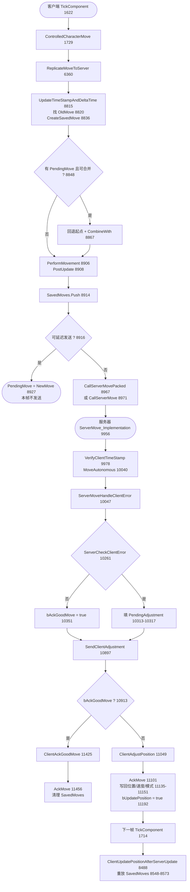

UE 的做法是把移动的关键信息全部数据化，这样移动就能自由存储和回放；为了节省带宽、提高效率，再通过合并、延迟发送、双移动等手段减少不必要的消息。理论上看，一个完全没有移动的玩家，其移动信息可以不发送。

## 6.3 Simulated 角色

先看官方文档对 Simulate 角色移动的描述：

> 对于那些不由人类控制的人物，其动作往往会通过正常的 `PerformMovement()` 代码在服务器（此时充当了主控者）上进行更新。Actor 的状态，如方位、旋转、速率和其他一些选定的人物特有状态（如跳跃）都会通过正常的复制机制复制到其他机器，因此，它们不必在每一帧都经由网络传送。为了在远程客户端上针对这些人物提供更流畅的视觉呈现，该客户端机器将在每一帧为模拟代理执行一次模拟更新，直到新的数据（由服务器主控）到来。

简单来说，Simulate 角色在服务器上的移动就是正常的 `PerformMovement` 流程；在客户端上则分成两步：收到服务器同步数据时直接设置，没有收到消息时根据上一次服务器传来的速度与旋转在本地模拟，等下一次数据到来再校正。这样做的目的是减小同步开销。

角色同步的属性集中在 `GetLifetimeReplicatedProps`：

```cpp
// Character.cpp:1716-1732
void ACharacter::GetLifetimeReplicatedProps( TArray< FLifetimeProperty > & OutLifetimeProps ) const
{
    Super::GetLifetimeReplicatedProps( OutLifetimeProps );

    DISABLE_REPLICATED_PROPERTY(ACharacter, JumpMaxHoldTime);
    DISABLE_REPLICATED_PROPERTY(ACharacter, JumpMaxCount);

    DOREPLIFETIME_CONDITION( ACharacter, RepRootMotion,						COND_SimulatedOnly );
    DOREPLIFETIME_CONDITION( ACharacter, ReplicatedBasedMovement,			COND_SimulatedOnly );
    DOREPLIFETIME_CONDITION( ACharacter, ReplicatedServerLastTransformUpdateTimeStamp, COND_SimulatedOnlyNoReplay );
    DOREPLIFETIME_CONDITION( ACharacter, ReplicatedMovementMode,			COND_SimulatedOnly );
    DOREPLIFETIME_CONDITION( ACharacter, bIsCrouched,						COND_SimulatedOnly );
    DOREPLIFETIME_CONDITION( ACharacter, bProxyIsJumpForceApplied,			COND_SimulatedOnly );
    DOREPLIFETIME_CONDITION( ACharacter, AnimRootMotionTranslationScale,	COND_SimulatedOnly );
    DOREPLIFETIME_CONDITION( ACharacter, ReplicatedGravityDirection,		COND_SimulatedOnly );
    DOREPLIFETIME_CONDITION( ACharacter, ReplayLastTransformUpdateTimeStamp, COND_ReplayOnly );
}
```

`ReplicatedMovement` 记录当前角色的位置、旋转、速度等数据，它定义在 `AActor` 上，条件是“正在复制移动”：

```cpp
// Actor.cpp:2012-2014
GatherCurrentMovement();
DOREPLIFETIME_ACTIVE_OVERRIDE_FAST(AActor, ReplicatedMovement, IsReplicatingMovement());
```

`ReplicatedServerLastTransformUpdateTimeStamp` 记录最近一次服务器移动更新的时间，但它不是每帧都写：

```cpp
// Character.cpp:1680-1688
if ((CharacterMovement->NetworkSmoothingMode == ENetworkSmoothingMode::Linear) || CharacterMovement->bNetworkAlwaysReplicateTransformUpdateTimestamp)
{
    SetReplicatedServerLastTransformUpdateTimeStamp(CharacterMovement->GetServerLastTransformUpdateTimeStamp());
}
else
{
    SetReplicatedServerLastTransformUpdateTimeStamp(0.f);
}
```

默认平滑模式是 `Exponential`，所以默认情况下这个时间戳是 0；切到线性平滑或显式打开 `bNetworkAlwaysReplicateTransformUpdateTimestamp` 才会真正同步服务器时间。

速度由 `APawn::PostNetReceiveVelocity` 写入移动组件：

```cpp
// Pawn.cpp:1190-1203
void APawn::PostNetReceiveVelocity(const FVector& NewVelocity)
{
    ...
    if (GetLocalRole() == ROLE_SimulatedProxy)
    {
        UMovementComponent* const MoveComponent = GetMovementComponent();
        if ( MoveComponent )
        {
            MoveComponent->Velocity = NewVelocity;
        }
    }
}
```

位置与旋转由 `ACharacter::PostNetReceiveLocationAndRotation` 处理：

```cpp
// Character.cpp:1589-1608
void ACharacter::PostNetReceiveLocationAndRotation()
{
    if(GetLocalRole() == ROLE_SimulatedProxy)
    {
        if (!GetReplicatedBasedMovement().HasRelativeLocation())
        {
            const FRepMovement& ConstRepMovement = GetReplicatedMovement();
            const FVector OldLocation = GetActorLocation();
            const FVector NewLocation = FRepMovement::RebaseOntoLocalOrigin(ConstRepMovement.Location, this);
            const FQuat OldRotation = GetActorQuat();

            CharacterMovement->bNetworkSmoothingComplete = false;
            CharacterMovement->bJustTeleported |= (OldLocation != NewLocation);
            CharacterMovement->SmoothCorrection(OldLocation, OldRotation, NewLocation, ConstRepMovement.Rotation.Quaternion());
            OnUpdateSimulatedPosition(OldLocation, OldRotation);
        }
        CharacterMovement->bNetworkUpdateReceived = true;
    }
}
```

这个回调做了三件事：清除“平滑已完成”标记、把胶囊体放到服务器位置（是否平滑由 `SmoothCorrection` 决定）、置位 `bNetworkUpdateReceived`，让接下来的 `SimulateMovement` 知道这一帧收到过网络数据。

下面按流程分析。Simulated 角色的胶囊体移动与 Mesh 移动是分开进行的。

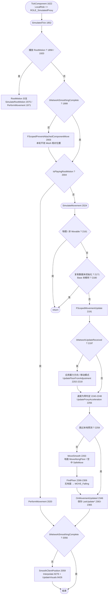

1. `TickComponent` 根据 `GetLocalRole()` 判断进入 `SimulatedTick`：

```cpp
// CharacterMovementComponent.cpp:1756-1766
else if (CharacterOwner->GetLocalRole() == ROLE_SimulatedProxy)
{
    FScopedMeshMovementUpdate ScopedMeshUpdate(CharacterOwner->GetMesh());

    if (bShrinkProxyCapsule)
    {
        AdjustProxyCapsuleSize();
    }
    SimulatedTick(DeltaSeconds);
}
```

2. `SimulatedTick` 先看是否在播放网络根运动 Montage，是的话走根运动分支：先 `TickCharacterPose`，再 `SimulateRootMotion`，必要时通过 `SimulatedRootMotionPositionFixup` 修正位置：

```cpp
// CharacterMovementComponent.cpp:1857-1862
if (CharacterOwner->IsPlayingNetworkedRootMotionMontage())
{
    bWasSimulatingRootMotion = true;
    ...
    TickCharacterPose(DeltaSeconds);
```

没有 Montage 但有根运动源时，走另一条根运动分支，用 `PerformMovement` 推进：

```cpp
// CharacterMovementComponent.cpp:1970-1977
// Perform movement
PerformMovement(DeltaSeconds);

// After movement correction, smooth out error in position if any.
if( bCorrectedToServer || CurrentRootMotion.NeedsSimulatedSmoothing() )
{
    SmoothCorrection(OldLocation, OldRotation, UpdatedComponent->GetComponentLocation(), UpdatedComponent->GetComponentQuat());
}
```

3. 两个根运动分支都不成立时进入普通模拟分支，先处理“上一帧还在模拟根运动、这一帧结束”的情况，强制同步一次移动属性：

```cpp
// CharacterMovementComponent.cpp:1985-1992
if( bWasSimulatingRootMotion )
{
    CharacterOwner->RootMotionRepMoves.Empty();
    CharacterOwner->OnRep_ReplicatedMovement();
    CharacterOwner->OnRep_ReplicatedBasedMovement();
    SetGravityDirection(CharacterOwner->GetReplicatedGravityDirection());
    ApplyNetworkMovementMode(GetCharacterOwner()->GetReplicatedMovementMode());
}
```

4. 如果平滑还没完成，本次模拟期间不要移动 Mesh，用 `FScopedPreventAttachedComponentMove` 把它临时改成绝对变换：

```cpp
// CharacterMovementComponent.cpp:1999-2003
const bool bPreventMeshMovement = !bNetworkSmoothingComplete;

// Avoid moving the mesh during movement if SmoothClientPosition will take care of it.
{
    const FScopedPreventAttachedComponentMove PreventMeshMovement(bPreventMeshMovement ? Mesh : nullptr);
```

```cpp
// SceneComponent.cpp:4100-4113
Owner->bAbsoluteLocation = true;
Owner->bAbsoluteRotation = true;
Owner->bAbsoluteScale = true;

if (bSavedNonAbsoluteComponent && Owner->GetAttachParent())
{
    Component->ConditionalUpdateComponentToWorld();
    Owner->RelativeLocation = Owner->GetComponentLocation();
    Owner->RelativeRotation = Owner->GetComponentRotation();
    Owner->RelativeScale3D = Owner->GetComponentScale();
}
```

析构时恢复原来的绝对/相对标记（`SceneComponent.cpp:4123–4130`），Mesh 的 World 位置在这一段里保持不变。

5. 没有根运动时进入 `SimulateMovement`。它先做三类早退：物理模拟或不可移动、复制数据还没初始化、服务器记录的 Base 在客户端找不到：

```cpp
// CharacterMovementComponent.cpp:2159-2184
void UCharacterMovementComponent::SimulateMovement(float DeltaSeconds)
{
    if (!HasValidData() || UpdatedComponent->Mobility != EComponentMobility::Movable || UpdatedComponent->IsSimulatingPhysics())
    {
        return;
    }
    ...
    if (CharacterOwner->GetReplicatedBasedMovement().IsBaseUnresolved())
    {
        return;
    }
```

6. 模拟前声明一个作用域，把这一轮移动里的多次 `MoveComponent` 的副作用合并到结束再提交：

```cpp
// CharacterMovementComponent.cpp:2189-2191
// Scoped updates can improve performance of multiple MoveComponent calls.
{
    FScopedCapsuleMovementUpdate ScopedMovementUpdate(UpdatedComponent, bEnableScopedMovementUpdates);
```

7. 如果这一帧收到过网络更新，先应用重力方向与移动模式，必要时重算地面：

```cpp
// CharacterMovementComponent.cpp:2197-2218（节选）
if (bNetworkUpdateReceived)
{
    bNetworkUpdateReceived = false;
    bHandledNetUpdate = true;
    if (bNetworkGravityDirectionChanged)
    {
        SetGravityDirection(CharacterOwner->GetReplicatedGravityDirection());
        bNetworkGravityDirectionChanged = false;
    }

    if (bNetworkMovementModeChanged)
    {
        ApplyNetworkMovementMode(CharacterOwner->GetReplicatedMovementMode());
        bNetworkMovementModeChanged = false;
    }
    else if (bJustTeleported || bForceNextFloorCheck)
    {
        bJustTeleported = false;
        UpdateFloorFromAdjustment();
    }
}
```

8. 判断这一帧要不要把速度清零：

```cpp
// CharacterMovementComponent.cpp:2240-2248
const bool bSimGravityDisabled = (bIsSimulatedProxy && CharacterOwner->bSimGravityDisabled);
const bool bZeroReplicatedGroundVelocity = (bIsSimulatedProxy && IsMovingOnGround() && ConstRepMovement.LinearVelocity.IsZero());

if (bSimGravityDisabled || bZeroReplicatedGroundVelocity)
{
    Velocity = FVector::ZeroVector;
}
```

`bSimGravityDisabled` 表示服务器复制时角色卡在几何体里，速度不可信；`bZeroReplicatedGroundVelocity` 表示角色在地面且服务器给的水平速度为零，继续模拟会自己漂出去。

9. 更新脚下 Base：

```cpp
// CharacterMovementComponent.cpp:2250
MaybeUpdateBasedMovement(DeltaSeconds);
```

10. 加速度来自复制数据，没有复制加速度时用速度方向代替：

```cpp
// CharacterMovementComponent.cpp:6866-6881（节选）
if (ReplicatedMovement.bRepAcceleration)
{
    Acceleration = ReplicatedMovement.Acceleration;
    AnalogInputModifier = ComputeAnalogInputModifier();
}
else
{
    Acceleration = Velocity.GetSafeNormal();
    AnalogInputModifier = 1.0f;
}
```

11. 真正模拟前看三个开关：这一帧是否刚处理过网络更新、组件上的 `bNetworkSkipProxyPredictionOnNetUpdate`、控制台变量 `NetEnableSkipProxyPredictionOnNetUpdate`，三者同时满足才跳过：

```cpp
// CharacterMovementComponent.cpp:2258-2263
if (!bHandledNetUpdate || !bNetworkSkipProxyPredictionOnNetUpdate || !CharacterMovementCVars::NetEnableSkipProxyPredictionOnNetUpdate)
{
    FStepDownResult StepDownResult;
    MoveSmooth(Velocity, DeltaSeconds, &StepDownResult);
```

12. `MoveSmooth` 按是否在地面分派：地面走 `MoveAlongFloor`，空中走 `SafeMoveUpdatedComponent`，撞到东西后飞行会尝试 `StepUp`，失败再沿表面滑动：

```cpp
// CharacterMovementComponent.cpp:6815-6860（节选）
FVector Delta = InVelocity * DeltaSeconds;
...
FScopedCapsuleMovementUpdate ScopedMovementUpdate(UpdatedComponent, bEnableScopedMovementUpdates);

if (IsMovingOnGround())
{
    MoveAlongFloor(InVelocity, DeltaSeconds, OutStepDownResult);
}
else
{
    FHitResult Hit(1.f);
    SafeMoveUpdatedComponent(Delta, UpdatedComponent->GetComponentQuat(), true, Hit);

    if (Hit.IsValidBlockingHit())
    {
        ...
        if (!bSteppedUp)
        {
            SlideAlongSurface(Delta, 1.f - Hit.Time, Hit.Normal, Hit, false);
        }
    }
}
```

13. 移动后在地面或下落状态时重新找地面，找不到可走地面就叠加重力并切到 `MOVE_Falling`：

```cpp
// CharacterMovementComponent.cpp:2266-2306（节选）
if (IsMovingOnGround() || MovementMode == MOVE_Falling)
{
    ...
    if (!CurrentFloor.IsWalkableFloor())
    {
        if (!bSimGravityDisabled)
        {
            if (GetGravitySpaceZ(Velocity) <= UE_KINDA_SMALL_NUMBER || bApplyGravityWhileJumping || !CharacterOwner->IsJumpProvidingForce())
            {
                Velocity = NewFallVelocity(Velocity, -GetGravityDirection() * GetGravityZ(), DeltaSeconds);
            }
        }
        SetMovementMode(MOVE_Falling);
    }
```

14. 模拟结束，广播回调并记录本帧状态：

```cpp
// CharacterMovementComponent.cpp:2340-2365（节选）
UpdateCharacterStateAfterMovement(DeltaSeconds);
...
OnMovementUpdated(DeltaSeconds, OldLocation, OldVelocity);

CallMovementUpdateDelegate(DeltaSeconds, OldLocation, OldVelocity);

SaveBaseLocation();
UpdateComponentVelocity();
bJustTeleported = false;

LastUpdateLocation = UpdatedComponent ? UpdatedComponent->GetComponentLocation() : FVector::ZeroVector;
LastUpdateRotation = UpdatedComponent ? UpdatedComponent->GetComponentQuat() : FQuat::Identity;
LastUpdateVelocity = Velocity;
```

15. 作用域结束后回到 `SimulatedTick`，如果平滑未完成就调用 `SmoothClientPosition` 处理 Mesh：

```cpp
// CharacterMovementComponent.cpp:2055-2060
// Smooth mesh location after moving the capsule above.
if (!bNetworkSmoothingComplete)
{
    SCOPE_CYCLE_COUNTER(STAT_CharacterMovementSmoothClientPosition);
    SmoothClientPosition(DeltaSeconds);
}
```

16. `SmoothClientPosition` 本身只做两件事：算偏移、把偏移应用到 Mesh：

```cpp
// CharacterMovementComponent.cpp:8252-8273
void UCharacterMovementComponent::SmoothClientPosition(float DeltaSeconds)
{
    ...
    SmoothClientPosition_Interpolate(DeltaSeconds);
    SmoothClientPosition_UpdateVisuals();
}
```

17. `SmoothClientPosition_Interpolate` 修改的是 `ClientData->MeshTranslationOffset` 与 `ClientData->MeshRotationOffset`，也就是 Mesh 相对胶囊体的偏移；`SmoothClientPosition_UpdateVisuals` 再把这两个偏移换算成 Mesh 的相对变换。

客户端的模拟流程到此为止。接收服务器数据并修正的入口是 `ACharacter::PostNetReceiveLocationAndRotation`，它调用 `SmoothCorrection` 把胶囊体直接放到服务器位置，同时把旧位置到新位置的差累加到 `MeshTranslationOffset` 上。平滑完成后，视觉上的 Mesh 才回到胶囊体原点。

### 6.3.1 SmoothCorrection

`SmoothCorrection` 做了什么?

**它不做插值本身**，只做三件事——把“旧位置到新位置”的差值记到 `MeshTranslationOffset`、把胶囊体直接放到服务器位置、更新用于插值的时间参数。真正的平滑发生在之后每一帧的 `SmoothClientPosition`。

1. 禁用平滑或单机模式时直接设置胶囊体位置，并标记平滑完成：

```cpp
// CharacterMovementComponent.cpp:8091-8095
if (NetworkSmoothingMode == ENetworkSmoothingMode::Disabled || GetNetMode() == NM_Standalone)
{
    UpdatedComponent->SetWorldLocationAndRotation(NewLocation, NewRotation, false, nullptr, ETeleportType::TeleportPhysics);
    bNetworkSmoothingComplete = true;
}
```

2. 其余情况取出预测数据，首次访问会创建：

```cpp
// CharacterMovementComponent.cpp:8096
else if (FNetworkPredictionData_Client_Character* ClientData = GetPredictionData_Client_Character())
```

3. 计算旧位置到新位置的偏移，并按三档处理：超过不平滑距离直接清零，超过最大平滑距离截断，否则累加：

```cpp
// CharacterMovementComponent.cpp:8104-8124
FVector NewToOldVector = (OldLocation - NewLocation);
...
const float DistSq = NewToOldVector.SizeSquared();
if (DistSq > FMath::Square(ClientData->MaxSmoothNetUpdateDist))
{
    ClientData->MeshTranslationOffset = (DistSq > FMath::Square(ClientData->NoSmoothNetUpdateDist)) 
        ? FVector::ZeroVector 
        : ClientData->MeshTranslationOffset + ClientData->MaxSmoothNetUpdateDist * NewToOldVector.GetSafeNormal();
}
else
{
    ClientData->MeshTranslationOffset = ClientData->MeshTranslationOffset + NewToOldVector;
}
```

4. 线性模式下记录起始偏移与旋转目标，只移动胶囊体、不改旋转：

```cpp
// CharacterMovementComponent.cpp:8127-8142
if (NetworkSmoothingMode == ENetworkSmoothingMode::Linear)
{
    ClientData->OriginalMeshTranslationOffset = ClientData->MeshTranslationOffset;

    ClientData->OriginalMeshRotationOffset = OldRotation;
    ClientData->MeshRotationOffset = OldRotation;
    ClientData->MeshRotationTarget = NewRotation;

    if (NewLocation != OldLocation)
    {
        const FScopedPreventAttachedComponentMove PreventMeshMove(CharacterOwner->GetMesh());
        UpdatedComponent->SetWorldLocation(NewLocation, false, nullptr, GetTeleportType());
    }
}
```

5. 指数模式下先把当前旋转偏移折算到新旋转的坐标系，再同时设置胶囊体的位置与旋转：

```cpp
// CharacterMovementComponent.cpp:8144-8152
else
{
    ClientData->MeshRotationOffset = (NewRotation.Inverse() * OldRotation) * ClientData->MeshRotationOffset;
    ClientData->MeshRotationTarget = FQuat::Identity;

    const FScopedPreventAttachedComponentMove PreventMeshMove(CharacterOwner->GetMesh());
    UpdatedComponent->SetWorldLocationAndRotation(NewLocation, NewRotation, false, nullptr, GetTeleportType());
}
```

6. 客户端跑得比服务器快时，把自己的时间戳往服务器方向拉回一半：

```cpp
// CharacterMovementComponent.cpp:8158-8166
if (ClientData->SmoothingClientTimeStamp > ClientData->SmoothingServerTimeStamp)
{
    const double OldClientTimeStamp = ClientData->SmoothingClientTimeStamp;
    ClientData->SmoothingClientTimeStamp = FMath::LerpStable(ClientData->SmoothingServerTimeStamp, OldClientTimeStamp, 0.5);
}
```

7. 取服务器时间戳，首次校正时把客户端时间戳直接对齐：

```cpp
// CharacterMovementComponent.cpp:8168-8182
double OldServerTimeStamp = ClientData->SmoothingServerTimeStamp;
if (bIsSimulatedProxy)
{
    ServerLastTransformUpdateTimeStamp = CharacterOwner->GetReplicatedServerLastTransformUpdateTimeStamp();
}
ClientData->SmoothingServerTimeStamp = ServerLastTransformUpdateTimeStamp;

if (ClientData->LastCorrectionTime == 0)
{
    ClientData->SmoothingClientTimeStamp = ClientData->SmoothingServerTimeStamp;
    OldServerTimeStamp = ClientData->SmoothingServerTimeStamp;
}
```

8. 用两次服务器更新的时间差算出客户端允许落后的上限，并夹住客户端时间戳：

```cpp
// CharacterMovementComponent.cpp:8184-8191
const double ServerDeltaTime = ClientData->SmoothingServerTimeStamp - OldServerTimeStamp;
const double MaxOffset = ClientData->MaxClientSmoothingDeltaTime;
const double MinOffset = FMath::Min(double(ClientData->SmoothNetUpdateTime), MaxOffset);
const double MaxDelta = FMath::Clamp(ServerDeltaTime * 1.25, MinOffset, MaxOffset);
ClientData->SmoothingClientTimeStamp = FMath::Clamp(ClientData->SmoothingClientTimeStamp, ClientData->SmoothingServerTimeStamp - MaxDelta, ClientData->SmoothingServerTimeStamp);
```

9. 记录本轮插值总时长与校正发生的时间：

```cpp
// CharacterMovementComponent.cpp:8193-8195
ClientData->LastCorrectionDelta = ClientData->SmoothingServerTimeStamp - ClientData->SmoothingClientTimeStamp;
ClientData->LastCorrectionTime = MyWorld->GetTimeSeconds();
```

`LastCorrectionDelta` 可以理解为服务器领先客户端的时间，`LastCorrectionTime` 是客户端处理这次校正时的世界时间，两者一起决定了后续插值的速度。

胶囊体与 Mesh 分开处理的目的就是提高代理模拟的流畅度。官方文档里的例子是：一个复制的状态显示角色在 t=0 以速度 (100, 0, 0) 移动，客户端模拟到 t=1 时会在 X 方向前进 100 单位；如果服务器发完这条数据后立刻停下，客户端的模拟位置就会和服务器位置不同。为了不出现这种突变，胶囊体照常模拟，Mesh 则通过 `MeshTranslationOffset` 慢慢回到胶囊体原点，视觉上看不出跳变。真正让 Mesh 停住的是 `FScopedPreventAttachedComponentMove`，它把 Mesh 临时设为绝对变换，不跟随父组件移动。

模拟客户端的平滑有三种可用模式，默认是 `Exponential`：

```cpp
// EngineTypes.h:1038
enum class ENetworkSmoothingMode : uint8
{
    /** No smoothing, only change position as network position updates are received. */
    Disabled     UMETA(DisplayName="Disabled"),

    /** Linear interpolation from source to target. */
    Linear       UMETA(DisplayName="Linear"),

    /** Exponential. Faster as you are further from target. */
    Exponential  UMETA(DisplayName="Exponential"),

    /** Special linear interpolation designed specifically for replays. Not intended as a selectable mode in-editor. */
    Replay       UMETA(Hidden, DisplayName="Replay"),
};
```

```cpp
// CharacterMovementComponent.cpp:708
NetworkSmoothingMode = ENetworkSmoothingMode::Exponential;
```

线性模式有外插值，指数模式没有；回放模式属于回放系统，会读取回放数据做线性插值，也不做外插。

以线性插值分析：

1. `SmoothClientPosition` 在 Simulated 客户端的 Tick 里执行，内部依次调用 `SmoothClientPosition_Interpolate` 与 `SmoothClientPosition_UpdateVisuals`。

2. 插值用到 `ClientData` 里的三个时间：`LastCorrectionDelta`（服务器领先多少）、`SmoothingClientTimeStamp`（客户端当前时间戳）、`SmoothingServerTimeStamp`（最近一次服务器时间戳）。

3. 每帧推进客户端时间戳，并限制最多领先服务器 15%：

```cpp
// CharacterMovementComponent.cpp:8287-8297
ClientData->SmoothingClientTimeStamp += DeltaSeconds;

const float MaxClientTimeAheadPercent = 0.15f;
const float MaxTimeAhead = TargetDelta * MaxClientTimeAheadPercent;
ClientData->SmoothingClientTimeStamp = FMath::Min<float>(ClientData->SmoothingClientTimeStamp, ClientData->SmoothingServerTimeStamp + MaxTimeAhead);
```

4. 计算插值比例：

```cpp
// CharacterMovementComponent.cpp:8299-8302
const float RemainingTime = ClientData->SmoothingServerTimeStamp - ClientData->SmoothingClientTimeStamp;
const float CurrentSmoothTime = TargetDelta - RemainingTime;
LerpPercent = FMath::Clamp(CurrentSmoothTime / TargetDelta, 0.0f, LerpLimit);
```

5. 比例接近 1 时判断速度：速度为零就直接收尾，否则继续按比例插值，允许 `LerpLimit = 1.15` 的轻微超前：

```cpp
// CharacterMovementComponent.cpp:8312-8332（节选）
if (LerpPercent >= 1.0f - UE_KINDA_SMALL_NUMBER)
{
    if (Velocity.IsNearlyZero())
    {
        ClientData->MeshTranslationOffset = FVector::ZeroVector;
        ClientData->SmoothingClientTimeStamp = ClientData->SmoothingServerTimeStamp;
        bNetworkSmoothingComplete = true;
    }
    else
    {
        ClientData->MeshTranslationOffset = FMath::LerpStable(ClientData->OriginalMeshTranslationOffset, FVector::ZeroVector, LerpPercent);
        bNetworkSmoothingComplete = (LerpPercent >= LerpLimit);
    }

    ClientData->MeshRotationOffset = ClientData->MeshRotationTarget;
}
```

6. 插值只改 `ClientData` 里的偏移，真正应用在 `SmoothClientPosition_UpdateVisuals` 里。

7. 线性模式把偏移按 `MeshRotationOffset` 反旋转后换算成相对位置：

```cpp
// CharacterMovementComponent.cpp:8445
const FVector NewRelLocation = (ClientData->MeshRotationOffset.UnrotateVector(ClientData->MeshTranslationOffset) / MeshParentScale) + CharacterOwner->GetBaseTranslationOffset();
```

8. 旋转几乎没变时只设置相对位置；旋转变化较大时先设位置，再转动胶囊体，让 Mesh 跟着一起转：

```cpp
// CharacterMovementComponent.cpp:8446-8458（节选）
if (!UpdatedComponent->GetComponentQuat().Equals(ClientData->MeshRotationOffset, 1e-6f))
{
    const FVector OldLocation = Mesh->GetRelativeLocation();
    const FRotator OldRotation = UpdatedComponent->GetRelativeRotation();
    Mesh->SetRelativeLocation_Direct(NewRelLocation);
    UpdatedComponent->SetWorldRotation(ClientData->MeshRotationOffset);
    ...
}
else
{
    Mesh->SetRelativeLocation(NewRelLocation, false, nullptr, GetTeleportType());
}
```

指数模式则不做时间比例插值，而是按时间常数衰减偏移，并在旋转差值足够小时直接收尾：

```cpp
// CharacterMovementComponent.cpp:8348-8382（节选）
const float SmoothLocationTime = Velocity.IsZero() ? 0.5f*ClientData->SmoothNetUpdateTime : ClientData->SmoothNetUpdateTime;
if (DeltaSeconds < SmoothLocationTime)
{
    ClientData->MeshTranslationOffset = (ClientData->MeshTranslationOffset * (1.f - DeltaSeconds / SmoothLocationTime));
}
else
{
    ClientData->MeshTranslationOffset = FVector::ZeroVector;
}
```

```cpp
// CharacterMovementComponent.cpp:8475-8478
const FVector NewRelTranslation = (UpdatedComponent->GetComponentToWorld().InverseTransformVectorNoScale(ClientData->MeshTranslationOffset) / MeshParentScale) + CharacterOwner->GetBaseTranslationOffset();
const FQuat NewRelRotation = ClientData->MeshRotationOffset * CharacterOwner->GetBaseRotationOffset();
Mesh->SetRelativeLocationAndRotation(NewRelTranslation, NewRelRotation, false, nullptr, GetTeleportType());
```

这两种模式的区别在于：线性模式按“服务器领先的时间”分摊偏移，并且允许最多 15% 的外插；指数模式只按每帧时间常数衰减，速度为零时衰减速度加倍，没有外插。默认配置下走的是指数模式，所以如果没有专门切换，`ReplicatedServerLastTransformUpdateTimeStamp` 不会被同步。

| Linear   | Exponential                                             |                                                          |
| -------- | ------------------------------------------------------- | -------------------------------------------------------- |
| 偏移来源     | `OriginalMeshTranslationOffset` 固定起点                    | 每帧按时间常数衰减当前值                                             |
| rotation | 从 `OriginalMeshRotationOffset` 插值到 `MeshRotationTarget` | 从 `MeshRotationOffset` 逼近 `MeshRotationTarget`           |
| 时间参数     | 依赖 `LastCorrectionDelta` 与服务器时间戳                        | 只用 `SmoothNetUpdateTime` / `SmoothNetUpdateRotationTime` |
| 外插       | 允许 0.15（`LerpLimit = 1.15`）                             | 无                                                        |
| 服务器时间戳复制 | 会同步 `ReplicatedServerLastTransformUpdateTimeStamp`      | 默认不同步，值为 0                                               |
| 默认       | 否                                                       | 是（`CharacterMovementComponent.cpp:708`）                    |

# 7 参考资料

- [《Exploring in UE4》移动组件详解[原理分析]（2019.7.14更新） - 知乎](https://zhuanlan.zhihu.com/p/34257208)
- [【UE角色移动相关】 窥见一隅，UE移动组件上的网络同步 - 知乎](https://zhuanlan.zhihu.com/p/694601656)
- [【UE】移动组件模拟移动详解 - 知乎](https://zhuanlan.zhihu.com/p/632479097)
- [AI也想学UE｜Character Movement 01：CharacterMovement 一帧到底做了什么？ - 知乎](https://zhuanlan.zhihu.com/p/2061560445878776992)
